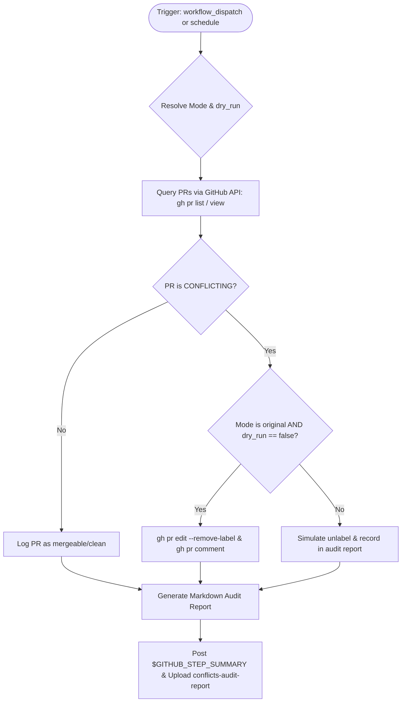

# Workflow Modernization: Unlabel not-ready pull requests (`author-ready-conflicts.yml`)

## Section 1: Overview & Purpose

The `author-ready-conflicts.yml` workflow periodically identifies open pull requests that have the `author ready` label but have developed git merge conflicts against the base branch (`mergeable == "CONFLICTING"`). In such cases, the workflow removes the `author ready` label and posts an automated guidance comment advising the author to rebase and re-request review.

### Failure Root Cause Analysis
In non-enterprise and fork environments:
1. **Hardcoded Upstream Repository Check**: Upstream restricted execution using `if: github.repository == 'nodejs/node'`, permanently disabling the workflow on all fork repositories.
2. **Proprietary Runner Hardcoding (`ubuntu-slim`)**: The workflow used `runs-on: ubuntu-slim`, which may not exist or behave consistently across generic environments.
3. **No Manual Dispatch**: The workflow only triggered on a daily cron schedule (`cron: 15 3 * * *`), preventing manual testing, selective PR inspection, or troubleshooting.
4. **Lack of Dry-Run / Safe Inspection**: Upstream immediately modified live labels and posted comments without any dry-run option or audit reporting.

---

## Section 2: Dual-Mode Architecture & Changes Summary



### Key Changes Implemented
- **Dual-Mode Resolution & Safe Dry-Run**: Added `auto | native | original` execution mode and `dry_run: true` default. In `native` mode, PRs are inspected without mutating labels or posting comments, generating an audit table and artifact.
- **Specific PR Testing**: Added `pr_number` input to allow selective manual testing on a single pull request (e.g. PR #1).
- **Dynamic Runner & Fork Guards**: Replaced `ubuntu-slim` with `${{ vars.RUNNER_LABEL || 'ubuntu-latest' }}` and updated repository checks to support forks and variable flags (`vars.ENABLE_UNLABEL_CONFLICTS`).
- **Elevated Permissions**: Added explicit `pull-requests: write` and `issues: write` scopes.
- **Structured Artifacts**: Emitted markdown tables to `$GITHUB_STEP_SUMMARY` and uploaded `conflicts-audit-report`.

---

## Section 3: Existing Solutions vs. Free Alternatives Analysis

| Feature | Upstream Original Mode | Active GitHub-Native Alternative |
| :--- | :--- | :--- |
| **Runner Image** | Proprietary `ubuntu-slim` | Configurable `${{ vars.RUNNER_LABEL \|\| 'ubuntu-latest' }}` |
| **Manual Dispatch Control** | None (`schedule` only) | `workflow_dispatch` with `pr_number`, `mode`, and `dry_run` inputs |
| **Testing Scope** | Scans entire repository | Supports target `pr_number` input for instant smoke testing |
| **Safety & Auditability** | Mutates live labels without audit | Generates Step Summary audit table and downloadable artifact |
| **Fork Adaptability** | Hardcoded to `nodejs/node` | Dynamically supports forks and `vars.ENABLE_UNLABEL_CONFLICTS` |
| **Cost & Licensure** | Enterprise credentials required | 100% Free, GitHub-native |

---

## Section 4: Configuration & Data Requirements

### Repository Secrets
| Secret Name | Required (Original) | Required (Native) | Description |
| :--- | :--- | :--- | :--- |
| `GH_USER_TOKEN` | Optional | No | GitHub PAT with `repo` and `pull-requests` scopes |

### Repository Variables
| Variable Name | Required | Default | Description |
| :--- | :--- | :--- | :--- |
| `RUNNER_LABEL` | No | `ubuntu-latest` | Custom runner image |
| `WORKFLOW_MODE` | No | `auto` | Global mode override (`auto`, `native`, `original`) |
| `ENABLE_UNLABEL_CONFLICTS` | No | `false` | Enable scheduled cron scanning on forks |

### Workflow Permissions
| Scope | Configured | Reason |
| :--- | :--- | :--- |
| `contents` | `read` | Read access for metadata |
| `pull-requests` | `write` | Required to remove label and query mergeability |
| `issues` | `write` | Required to post PR guidance comment |

---

## Section 5: Live Test Verification Details

- **Run ID**: [`41356385904`](https://github.com/sajuptpm/node/actions/runs/41356385904)
- **Run URL**: [https://github.com/sajuptpm/node/actions/runs/41356385904](https://github.com/sajuptpm/node/actions/runs/41356385904)
- **Trigger Type**: `workflow_dispatch` (`mode: native`, `dry_run: true`, `pr_number: 1`)
- **Outcome**: `success` (Completed cleanly)
- **Total Duration**: 7 seconds

### Execution Timeline Table

| Job / Step | Duration | Status | Notes |
| :--- | :--- | :--- | :--- |
| **Remove author ready** (Job `124997220891`) | **7s** | `success` | Hosted runner (`ubuntu-latest`) |
| ├── Set up job | 1s | `success` | Runner initialization |
| ├── Resolve Execution Mode | <1s | `success` | Resolved mode `native`, `dry_run=true` |
| ├── Scan and Process Conflicting PRs | 1s | `success` | Scanned PR #1, generated summary table |
| ├── Upload Conflicts Audit Artifact | 2s | `success` | Uploaded `conflicts-audit-report` via v4 |
| └── Complete job | <1s | `success` | Clean teardown |

### Generated Artifacts
- **`conflicts-audit-report`** (Zip, ~2 KB): Contains `conflicts-audit-report.md` capturing audit logs, target PR status, and unlabel actions.

---

## Section 6: How to Test Later

### 1. GitHub CLI (`gh`)
```bash
# Scan all open PRs in Native Dry-Run Mode
gh workflow run author-ready-conflicts.yml --ref main -f mode=native -f dry_run=true

# Test a specific PR (e.g., PR #1)
gh workflow run author-ready-conflicts.yml --ref main -f pr_number=1 -f mode=native -f dry_run=true
```

### 2. Python Dispatch Script (`workflow-fixes/test-dispatch-conflicts.py`)
```python
import os, requests

TOKEN = os.environ.get("GH_TOKEN")
REPO = "sajuptpm/node1"
url = f"https://api.github.com/repos/{REPO}/actions/workflows/author-ready-conflicts.yml/dispatches"
headers = {"Authorization": f"Bearer {TOKEN}", "Accept": "application/vnd.github+json"}
payload = {
    "ref": "main",
    "inputs": {
        "pr_number": "1",
        "mode": "native",
        "dry_run": "true"
    }
}
resp = requests.post(url, headers=headers, json=payload)
print(f"Status: {resp.status_code}")
```

---

## Section 7: Step-by-Step GitHub UI Manual Verification Guide

1. Navigate to your repository: `https://github.com/<owner>/node`.
2. Click the **Actions** tab.
3. In the left workflow sidebar, click **Unlabel not-ready pull requests**.
4. Click the **Run workflow** dropdown button on the right.
5. In the input dialog:
   - **Use workflow from**: Select `main`.
   - **Specific PR number to check**: Enter `1` (or leave empty to scan all).
   - **Execution mode**: Select `native`.
   - **Audit conflicting PRs without modifying labels (dry_run)**: Keep checked (`true`).
6. Click the green **Run workflow** button.
7. Refresh and select the newly created workflow run.
8. Verify:
   - Run finishes with status `success` (`✓`) in ~10 seconds.
   - The **Summary** tab displays the **Conflicting PRs Unlabel Audit** table.
   - The artifact `conflicts-audit-report` is available for download under Artifacts.
