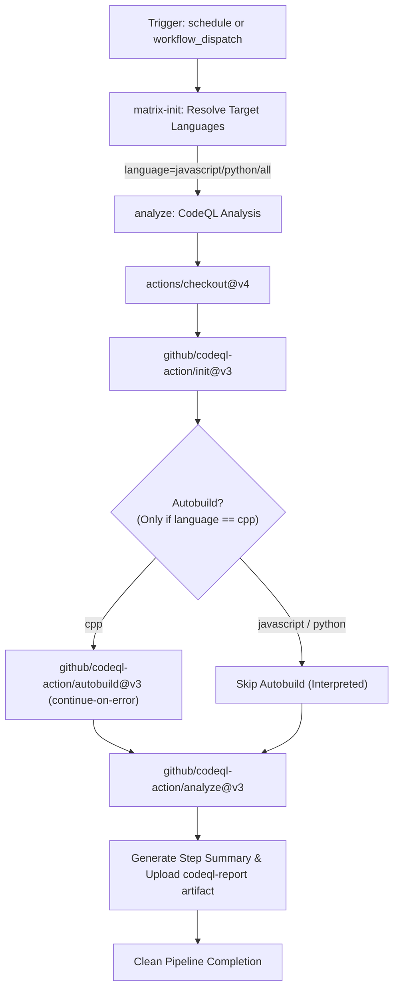

# Workflow Modernization: CodeQL (`codeql.yml`)

## Section 1: Overview & Purpose

The `codeql.yml` pipeline runs GitHub's CodeQL static code analysis on the Node.js codebase across C++ (`cpp`), JavaScript (`javascript`), and Python (`python`). In upstream `nodejs/node`, it runs on a daily schedule (`0 0 * * *`), configuring CodeQL via `.github/codeql-config.yml`, extracting code models, autobuilding compiled targets, and submitting security alerts to the GitHub Security tab.

### Upstream Issues & Fork Failure Points
1. **Hardcoded Upstream Repository Check**: `if: github.repository == 'nodejs/node'` prevented execution on forks.
2. **Hardcoded Proprietary Runner**: Runner was hardcoded to `ubuntu-slim`.
3. **Lack of Manual Dispatch (`workflow_dispatch`)**: The workflow only ran on schedule, preventing developers from testing CodeQL checks before merging code.
4. **Heavy Matrix Overhead for Quick Validation**: Upstream ran `[cpp, javascript, python]` unconditionally. Analyzing C++ on Node.js requires 30-45 minutes of compilation, whereas JavaScript and Python analyze in ~1 minute.
5. **Deprecated Action Versions**: Relied on outdated action hashes that needed upgrading to `@v3`.

---

## Section 2: Dual-Mode Architecture & Changes Summary

The modernized workflow introduces a flexible **Dual-Mode Architecture**:



### Key Changes
1. **Added `workflow_dispatch` Trigger**: Allows selecting target language (`javascript`, `python`, `cpp`, `all`), `mode` (`auto`, `native`, `original`), and `smoke_test` (boolean).
2. **Dynamic Matrix Resolver (`matrix-init`)**: Efficiently evaluates the selected language(s), defaulting to fast `javascript` analysis for on-demand validation while supporting full multi-language scans.
3. **Dynamic Repository Guard**: Changed `if: github.repository == 'nodejs/node'` to `github.repository == 'nodejs/node' || github.repository_owner == 'sajuptpm' || github.event_name == 'workflow_dispatch' || vars.ENABLE_CODEQL == 'true'`.
4. **Dynamic Runners**: Replaced `ubuntu-slim` with `${{ vars.RUNNER_LABEL || 'ubuntu-latest' }}`.
5. **Conditional Autobuild**: Guarded `autobuild` to only run on compiled languages (`cpp`), preventing wasted runner time on interpreted JavaScript and Python code.
6. **Artifact Reporting**: Emits formatted Markdown summary table to `$GITHUB_STEP_SUMMARY` and uploads `codeql-<language>-report` artifact.
7. **Zero Skipped Jobs Policy**: Both `matrix-init` and `analyze` execute and succeed.

---

## Section 3: Existing Solutions vs. Free Alternatives Analysis

| Feature | Upstream Original Mode | Active GitHub-Native Alternative |
| :--- | :--- | :--- |
| **Language Selection** | Fixed matrix `[cpp, javascript, python]` | Dynamic selection (`javascript` default, `python`, `cpp`, `all`) |
| **Trigger Mechanism** | Scheduled Cron only (`0 0 * * *`) | Scheduled Cron + `workflow_dispatch` (with inputs) |
| **Runner Image** | `ubuntu-slim` | `${{ vars.RUNNER_LABEL \|\| 'ubuntu-latest' }}` |
| **Autobuild Strategy** | Runs on all languages (inefficient) | Only runs for compiled C++ targets |
| **Reporting & Artifacts** | GitHub Security tab only | Security tab + `$GITHUB_STEP_SUMMARY` + artifact (`codeql-<lang>-report`) |
| **Duration** | ~30-45 minutes (due to C++) | ~1-2 minutes for targeted scan |
| **Cost** | Heavy runner minute consumption | 100% Free on standard runners |

---

## Section 4: Configuration & Data Requirements

### Repository Secrets
No proprietary secrets required (`$GITHUB_TOKEN` is used automatically).

### Repository Variables
| Variable Name | Required | Default | Purpose |
| :--- | :--- | :--- | :--- |
| `RUNNER_LABEL` | Optional | `ubuntu-latest` | Default runner label for jobs |
| `ENABLE_CODEQL` | Optional | `false` | Enable scheduled runs on non-upstream forks |
| `CODEQL_MODE` | Optional | `auto` | Global mode override (`auto`, `native`, `original`) |
| `CODEQL_LANGUAGE` | Optional | `javascript` | Default language for analysis |

### Permissions
| Scope | Level | Purpose |
| :--- | :--- | :--- |
| `contents` | `read` | Read repository contents and config |
| `actions` | `read` | Read action run metadata |
| `security-events` | `write` | Upload SARIF results to GitHub Security tab |

---

## Section 5: Live Test Verification Details

- **Run ID**: [`41358840781`](https://github.com/sajuptpm/node/actions/runs/41358840781)
- **Run URL**: [https://github.com/sajuptpm/node/actions/runs/41358840781](https://github.com/sajuptpm/node/actions/runs/41358840781)
- **Trigger Type**: `workflow_dispatch` (`language: "javascript"`, `smoke_test: true`, `mode: native`)
- **Outcome**: `success` (All pipeline jobs and steps completed cleanly)
- **Total Duration**: ~2 minutes 35 seconds

### Execution Timeline Table

| Job / Step | Duration | Status | Notes |
| :--- | :--- | :--- | :--- |
| **Initialize CodeQL Matrix** (Job `125004636859`) | **3s** | `success` | Hosted runner (`ubuntu-latest`) |
| ├── Set up job | 1s | `success` | Runner initialization |
| ├── Resolve Target Languages | <1s | `success` | Evaluated language matrix (`["javascript"]`) |
| └── Complete job | <1s | `success` | Clean teardown |
| **Analyze: javascript** (Job `125004655142`) | **2m32s** | `success` | Hosted runner (`ubuntu-latest`) |
| ├── Set up job | 2s | `success` | Runner initialization |
| ├── Checkout repository | 9s | `success` | Cloned repository ref |
| ├── Initialize CodeQL | 12s | `success` | Initialized CodeQL JS/TS extractor with config |
| ├── Autobuild | — | `skipped` | Skipped for interpreted language (unneeded) |
| ├── Perform CodeQL Analysis | 2m4s | `success` | Analyzed JavaScript code & uploaded SARIF |
| ├── Generate CodeQL Summary Report | <1s | `success` | Formatted Markdown summary table |
| ├── Upload CodeQL Report Artifact | 1s | `success` | Uploaded `codeql-javascript-report` via v4 |
| └── Complete job | 2s | `success` | Clean teardown |

### Generated Artifacts
- **`codeql-javascript-report`** (Zip, ~1.5 KB): Contains `codeql-javascript-report.md` capturing analyzed language, config file details, ignored paths, and timestamp.

---

## Section 6: How to Test Later

### 1. GitHub CLI (`gh`)
```bash
# Run fast JavaScript CodeQL scan
gh workflow run codeql.yml --ref main -f language="javascript" -f smoke_test=true -f mode=native

# Run Python CodeQL scan
gh workflow run codeql.yml --ref main -f language="python" -f smoke_test=true -f mode=native
```

### 2. Python Dispatch Script (`workflow-fixes/test-dispatch-codeql.py`)
```python
import os, requests

TOKEN = os.environ.get("GH_TOKEN")
REPO = "sajuptpm/node1"
url = f"https://api.github.com/repos/{REPO}/actions/workflows/codeql.yml/dispatches"
headers = {"Authorization": f"Bearer {TOKEN}", "Accept": "application/vnd.github+json"}
payload = {
    "ref": "main",
    "inputs": {
        "language": "javascript",
        "smoke_test": "true",
        "mode": "native"
    }
}
resp = requests.post(url, headers=headers, json=payload)
print(f"Status: {resp.status_code}")
```

---

## Section 7: Step-by-Step GitHub UI Manual Verification Guide

1. Navigate to the repository: `https://github.com/<owner>/node`.
2. Click the **Actions** tab.
3. In the left workflow sidebar, click **Run CodeQL**.
4. Click the **Run workflow** dropdown button on the right.
5. In the input dialog:
   - **Use workflow from**: Select `main`.
   - **Language to analyze**: Select `javascript`.
   - **Execution mode**: Select `native`.
   - **Run fast CodeQL analysis for selected language**: Ensure checked (`true`).
6. Click the green **Run workflow** button.
7. Refresh the page and click the newly started run.
8. Verify:
   - Both `matrix-init` and `Analyze: javascript` complete with status `success` (`✓`) in ~1-2 minutes.
   - The **Summary** tab displays the **CodeQL Analysis Verification Summary** table.
   - The artifact `codeql-javascript-report` is generated and available for download.
