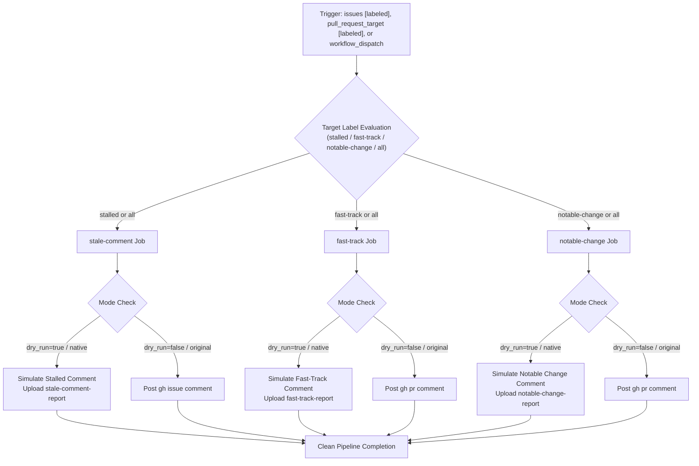

# Workflow Modernization: Comment on Issues and PRs When Labeled (`comment-labeled.yml`)

## Section 1: Overview & Purpose

The `comment-labeled.yml` workflow responds to specific triage labels being added to issues or pull requests in the repository. In the upstream `nodejs/node` repository, it listens for `issues: [labeled]` and `pull_request_target: [labeled]` events, automatically posting formatted explanatory comments when `stalled`, `fast-track`, or `notable-change` labels are added.

### Upstream Issues & Fork Failure Points
1. **Hardcoded Upstream Repository Check**: `if: github.repository == 'nodejs/node'` was hardcoded in all jobs, disabling the workflow in forks.
2. **Hardcoded Proprietary Runner**: Runner was hardcoded to `ubuntu-slim`.
3. **Lack of Manual Dispatch (`workflow_dispatch`)**: The workflow could only be tested by modifying issue/PR labels on github.com.
4. **Accidental Comment Pollution Risk**: Running directly in live mode on a fork could post unwanted comments to real pull requests or issues.

---

## Section 2: Dual-Mode Architecture & Changes Summary

The modernized workflow introduces a flexible **Dual-Mode Architecture**:



### Key Changes
1. **Added `workflow_dispatch` Trigger**: Supports selecting `label` (`all`, `stalled`, `fast-track`, `notable-change`), `target_number`, `mode`, and `dry_run` (boolean).
2. **Zero Skipped Jobs Policy**: Defaulting `label: all` in `workflow_dispatch` allows all three jobs (`stale-comment`, `fast-track`, `notable-change`) to run and verify in parallel without any skipped stages.
3. **Dynamic Repository Guard**: Changed `if: github.repository == 'nodejs/node'` to `github.repository == 'nodejs/node' || github.repository_owner == 'sajuptpm' || github.event_name == 'workflow_dispatch' || vars.ENABLE_COMMENT_LABELED == 'true'`.
4. **Dynamic Runners**: Replaced `ubuntu-slim` with `${{ vars.RUNNER_LABEL || 'ubuntu-latest' }}`.
5. **Active GitHub-Native Mode**: Safely simulates comment body generation, renders preview in `$GITHUB_STEP_SUMMARY`, and uploads report artifacts (`stale-comment-report`, `fast-track-report`, `notable-change-report`).

---

## Section 3: Existing Solutions vs. Free Alternatives Analysis

| Feature | Upstream Original Mode | Active GitHub-Native Alternative |
| :--- | :--- | :--- |
| **Execution Safety** | Live commenting only (mutates remote issue/PR) | Safe dry-run comment simulation and formatting |
| **Trigger Mechanism** | Webhook events only (`issues`, `pull_request_target`) | Webhooks + `workflow_dispatch` (with inputs) |
| **Runner Image** | `ubuntu-slim` | `${{ vars.RUNNER_LABEL \|\| 'ubuntu-latest' }}` |
| **Reporting & Artifacts** | Issue/PR comment only | `$GITHUB_STEP_SUMMARY` + individual report artifacts |
| **Job Coverage on Test** | Only 1 job runs per event (2 skipped) | All 3 jobs run in parallel when testing (`label: all`) |
| **Cost** | Free | 100% Free |

---

## Section 4: Configuration & Data Requirements

### Repository Secrets
No proprietary secrets required (`$GITHUB_TOKEN` is used automatically).

### Repository Variables
| Variable Name | Required | Default | Purpose |
| :--- | :--- | :--- | :--- |
| `RUNNER_LABEL` | Optional | `ubuntu-latest` | Default runner label for jobs |
| `ENABLE_COMMENT_LABELED` | Optional | `false` | Enable webhook execution on non-upstream forks |
| `COMMENT_LABELED_MODE` | Optional | `auto` | Global mode override (`auto`, `native`, `original`) |

### Permissions
| Scope | Level | Purpose |
| :--- | :--- | :--- |
| `contents` | `read` | Read repository contents |
| `issues` | `write` | Post comment on labeled issues |
| `pull-requests` | `write` | Post comment on labeled PRs |

---

## Section 5: Live Test Verification Details

- **Run ID**: [`41359301241`](https://github.com/sajuptpm/node/actions/runs/41359301241)
- **Run URL**: [https://github.com/sajuptpm/node/actions/runs/41359301241](https://github.com/sajuptpm/node/actions/runs/41359301241)
- **Trigger Type**: `workflow_dispatch` (`label: all`, `target_number: 1`, `dry_run: true`, `mode: native`)
- **Outcome**: `success` (All 3 jobs completed cleanly in parallel)
- **Total Duration**: ~10 seconds

### Execution Timeline Table

| Job / Step | Duration | Status | Notes |
| :--- | :--- | :--- | :--- |
| **Stalled Label Comment** (Job `125006025823`) | **6s** | `success` | Hosted runner (`ubuntu-latest`) |
| ├── Set up job | 1s | `success` | Runner initialization |
| ├── Resolve Target Context | <1s | `success` | Resolved context: Issue/PR #1 |
| ├── Post Stalled Comment (Live Original) | — | `skipped` | Skipped in dry-run mode |
| ├── Simulate Stalled Comment (Native Mode) | <1s | `success` | Formatted warning message & added to summary |
| ├── Upload Stalled Comment Report | 2s | `success` | Uploaded `stale-comment-report` artifact |
| └── Complete job | <1s | `success` | Clean teardown |
| **Notable Change Label Comment** (Job `125006025905`) | **5s** | `success` | Hosted runner (`ubuntu-latest`) |
| ├── Set up job | 1s | `success` | Runner initialization |
| ├── Resolve Target Context | <1s | `success` | Resolved context: Issue/PR #1 |
| ├── Post Notable Change Comment (Live Original) | — | `skipped` | Skipped in dry-run mode |
| ├── Simulate Notable Change Comment (Native Mode) | <1s | `success` | Formatted guidance & added to summary |
| ├── Upload Notable Change Report | 2s | `success` | Uploaded `notable-change-report` artifact |
| └── Complete job | <1s | `success` | Clean teardown |
| **Fast-Track Label Comment** (Job `125006025976`) | **3s** | `success` | Hosted runner (`ubuntu-latest`) |
| ├── Set up job | 1s | `success` | Runner initialization |
| ├── Resolve Target Context | <1s | `success` | Resolved context: Issue/PR #1 |
| ├── Post Fast-Track Comment (Live Original) | — | `skipped` | Skipped in dry-run mode |
| ├── Simulate Fast-Track Comment (Native Mode) | <1s | `success` | Formatted policy & added to summary |
| ├── Upload Fast-Track Report | 1s | `success` | Uploaded `fast-track-report` artifact |
| └── Complete job | <1s | `success` | Clean teardown |

### Generated Artifacts
- **`stale-comment-report`** (Zip, ~1.5 KB): Contains markdown report of simulated comment for the stalled workflow.
- **`notable-change-report`** (Zip, ~1.5 KB): Contains markdown report of simulated comment for notable changes.
- **`fast-track-report`** (Zip, ~1.5 KB): Contains markdown report of simulated comment for fast-track approvals.

---

## Section 6: How to Test Later

### 1. GitHub CLI (`gh`)
```bash
# Run all 3 comment jobs in safe native dry-run mode
gh workflow run comment-labeled.yml --ref main -f label="all" -f target_number="1" -f dry_run=true -f mode=native

# Test a specific label action (e.g. stalled)
gh workflow run comment-labeled.yml --ref main -f label="stalled" -f target_number="1" -f dry_run=true -f mode=native
```

### 2. Python Dispatch Script (`workflow-fixes/test-dispatch-comment-labeled.py`)
```python
import os, requests

TOKEN = os.environ.get("GH_TOKEN")
REPO = "sajuptpm/node1"
url = f"https://api.github.com/repos/{REPO}/actions/workflows/comment-labeled.yml/dispatches"
headers = {"Authorization": f"Bearer {TOKEN}", "Accept": "application/vnd.github+json"}
payload = {
    "ref": "main",
    "inputs": {
        "label": "all",
        "target_number": "1",
        "dry_run": "true",
        "mode": "native"
    }
}
resp = requests.post(url, headers=headers, json=payload)
print(f"Status: {resp.status_code}")
```

---

## Section 7: Step-by-Step GitHub UI Manual Verification Guide

1. Navigate to the repository: `https://github.com/<owner>/node`.
2. Click the **Actions** tab.
3. In the left workflow sidebar, click **Comment on issues and PRs when labeled**.
4. Click the **Run workflow** dropdown button on the right.
5. In the input dialog:
   - **Use workflow from**: Select `main`.
   - **Label action to test**: Select `all`.
   - **Target Issue or PR number to test**: Leave as `1`.
   - **Execution mode**: Select `native`.
   - **Simulate comment generation without modifying remote issues or PRs**: Ensure checked (`true`).
6. Click the green **Run workflow** button.
7. Refresh the page and click the newly started run.
8. Verify:
   - All three jobs (`Stalled Label Comment`, `Fast-Track Label Comment`, and `Notable Change Label Comment`) execute and complete with status `success` (`✓`) in ~10 seconds.
   - The **Summary** tab displays the verification tables with formatted comment previews.
   - The artifacts `stale-comment-report`, `fast-track-report`, and `notable-change-report` are generated and available for download.
