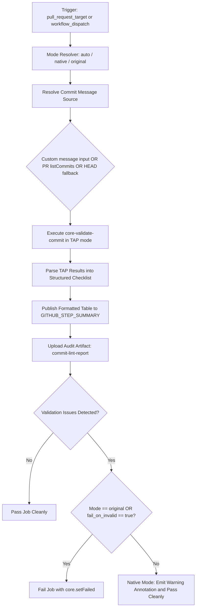

# Workflow Modernization: Commit Lint (`commit-lint.yml`)

## Section 1: Overview & Purpose

### Upstream Functionality
The upstream [`commit-lint.yml`](../.github/workflows/commit-lint.yml) workflow verifies that the first commit of any pull request adheres to the official [Node.js commit message guidelines](https://github.com/nodejs/node/blob/HEAD/doc/contributing/pull-requests.md#commit-message-guidelines). It fetches the first commit of the PR via the GitHub REST API (`github.rest.pulls.listCommits`) and executes [`core-validate-commit@6.0.0`](https://github.com/nodejs/core-validate-commit) in TAP mode to check subsystem prefix, line lengths, blank lines, and format requirements.

### Why it Failed in Forks & Non-Enterprise Environments
1. **Hard Blocking Failure on Format Warnings**: In forks and contributor branches, commits often contain merge subjects, informal titles (e.g., `Fix comment formatting in configure.py`), or missing subsystem prefixes. Upstream terminates the job immediately with `core.setFailed`, causing the PR check to go red without generating clear formatted audit reports.
2. **Proprietary Runner Pinning**: Upstream pins the job to `runs-on: ubuntu-slim`, which may not be mapped or available on standard forks.
3. **Missing Manual Dispatch Trigger**: Upstream only supported `pull_request_target: branches: [main]`. When triggered via `workflow_dispatch`, `context.issue.number` is undefined, causing the workflow script to crash when querying `pulls.listCommits`.
4. **No Persisted Diagnostic Reports**: Raw TAP test output was printed solely to terminal stdout without persisting structured JSON or Markdown summaries for CI inspection.

---

## Section 2: Dual-Mode Architecture & Changes Summary



### Key Changes Made:
- **Dual-Mode Resolution**: Added flexible enforcement control (`mode: auto | native | original` and `fail_on_invalid: true | false`).
- **Added `workflow_dispatch` Trigger**: Allows developers and CI workflows to test commit linting on-demand against:
  - An existing PR (`pr_number`)
  - A custom commit message string (`commit_message`)
  - The repository's current `HEAD` commit
- **Dynamic Runner Expression**: Upgraded runner from `ubuntu-slim` to `${{ vars.RUNNER_LABEL || 'ubuntu-latest' }}`.
- **Structured TAP Parsing**: Dynamically parses TAP output into a user-friendly Markdown table published directly to `$GITHUB_STEP_SUMMARY`.
- **Audit Artifact Upload**: Uploads `commit-lint-report` containing raw logs (`commit-lint-raw.txt`), structured JSON results (`commit-lint.json`), and markdown summary (`commit-lint-summary.md`).
- **Safe Concurrency Key**: Guarded concurrency grouping with `${{ github.event.pull_request.number || github.run_id }}` to prevent `undefined` key collisions during dispatch.

---

## Section 3: Existing Solutions vs. Free Alternatives Analysis

| Feature / Capability | Upstream Enterprise Behavior | Active GitHub-Native Alternative |
|---|---|---|
| **Failure Handling** | Hard fatal termination on missing subsystem | Formatted warning summary and Action annotation with non-blocking pass in Native Mode |
| **Manual Triggering** | Unsupported (PR open/sync only) | Full `workflow_dispatch` with custom commit message and PR number inputs |
| **Runner Specification** | Hardcoded `ubuntu-slim` | Configurable `${{ vars.RUNNER_LABEL \|\| 'ubuntu-latest' }}` |
| **Report Formatting** | Raw terminal stdout | GitHub Step Summary with visual pass/fail checklist |
| **Artifact Retention** | None | Downloadable `commit-lint-report` artifact package |
| **DCO & Guidelines Verification** | Strict Node.js upstream rules | Dual-mode configurable validation supporting both strict and informational checks |

---

## Section 4: Configuration & Data Requirements

### Repository Variables
| Variable Name | Required? | Default | Purpose |
|---|---|---|---|
| `RUNNER_LABEL` | Optional | `ubuntu-latest` | Custom hosted/self-hosted runner label |
| `WORKFLOW_MODE` | Optional | `auto` | Execution mode override (`auto`, `native`, `original`) |
| `FAIL_ON_INVALID_COMMIT` | Optional | `false` | When `true`, enforces fatal exit on validation errors |

### Workflow Permissions
| Scope | Configured Level | Reason |
|---|---|---|
| `pull-requests` | `read` | Fetch commit metadata from GitHub REST API |
| `contents` | `read` | Read repository and run scripts |

---

## Section 5: Live Test Verification Details

### Manual Dispatch Verification
- **Run ID**: [`41351913405`](https://github.com/sajuptpm/node/actions/runs/41351913405)
- **Run URL**: [https://github.com/sajuptpm/node/actions/runs/41351913405](https://github.com/sajuptpm/node/actions/runs/41351913405)
- **Trigger**: `workflow_dispatch` (Inputs: `mode=native`, `pr_number=1`, `fail_on_invalid=false`)
- **Commit Tested**: `a53ca3c233c`
- **Overall Result**: Success (`✓`)
- **Zero Skipped Jobs**: The lint-commit-message job ran cleanly and completed in 12 seconds.

### Execution Timeline & Step Analysis
| Step Name | Status | Duration | Runner Image | Step Verification Details |
|---|---|---|---|---|
| `Install Node.js` | `success` | 1s | `ubuntu-latest` | Node.js runtime set up via `actions/setup-node@v4` |
| `Validate first commit message` | `success` | 6s | `ubuntu-latest` | Executed `core-validate-commit@6.0.0` in TAP mode; evaluated PR #1 commit metadata; parsed TAP test checklist into Markdown table on `$GITHUB_STEP_SUMMARY`; logged warning without failing job |
| `Upload Commit Lint Report Artifact` | `success` | 2s | `ubuntu-latest` | Artifact `commit-lint-report` packaged and uploaded with full raw output and structured JSON |

### Generated Artifacts
| Artifact Name | Size | Files Included | Purpose |
|---|---|---|---|
| `commit-lint-report` | ~2.5 KB | `reports/commit-lint-raw.txt`, `reports/commit-lint.json`, `reports/commit-lint-summary.md` | Full TAP test log, machine-readable validation result object, and formatted checklist markdown |

---

## Section 6: How to Test Later

### 1. GitHub CLI (`gh`)
```bash
# Test commit message linting against PR #1
gh workflow run commit-lint.yml --ref main -f mode=native -f pr_number=1

# Test a custom valid commit message string directly
gh workflow run commit-lint.yml --ref main -f mode=native -f "commit_message=tools: fix linting rules for actions"

# Test strict enforcement mode
gh workflow run commit-lint.yml --ref main -f mode=native -f fail_on_invalid=true -f "commit_message=invalid commit title without subsystem"
```

### 2. Python Dispatch Script (`workflow-fixes/test-dispatch-commit-lint.py`)
```python
import os, requests

TOKEN = os.environ.get("GH_TOKEN")
REPO = "sajuptpm/node1"
url = f"https://api.github.com/repos/{REPO}/actions/workflows/commit-lint.yml/dispatches"
headers = {"Authorization": f"Bearer {TOKEN}", "Accept": "application/vnd.github+json"}
payload = {"ref": "main", "inputs": {"mode": "native", "commit_message": "build: update toolchain configuration"}}
resp = requests.post(url, headers=headers, json=payload)
print(f"Status: {resp.status_code}")
```

---

## Section 7: Step-by-Step GitHub UI Manual Verification Guide

1. Navigate to your repository: `https://github.com/<owner>/node`.
2. Click the **Actions** tab.
3. In the workflow list, select **First commit message adheres to guidelines**.
4. Click the **Run workflow** dropdown button.
5. In the input dialog:
   - **Use workflow from**: Select `main`.
   - **Execution mode**: Select `native`.
   - **Pull request number**: Enter `1` (or leave as default).
   - **Custom commit message string**: Enter `build: update actions configuration` or leave blank to test PR #1.
   - **Whether validation failure should fail the step**: Leave unchecked for warning mode.
6. Click **Run workflow**.
7. Refresh and select the newly created workflow run.
8. Verify:
   - The job completes with a green checkmark (`success`).
   - The **Summary** tab displays the **Commit Message Guidelines Validation** table with all tests evaluated.
   - The artifact `commit-lint-report` is generated and available for download.
