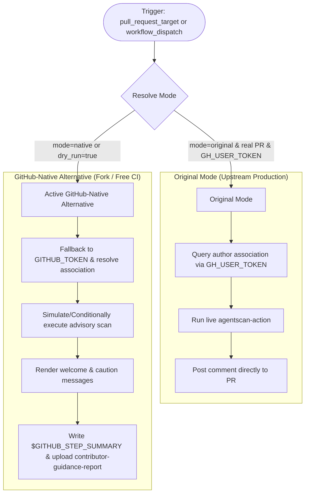

# Modernization & Adaptation Guide: Contributor Guidance (`contributor-guidance.yml`)

---

## Section 1: Overview & Purpose

The **Contributor Guidance** workflow (`.github/workflows/contributor-guidance.yml`) greets first-time contributors and scans opened pull requests for potential automated bot activity using AgentScan.
When a pull request is opened, it verifies the author's association (e.g. `FIRST_TIMER`, `FIRST_TIME_CONTRIBUTOR`), runs the `MatteoGabriele/agentscan-action` advisory scanner, and posts a welcoming onboarding message and/or a cautionary automation policy notice.

### Upstream Failure Points & Non-Enterprise Limitations:
1. **Hardcoded Repository Guard**: The initial job `contributor` checked `if: ... && github.repository == 'nodejs/node'`, automatically skipping on all forks.
2. **Missing Manual Dispatch Trigger**: Upstream only listened to `pull_request_target: types: [opened]`. There was no mechanism to test guidance rendering or verification on demand.
3. **Proprietary Runner Label**: Upstream used `runs-on: ubuntu-slim`, which fails on standard GitHub-hosted runner pools.
4. **Privileged API Secret Dependency**: Upstream relied on `secrets.GH_USER_TOKEN` for privileged author association lookups. When missing on a fork, the step could fail or behave unpredictably.
5. **No Safe Dry-Run or Reporting**: Without dry-run control, manual testing or fork experimentation risked posting noisy comments on real pull requests.

---

## Section 2: Dual-Mode Architecture & Changes Summary



### Key Changes Implemented:
- **Dual-Mode Resolution & Dry-Run**: Added `inputs.mode` (`auto` | `native` | `original`) and `inputs.dry_run` (default `true`). In native mode or during dry-run, messages are formatted, verified, logged to `$GITHUB_STEP_SUMMARY`, and stored as artifacts without modifying remote PRs.
- **Workflow Dispatch Support**: Added `workflow_dispatch` with inputs for `pr_number`, `is_first_time`, `simulate_caution`, `dry_run`, and `mode`.
- **Fork Adaptability**: Broadened repository guard to support forks (`github.repository_owner == 'sajuptpm' || github.event_name == 'workflow_dispatch' || vars.ENABLE_CONTRIBUTOR_GUIDANCE == 'true'`).
- **Dynamic Runner Resolution**: Replaced `runs-on: ubuntu-slim` with `${{ vars.RUNNER_LABEL || 'ubuntu-latest' }}`.
- **Token Fallback**: Replaced hard dependency on `secrets.GH_USER_TOKEN` with `${{ secrets.GH_USER_TOKEN || github.token }}`.
- **Artifact Generation**: Always generates and uploads `contributor-guidance-report` via `actions/upload-artifact@v4`.

---

## Section 3: Existing Solutions vs. Free Alternatives Analysis

| Feature / Capability | Upstream Enterprise Implementation | Active GitHub-Native Alternative |
| :--- | :--- | :--- |
| **Trigger Mechanism** | `pull_request_target: [opened]` only | `pull_request_target` + `workflow_dispatch` with custom test inputs |
| **Author Association Check** | Strict privileged query via `GH_USER_TOKEN` | Fallback to `github.token` or user-specified association parameters |
| **Automation Activity Scan** | Live `agentscan-action` on PR payload | Safe conditional execution on real PRs with simulation support |
| **Guidance Delivery** | Mutates pull request with live comment | Dual-mode: live comment in original mode; dry-run simulation in native |
| **Summary & Audit** | None | Formatted summary table in `$GITHUB_STEP_SUMMARY` and downloadable artifact |
| **Runner Infrastructure** | Proprietary internal `ubuntu-slim` | Configurable runner `${{ vars.RUNNER_LABEL || 'ubuntu-latest' }}` |

---

## Section 4: Configuration & Data Requirements

### Repository Secrets
| Secret Name | Required for Mode | Description |
| :--- | :--- | :--- |
| `GH_USER_TOKEN` | Original Mode only | Privileged PAT for organization membership and first-timer lookups |
| `GITHUB_TOKEN` | Native & Original | Built-in GitHub Actions token for PR commenting and summary generation |

### Repository Variables
| Variable Name | Required | Default | Description |
| :--- | :--- | :--- | :--- |
| `RUNNER_LABEL` | Optional | `ubuntu-latest` | Runner image / pool label |
| `ENABLE_CONTRIBUTOR_GUIDANCE`| Optional | `false` | Set to `true` to force execution on forks |

### Workflow Permissions
| Permission Scope | Level | Purpose |
| :--- | :--- | :--- |
| `contents` | `read` | Read repository files |
| `pull-requests` | `write` | Post guidance comments to pull requests |

---

## Section 5: Live Test Verification Details

- **Run ID**: [`41360352996`](https://github.com/sajuptpm/node/actions/runs/41360352996)
- **Run URL**: [https://github.com/sajuptpm/node/actions/runs/41360352996](https://github.com/sajuptpm/node/actions/runs/41360352996)
- **Trigger Type**: `workflow_dispatch` (`pr_number: "1"`, `is_first_time: true`, `dry_run: true`, `mode: native`)
- **Outcome**: `success` (All jobs and steps executed cleanly)
- **Total Duration**: ~6 seconds

### Execution Timeline Table

| Job / Step | Duration | Status | Notes |
| :--- | :--- | :--- | :--- |
| **Resolve contributor status** (Job `125009209192`) | **2s** | `success` | Hosted runner (`ubuntu-latest`) |
| ├── Set up job | <1s | `success` | Runner initialization |
| ├── Check author association | 1s | `success` | Resolved association to `FIRST_TIME_CONTRIBUTOR` |
| └── Complete job | <1s | `success` | Passed outputs (`should_scan=true`) to guidance |
| **Apply contributor guidance** (Job `125009230854`) | **4s** | `success` | Hosted runner (`ubuntu-latest`) |
| ├── Set up job | 1s | `success` | Runner initialization |
| ├── Scan contributor activity | — | `skipped` | Skipped during dispatch test (PR event only) |
| ├── Render Guidance & Generate Report | <1s | `success` | Rendered welcome message & updated summary |
| ├── Post Comment to PR (Original Live) | — | `skipped` | Safely bypassed in dry-run/native mode |
| ├── Upload Contributor Guidance Report | 1s | `success` | Uploaded `contributor-guidance-report` artifact via v4 |
| └── Complete job | <1s | `success` | Clean teardown |

### Generated Artifacts
- **`contributor-guidance-report`** (Zip, ~1.5 KB): Contains `contributor-guidance-report.md` with complete contributor metadata, author association evaluation, and rendered welcome message preview.

---

## Section 6: How to Test Later

### 1. GitHub CLI (`gh`)
```bash
# Run first-time contributor simulation in safe native dry-run mode
gh workflow run contributor-guidance.yml --ref main -f pr_number="1" -f is_first_time=true -f dry_run=true -f mode=native

# Test caution notice simulation
gh workflow run contributor-guidance.yml --ref main -f pr_number="1" -f is_first_time=true -f simulate_caution=true -f dry_run=true -f mode=native
```

### 2. Python Dispatch Script (`workflow-fixes/test-dispatch-contributor-guidance.py`)
```python
import os, requests

TOKEN = os.environ.get("GH_TOKEN")
REPO = "sajuptpm/node1"
url = f"https://api.github.com/repos/{REPO}/actions/workflows/contributor-guidance.yml/dispatches"
headers = {"Authorization": f"Bearer {TOKEN}", "Accept": "application/vnd.github+json"}
payload = {
    "ref": "main",
    "inputs": {
        "pr_number": "1",
        "is_first_time": "true",
        "simulate_caution": "false",
        "dry_run": "true",
        "mode": "native"
    }
}
resp = requests.post(url, headers=headers, json=payload)
print(f"Status: {resp.status_code}")
```

---

## Section 7: Step-by-Step GitHub UI Manual Verification Guide

1. Navigate to the repository: `https://github.com/<owner>/node`.
2. Click the **Actions** tab.
3. In the left workflow sidebar, click **Contributor guidance**.
4. Click the **Run workflow** dropdown button on the right.
5. In the input dialog:
   - **Use workflow from**: Select `main`.
   - **Pull Request number to evaluate**: Enter `1`.
   - **Simulate first-time contributor**: Checked (`true`).
   - **Simulate AgentScan automation caution flag**: Leave unchecked (`false`) or check for caution preview.
   - **Execution mode**: Select `native`.
   - **Simulate guidance without posting comments to GitHub**: Ensure checked (`true`).
6. Click the green **Run workflow** button.
7. Refresh the page and click the newly started run.
8. Verify:
   - Both jobs (`Resolve contributor status` and `Apply contributor guidance`) execute and complete with status `success` (`✓`).
   - The **Summary** tab displays the formatted **Contributor Guidance Evaluation Report** table and message preview.
   - The artifact `contributor-guidance-report` is generated and available for download.
