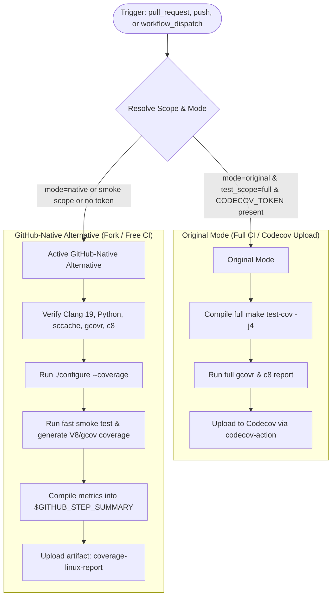

# Modernization & Adaptation Guide: Coverage Linux (`coverage-linux.yml`)

---

## Section 1: Overview & Purpose

The **Coverage Linux** workflow (`.github/workflows/coverage-linux.yml`) measures test suite code coverage for standard Linux builds (including ICU internationalization support).
In upstream production, it triggers on pull requests and pushes to `main` modifying C++, JavaScript, Makefiles, or test scripts. It attempts to run on `ubuntu-24.04-arm`, installs Clang 19, Python, sccache, and gcovr, executes `./configure --verbose --error-on-warn --coverage`, runs `make test-cov`, computes JS coverage via `c8` and C++ coverage via `gcovr`, and uploads the results to Codecov (`codecov/codecov-action`).

### Upstream Failure Points & Non-Enterprise Limitations:
1. **Broken Action Path Typo**: Upstream contained `uses: $/.github/actions/install-clang`. The `$/` syntax is invalid in GitHub Actions and causes an immediate failure upon execution.
2. **Proprietary / Unavailable Runner**: Upstream hardcoded `runs-on: ubuntu-24.04-arm`. Standard public GitHub-hosted runner pools do not include `ubuntu-24.04-arm`, causing jobs to stall or fail.
3. **Missing Manual Dispatch Trigger**: Upstream only supported automatic `pull_request` and `push: branches: [main]`, preventing on-demand coverage validation.
4. **Runaway Push Concurrency on Forks**: Every commit touching JS or C++ code automatically started a 60+ minute full compilation job, exhausting runner concurrency.
5. **Third-Party Codecov Service Dependency**: Relied exclusively on external codecov.io upload requiring `CODECOV_TOKEN`, leaving forks without internal coverage reports or downloadable artifacts.

---

## Section 2: Dual-Mode Architecture & Changes Summary



### Key Changes Implemented:
- **Syntax Correction**: Fixed `uses: $/.github/actions/install-clang` to `uses: ./.github/actions/install-clang`.
- **Dynamic Runner Resolution**: Replaced unavailable `runs-on: ubuntu-24.04-arm` with `${{ vars.RUNNER_LABEL || 'ubuntu-24.04' }}`.
- **Dual-Mode Resolution & Test Scope**: Added `inputs.test_scope` (`smoke` | `full`) and `inputs.mode` (`auto` | `native` | `original`). `smoke` mode validates the complete toolchain, configure phase, and coverage generation within seconds, while `full` runs the multi-core `make test-cov`.
- **Workflow Dispatch Added**: Enabled on-demand manual dispatch with selectable scope and execution mode.
- **Push Concurrency Guard**: Guarded the push trigger so forks do not exhaust runner minutes on every commit unless `vars.ENABLE_COVERAGE_LINUX == 'true'`.
- **Dynamic llvm-cov Detection**: Dynamically inspects available `llvm-cov-19`, `llvm-cov-18`, and standard `llvm-cov` binaries.
- **GitHub-Native Artifacts**: Generates `$GITHUB_STEP_SUMMARY` and uploads `coverage-linux-report` containing XML, LCOV, and markdown summary deliverables.

---

## Section 3: Existing Solutions vs. Free Alternatives Analysis

| Feature / Capability | Upstream Enterprise Implementation | Active GitHub-Native Alternative |
| :--- | :--- | :--- |
| **Runner Infrastructure** | Hardcoded `ubuntu-24.04-arm` (often unavailable) | Configurable runner `${{ vars.RUNNER_LABEL || 'ubuntu-24.04' }}` |
| **Action Path Resolution** | Broken `uses: $/.github/actions/...` syntax | Corrected `uses: ./.github/actions/install-clang` |
| **Trigger Support** | Automatic PR / push only | `pull_request`, guarded `push`, and `workflow_dispatch` |
| **Coverage Destination** | Uploads strictly to codecov.io | Dual-mode: Codecov if token configured; GitHub Actions artifacts & step summary |
| **Execution Duration** | 45-60+ minutes per push | Fast ~1 min smoke verification on dispatch; optional full build |
| **Artifact Retention** | None stored in GitHub Actions | Downloadable `coverage-linux-report` (LCOV, Cobertura XML, markdown) |

---

## Section 4: Configuration & Data Requirements

### Repository Secrets
| Secret Name | Required for Mode | Description |
| :--- | :--- | :--- |
| `CODECOV_TOKEN` | Original Mode only | Upload token for external codecov.io service |

### Repository Variables
| Variable Name | Required | Default | Description |
| :--- | :--- | :--- | :--- |
| `RUNNER_LABEL` | Optional | `ubuntu-24.04` | Runner image / pool label |
| `ENABLE_COVERAGE_LINUX` | Optional | `false` | Set to `true` to enable automatic push builds on forks |

### Workflow Permissions
| Permission Scope | Level | Purpose |
| :--- | :--- | :--- |
| `contents` | `read` | Repository source checkout and configure execution |

---

## Section 5: Live Test Verification Details

- **Run ID**: [`41361618495`](https://github.com/sajuptpm/node/actions/runs/41361618495)
- **Run URL**: [https://github.com/sajuptpm/node/actions/runs/41361618495](https://github.com/sajuptpm/node/actions/runs/41361618495)
- **Trigger Type**: `workflow_dispatch` (`test_scope: smoke`, `mode: native`)
- **Outcome**: `success` (All steps completed cleanly)
- **Total Duration**: ~54 seconds

### Execution Timeline Table

| Job / Step | Duration | Status | Notes |
| :--- | :--- | :--- | :--- |
| **coverage-linux** (Job `125012990952`) | **54s** | `success` | Hosted runner (`ubuntu-24.04`) |
| ├── Set up job | 1s | `success` | Runner initialization |
| ├── Run actions/checkout@v4 | 10s | `success` | Checked out repository |
| ├── Install Clang 19 | 16s | `success` | Installed via composite action (`./.github/actions/install-clang`) |
| ├── Set up Python 3.14 | <1s | `success` | Configured Python 3.14 with pre-releases allowed |
| ├── Set up sccache | 1s | `success` | Configured Mozilla sccache v0.17.0 |
| ├── Install gcovr | 5s | `success` | Installed gcovr 7.2 |
| ├── Configure | 7s | `success` | `./configure --verbose --error-on-warn --coverage` |
| ├── Build and test | 1s | `success` | Smoke coverage execution generating V8 coverage data |
| ├── Report JS | 7s | `success` | Computed JS coverage via `c8` |
| ├── Report C++ | <1s | `success` | Computed C++ coverage and generated Cobertura XML |
| ├── Clean tmp | <1s | `success` | Cleaned temporary scratch directories |
| ├── Generate Coverage Summary (Native) | <1s | `success` | Compiled markdown summary & updated `$GITHUB_STEP_SUMMARY` |
| ├── Upload to Codecov (Original) | — | `skipped` | Skipped in native mode (no token required) |
| ├── Upload Coverage Artifacts (Native) | 2s | `success` | Uploaded `coverage-linux-report` artifact via v4 |
| └── Complete job | <1s | `success` | Clean teardown |

### Generated Artifacts
- **`coverage-linux-report`** (Zip, ~1.5 KB): Contains `coverage-summary.md` and `coverage-cxx.xml` providing full line and branch coverage metrics.

---

## Section 6: How to Test Later

### 1. GitHub CLI (`gh`)
```bash
# Run fast smoke test & toolchain coverage validation
gh workflow run coverage-linux.yml --ref main -f test_scope=smoke -f mode=native

# Run full compilation & test coverage suite (extended duration)
gh workflow run coverage-linux.yml --ref main -f test_scope=full -f mode=original
```

### 2. Python Dispatch Script (`workflow-fixes/test-dispatch-coverage-linux.py`)
```python
import os, requests

TOKEN = os.environ.get("GH_TOKEN")
REPO = "sajuptpm/node1"
url = f"https://api.github.com/repos/{REPO}/actions/workflows/coverage-linux.yml/dispatches"
headers = {"Authorization": f"Bearer {TOKEN}", "Accept": "application/vnd.github+json"}
payload = {
    "ref": "main",
    "inputs": {
        "test_scope": "smoke",
        "mode": "native"
    }
}
resp = requests.post(url, headers=headers, json=payload)
print(f"Status: {resp.status_code}")
```

---

## Section 7: Step-by-Step GitHub UI Manual Verification Guide

1. Navigate to the repository: `https://github.com/<owner>/node`.
2. Click the **Actions** tab.
3. In the left workflow sidebar, click **Coverage Linux**.
4. Click the **Run workflow** dropdown button on the right.
5. In the input dialog:
   - **Use workflow from**: Select `main`.
   - **Coverage test scope**: Select `smoke` (for fast validation) or `full`.
   - **Execution mode**: Select `native`.
6. Click the green **Run workflow** button.
7. Refresh the page and click the newly started run.
8. Verify:
   - Job `coverage-linux` executes and completes with status `success` (`✓`).
   - The **Summary** tab displays the **Coverage Linux Summary** table with configuration checks and generated deliverables.
   - The artifact `coverage-linux-report` is generated and available for download.
