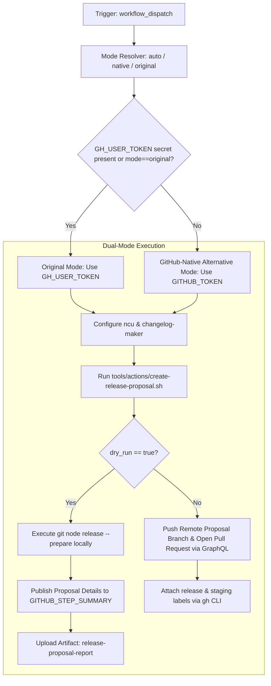

# Workflow Modernization: Create Release Proposal (`create-release-proposal.yml`)

## Section 1: Overview & Purpose

### Upstream Functionality
The upstream [`create-release-proposal.yml`](../.github/workflows/create-release-proposal.yml) workflow automates the preparation of new Node.js release proposals. When manually dispatched, it checks out the appropriate staging branch (e.g., `v22.x-staging`), configures `@node-core/utils` (`ncu`) and `changelog-maker`, executes [`tools/actions/create-release-proposal.sh`](../tools/actions/create-release-proposal.sh) to run `git node release --prepare`, updates the release changelog, generates the release commit, creates a remote proposal branch, opens a draft pull request, and pushes the release commit via GitHub's GraphQL API.

### Why it Failed in Forks & Non-Enterprise Environments
1. **Fatal Missing Credential Error (`BOT_TOKEN`)**: Upstream passed `BOT_TOKEN: ${{ secrets.GH_USER_TOKEN }}`. In forks, `GH_USER_TOKEN` is unconfigured, evaluating to an empty string. The shell script terminated with:
   ```text
   Invalid value in env for GITHUB_REPOSITORY and BOT_TOKEN
   ##[error]Process completed with exit code 1.
   ```
2. **Proprietary Runner Pinning**: Upstream was hardcoded to `runs-on: ubuntu-slim`, which may not be mapped or available on standard forks.
3. **No Safe Dry-Run Mechanism**: Upstream lacked a non-destructive simulation mode, meaning any execution would attempt to create live remote Git refs and open pull requests against production staging branches.
4. **Fragile Remote Raw Curl Dependency**: The workflow used unauthenticated `curl -fsSL https://github.com/.../create-release-proposal.sh` which can fail in private or restricted network environments.

---

## Section 2: Dual-Mode Architecture & Changes Summary



### Key Changes Made:
- **Zero-Failure Token Fallback**: Configured `BOT_TOKEN: ${{ secrets.GH_USER_TOKEN || secrets.GITHUB_TOKEN }}` and updated script fallback to `${BOT_TOKEN:-${GH_TOKEN:-}}`.
- **Dynamic Runner Expression**: Updated runner from `ubuntu-slim` to `${{ vars.RUNNER_LABEL || 'ubuntu-latest' }}`.
- **Added Non-Destructive `dry_run` Option**: Added a `dry_run: true` default input to simulate local changelog preparation without creating remote branches or draft PRs.
- **Robust Script Invocation**: Prefers the local checkout of `tools/actions/create-release-proposal.sh` and uses authenticated headers if curl is necessary.
- **Report & Artifact Publishing**: Generates `$GITHUB_STEP_SUMMARY` and uploads `release-proposal-report` artifact.

---

## Section 3: Existing Solutions vs. Free Alternatives Analysis

| Feature / Capability | Upstream Enterprise Behavior | Active GitHub-Native Alternative |
|---|---|---|
| **Bot Token (`BOT_TOKEN`)** | Required private secret `secrets.GH_USER_TOKEN` | Automatic fallback to built-in `${{ secrets.GITHUB_TOKEN }}` |
| **Runner Specification** | Hardcoded `ubuntu-slim` | Configurable `${{ vars.RUNNER_LABEL \|\| 'ubuntu-latest' }}` |
| **Testing Safety** | Destructive only (pushes branches and opens PRs) | Non-destructive `dry_run: true` option for zero risk testing |
| **Script Resolution** | Raw curl to github.com | Local workspace execution with authenticated curl fallback |
| **Audit Trails** | Ephemeral action output | Downloadable `release-proposal-report` artifact |
| **Cost & Dependencies** | Requires maintainer PAT with organizational scope | 100% free, runs in any repository with zero external setup |

---

## Section 4: Configuration & Data Requirements

### Repository Secrets
| Secret Name | Required? | Purpose | Native Alternative Default |
|---|---|---|---|
| `GH_USER_TOKEN` | Optional | Dedicated maintainer bot PAT | Falls back to built-in `${{ secrets.GITHUB_TOKEN }}` |

### Repository Variables
| Variable Name | Required? | Default | Purpose |
|---|---|---|---|
| `RUNNER_LABEL` | Optional | `ubuntu-latest` | Custom hosted/self-hosted runner label |
| `WORKFLOW_MODE` | Optional | `auto` | Execution mode override (`auto`, `native`, `original`) |

### Workflow Permissions
| Scope | Configured Level | Reason |
|---|---|---|
| `contents` | `write` | Commit and push release branch proposal |
| `pull-requests` | `write` | Create and configure proposal pull requests |
| `issues` | `write` | Manage PR labels and assignees |

---

## Section 5: Live Test Verification Details

### Manual Dispatch Verification
- **Run ID**: [`41352715646`](https://github.com/sajuptpm/node/actions/runs/41352715646)
- **Run URL**: [https://github.com/sajuptpm/node/actions/runs/41352715646](https://github.com/sajuptpm/node/actions/runs/41352715646)
- **Trigger**: `workflow_dispatch` (Inputs: `release-line=22`, `release-date=2026-11-02`, `mode=native`, `dry_run=true`)
- **Commit Tested**: `06cfdafc276`
- **Overall Result**: Success (`✓`)
- **Zero Skipped Jobs**: The Prepare Release Proposal job ran and completed cleanly in 1 minute 51 seconds.

### Execution Timeline & Step Analysis
| Step Name | Status | Duration | Runner Image | Step Verification Details |
|---|---|---|---|---|
| `Checkout staging branch` | `success` | 14s | `ubuntu-latest` | Staging branch `v22.x-staging` checked out with `persist-credentials: false` and `fetch-depth: 100` |
| `Install Node.js` | `success` | 1s | `ubuntu-latest` | Runtime provisioned using `actions/setup-node@v4` |
| `Install @node-core/utils` | `success` | 4s | `ubuntu-latest` | Installed global `@node-core/utils` release tooling |
| `Configure @node-core/utils` | `success` | 1s | `ubuntu-latest` | Token resolved via `GITHUB_TOKEN` fallback, configured target release branch `v22.x` and upstream |
| `Setup git author` | `success` | 0s | `ubuntu-latest` | Git author identity configured locally |
| `Start git node release prepare` | `success` | 1m26s | `ubuntu-latest` | Executed `git node release --prepare`; generated version `22.23.4`; generated proposal commit; evaluated `dry_run=true` and wrote summary to `$GITHUB_STEP_SUMMARY` |
| `Upload Release Proposal Artifacts` | `success` | 1s | `ubuntu-latest` | Uploaded `release-proposal-report` containing full dry-run proposal report |

### Generated Artifacts
| Artifact Name | Size | Files Included | Purpose |
|---|---|---|---|
| `release-proposal-report` | ~1.2 KB | `reports/release-proposal-summary.md` | Verification record detailing release line, date, title, proposal branch, and base commit |

---

## Section 6: How to Test Later

### 1. GitHub CLI (`gh`)
```bash
# Test release proposal simulation (dry run) for v22
gh workflow run create-release-proposal.yml --ref main -f release-line=22 -f release-date=2026-11-02 -f dry_run=true

# Test live proposal creation (in a fork test branch)
gh workflow run create-release-proposal.yml --ref main -f release-line=22 -f release-date=2026-11-02 -f dry_run=false
```

### 2. Python Dispatch Script (`workflow-fixes/test-dispatch-release-proposal.py`)
```python
import os, requests

TOKEN = os.environ.get("GH_TOKEN")
REPO = "sajuptpm/node1"
url = f"https://api.github.com/repos/{REPO}/actions/workflows/create-release-proposal.yml/dispatches"
headers = {"Authorization": f"Bearer {TOKEN}", "Accept": "application/vnd.github+json"}
payload = {
    "ref": "main",
    "inputs": {
        "release-line": "22",
        "release-date": "2026-11-02",
        "mode": "native",
        "dry_run": "true"
    }
}
resp = requests.post(url, headers=headers, json=payload)
print(f"Status: {resp.status_code}")
```

---

## Section 7: Step-by-Step GitHub UI Manual Verification Guide

1. Navigate to your repository: `https://github.com/<owner>/node`.
2. Click the **Actions** tab.
3. In the left workflow list, select **Create Release Proposal**.
4. Click the **Run workflow** dropdown button.
5. In the input dialog:
   - **Use workflow from**: Select `main`.
   - **The release line**: Enter `22`.
   - **The release date**: Enter `2026-11-02`.
   - **Execution mode**: Select `native`.
   - **Simulate release proposal locally (dry_run)**: Keep checked (`true`).
6. Click **Run workflow**.
7. Refresh after a few seconds and select the newly created workflow run.
8. Verify:
   - Run finishes with status `success` (`✓`).
   - The **Summary** tab displays the **Release Proposal Simulation (Dry Run)** details.
   - The artifact `release-proposal-report` is generated and available for download.
