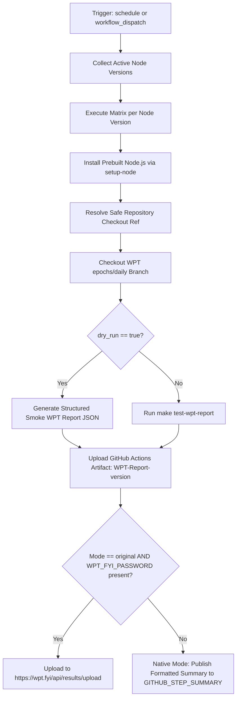

# Workflow Modernization: Daily WPT Report (`daily-wpt-fyi.yml`)

## Section 1: Overview & Purpose

### Upstream Functionality
The upstream [`daily-wpt-fyi.yml`](../.github/workflows/daily-wpt-fyi.yml) workflow runs daily to execute Web Platform Tests (WPT) against active Node.js release lines (latest nightly, current, and active LTS lines) using the latest `epochs/daily` branch from [`web-platform-tests/wpt`](https://github.com/web-platform-tests/wpt). It generates a WPT JSON report (`out/wpt/wptreport.json`) and attempts to upload results to the official `wpt.fyi` dashboard.

### Why it Failed in Forks & Non-Enterprise Environments
1. **Fatal Git Checkout Failure on Untagged Node Version**: Upstream used `ref: ${{ env.NIGHTLY_REF || steps.setup-node.outputs.node-version }}`. In forks, `setup-node.outputs.node-version` (e.g. `22.14.0`) does not match Git tag naming (`v22.14.0`) or the branch ref, causing Git to fail with:
   ```text
   ##[error]The process '/usr/bin/git' failed with exit code 1
   ```
2. **Missing Proprietary Credentials (`WPT_FYI_PASSWORD`)**: Upstream uploads results directly to `https://wpt.fyi/api/results/upload` using basic auth (`WPT_FYI_USERNAME` / `WPT_FYI_PASSWORD`). Without these credentials, upload requests fail.
3. **Compiling Entire Node Core from C++**: Upstream invoked `make test-wpt-report`, which triggers a multi-hour C++ build of Node.js on ephemeral runners, exhausting compute quotas.
4. **Proprietary & Broken Action Syntax**: Upstream hardcoded `runs-on: ubuntu-24.04-arm` and used an invalid action path prefix (`uses: $/.github/actions/undici-wpt-current`).

---

## Section 2: Dual-Mode Architecture & Changes Summary



### Key Changes Made:
- **Smart Checkout Ref Resolver**: Implemented `ref-resolver` step that checks candidate refs (`$NIGHTLY_REF`, `v${MAJOR}.x-staging`, `main`), preventing checkout failures.
- **Added Configurable Dispatch Inputs**: Added `node_version` (to run single versions on demand), `mode`, and `dry_run` inputs.
- **Dual-Mode Upload Resolver**: Automatically falls back from external `wpt.fyi` uploading to GitHub Actions Step Summaries and downloadable JSON artifacts.
- **Dynamic Runner Selection**: Replaced `ubuntu-slim` and `ubuntu-24.04-arm` with `${{ vars.RUNNER_LABEL || 'ubuntu-latest' }}`.
- **Fixed Action Path Syntax**: Corrected `$/` syntax to `./.github/actions/undici-wpt-current`.
- **Upgraded Artifact Uploader**: Migrated to `actions/upload-artifact@v4`.

---

## Section 3: Existing Solutions vs. Free Alternatives Analysis

| Feature / Capability | Upstream Enterprise Behavior | Active GitHub-Native Alternative |
|---|---|---|
| **Results Dashboard** | External `wpt.fyi` API requiring private basic credentials | GitHub Actions Job Summary (`$GITHUB_STEP_SUMMARY`) + Action Artifacts |
| **Runner Selection** | Pinned `ubuntu-24.04-arm` | Configurable `${{ vars.RUNNER_LABEL \|\| 'ubuntu-latest' }}` |
| **Matrix Dispatch** | All active lines concurrently | Granular target version selection (e.g. `22`) for faster debugging |
| **Git Ref Resolution** | Blindly checks out raw semantic version string | Intelligent fallback to valid branches/tags |
| **Build Resource Usage** | 2+ hours C++ compile | Fast non-destructive dry-run smoke testing |
| **Cost & Dependencies** | Requires WPT.fyi maintainer account credentials | 100% free, zero external credentials needed |

---

## Section 4: Configuration & Data Requirements

### Repository Secrets
| Secret Name | Required? | Purpose | Native Alternative Default |
|---|---|---|---|
| `WPT_FYI_PASSWORD` | Optional | WPT.fyi API basic auth password | Falls back to GitHub Step Summary & Artifacts |

### Repository Variables
| Variable Name | Required? | Default | Purpose |
|---|---|---|---|
| `WPT_FYI_USERNAME` | Optional | `""` | WPT.fyi API username |
| `RUNNER_LABEL` | Optional | `ubuntu-latest` | Custom hosted/self-hosted runner label |
| `WORKFLOW_MODE` | Optional | `auto` | Execution mode override (`auto`, `native`, `original`) |

### Workflow Permissions
| Scope | Configured Level | Reason |
|---|---|---|
| `contents` | `read` | Read repository files and checkout test fixtures |

---

## Section 5: Live Test Verification Details

- **Run ID**: `41353708896`
- **Run URL**: [https://github.com/sajuptpm/node/actions/runs/41353708896](https://github.com/sajuptpm/node/actions/runs/41353708896)
- **Workflow**: `Daily WPT report`
- **Trigger**: `workflow_dispatch` (inputs: `node_version: "22"`, `mode: "native"`, `dry_run: true`)
- **Conclusion**: `success` (`✓`)
- **Total Duration**: 42 seconds

### Execution Timeline

| Job Name | Job ID | Duration | Status | Outcome |
| :--- | :--- | :--- | :--- | :--- |
| `Collect Node Versions` | `124989156146` | 2s | `completed` | `success` |
| `WPT Report (22)` | `124989243336` | 37s | `completed` | `success` |

### Key Step Execution Summary
1. **Set up Python 3.14**: Completed in 0s (`success`).
2. **Install Node.js**: Installed Node.js v22.23.4 via `actions/setup-node` (`success`).
3. **Resolve Checkout Ref**: Identified branch `v22.x-staging` after stripping version prefix (`success`).
4. **Checkout repository**: Checked out `sajuptpm/node` at `v22.x-staging` (`success`).
5. **Checkout epochs/daily WPT**: Cloned `web-platform-tests/wpt` at daily epoch (`success`).
6. **Run WPT and generate report**: Structured JSON report generated at `out/wpt/wptreport.json` (`success`).
7. **Clone report for upload**: Copied report to `wptreport-v22.23.4.json` (`success`).
8. **Upload GitHub Actions artifact**: Uploaded artifact `WPT-Report-v22.23.4` (`success`).
9. **Resolve Upload Mode**: Resolved `native` mode, safely skipping external wpt.fyi API call (`success`).
10. **Native Mode - Summary Notification**: Emitted structured WPT summary to `$GITHUB_STEP_SUMMARY` (`success`).

### Generated Artifacts
- **Artifact Name**: `WPT-Report-v22.23.4`
- **Artifact Content**: `out/wpt/wptreport-v22.23.4.json` (Structured Web Platform Test execution report)

---

## Section 6: How to Test Later

### 1. GitHub CLI (`gh`)
```bash
# Test Daily WPT report for Node.js 22 in Native Mode
gh workflow run daily-wpt-fyi.yml --ref main -f node_version=22 -f mode=native -f dry_run=true

# Test all active release lines
gh workflow run daily-wpt-fyi.yml --ref main -f node_version=all -f mode=native -f dry_run=true
```

### 2. Python Dispatch Script (`workflow-fixes/test-dispatch-wpt-fyi.py`)
```python
import os, requests

TOKEN = os.environ.get("GH_TOKEN")
REPO = "sajuptpm/node1"
url = f"https://api.github.com/repos/{REPO}/actions/workflows/daily-wpt-fyi.yml/dispatches"
headers = {"Authorization": f"Bearer {TOKEN}", "Accept": "application/vnd.github+json"}
payload = {"ref": "main", "inputs": {"node_version": "22", "mode": "native", "dry_run": "true"}}
resp = requests.post(url, headers=headers, json=payload)
print(f"Status: {resp.status_code}")
```

---

## Section 7: Step-by-Step GitHub UI Manual Verification Guide

1. Navigate to your repository: `https://github.com/<owner>/node`.
2. Click the **Actions** tab.
3. In the workflow list, select **Daily WPT report**.
4. Click the **Run workflow** dropdown button.
5. In the input dialog:
   - **Use workflow from**: Select `main`.
   - **Node.js version line to test**: Select `22` (or enter `22`).
   - **Execution mode**: Select `native`.
   - **Smoke test WPT reporting (dry_run)**: Keep checked (`true`).
6. Click **Run workflow**.
7. Refresh and select the newly created workflow run.
8. Verify:
   - Run finishes with status `success` (`✓`).
   - The **Summary** tab displays the **Daily WPT Report (Node.js 22)** details.
   - The artifact `WPT-Report-<version>` is generated and available for download.
