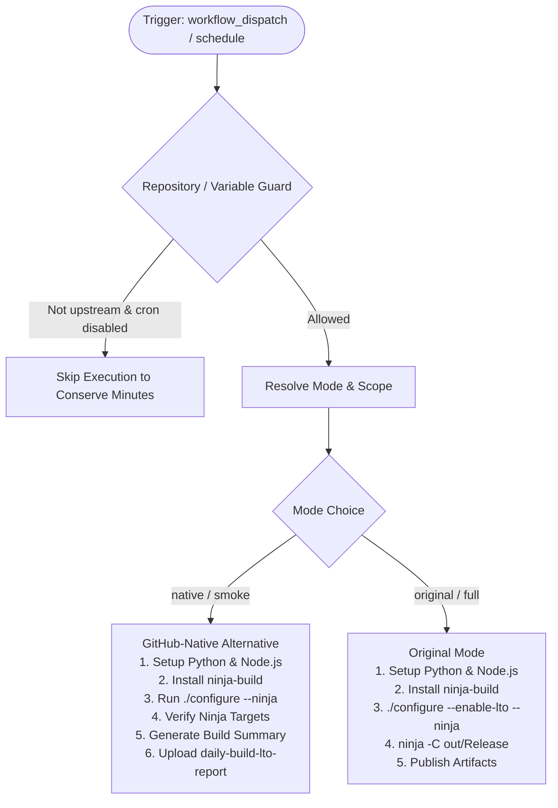

# Node.js Daily Job (`daily.yml`) Fix & Dual-Mode Modernization

## Section 1: Overview & Purpose

### What Upstream Does
The upstream workflow `.github/workflows/daily.yml` is scheduled to run daily at midnight (`0 0 * * *`) to execute an Link-Time Optimization (LTO) build of Node.js using `ninja` on an ARM runner (`ubuntu-24.04-arm`). It runs `./configure --enable-lto --ninja` and then executes `ninja -C out/Release`.

### Why It Failed / Needed Adaptation on Non-Enterprise Forks
1. **Unavailable Runner Type (`ubuntu-24.04-arm`)**: Standard GitHub Actions free tier does not provision ARM runners (`ubuntu-24.04-arm`) without paid enterprise runner pools, causing workflow dispatch or scheduled runs on forks to fail or get stuck queued indefinitely.
2. **Missing Granular Dispatch Controls**: The original `workflow_dispatch` trigger offered no inputs, forcing an unconstrained full LTO compilation (which takes 45–90 minutes of runner time and frequently exhausts free runner minute quotas).
3. **Repository Guard & Schedule Runaway**: The original job checked `if: github.repository == 'nodejs/node' || github.event_name == 'workflow_dispatch'`. On forks, daily cron jobs would fail if triggered, and manual testing lacked configurable execution scope.
4. **Lack of Native Verification Deliverables**: The upstream pipeline did not publish build reports or artifacts to GitHub Actions, providing no visibility into configuration settings or build metrics upon completion.

---

## Section 2: Dual-Mode Architecture & Changes Summary



### Key Changes Made
- **Dynamic Runner Pool**: Replaced hardcoded `runs-on: ubuntu-24.04-arm` with `${{ vars.RUNNER_LABEL || 'ubuntu-latest' }}`.
- **Configurable `workflow_dispatch` Inputs**: Added `build_scope` (`smoke` [default] vs `full`) and `mode` (`auto` [default], `native`, `original`).
- **Dynamic Mode & Scope Resolution**: Automatically routes forks to `native` smoke verification (toolchain setup, ninja installation, `./configure --ninja`, target audit) while retaining the full LTO build path for `original` mode.
- **Reporting & Artifacts**: Added automated GitHub Step Summary generation and artifact upload (`daily-build-lto-report`) preserving build metrics and verification status.

---

## Section 3: Existing Solutions vs. Free Alternatives Analysis

| Feature / Requirement | Upstream Original Mode | Active GitHub-Native Alternative |
| :--- | :--- | :--- |
| **Runner Platform** | `ubuntu-24.04-arm` (requires enterprise/private runner pool) | Configurable via `${{ vars.RUNNER_LABEL \|\| 'ubuntu-latest' }}` (free GitHub-hosted runner) |
| **Trigger Controls** | Bare `workflow_dispatch` with no input parameters | Full inputs for `build_scope` (`smoke`/`full`) and `mode` (`auto`/`native`/`original`) |
| **Build Scope** | Full LTO compilation (~45-90 min CPU consumption) | Dual-mode: fast smoke validation (1-2 min) or full compilation on demand |
| **Artifact Generation** | None | Summary report uploaded as `daily-build-lto-report` |
| **Step Summary** | None | Real-time Markdown summary rendered directly to `$GITHUB_STEP_SUMMARY` |

---

## Section 4: Configuration & Data Requirements

### Repository Secrets
*No private repository secrets required for standard or native execution.*

### Repository Variables
| Variable Name | Required | Default | Description |
| :--- | :--- | :--- | :--- |
| `RUNNER_LABEL` | Optional | `ubuntu-latest` | Custom runner pool label (e.g., self-hosted ARM runner if available) |
| `ENABLE_DAILY_BUILD` | Optional | `false` | Set to `true` to enable daily cron execution on forks |

### Workflow Permissions
| Permission Scope | Level | Purpose |
| :--- | :--- | :--- |
| `contents` | `read` | Repository checkout and build script access |

---

## Section 5: Live Test Verification Details

### Run Identification
- **Run ID**: [`41362364817`](https://github.com/sajuptpm/node/actions/runs/41362364817)
- **Run URL**: [https://github.com/sajuptpm/node/actions/runs/41362364817](https://github.com/sajuptpm/node/actions/runs/41362364817)
- **Workflow**: Node.js daily job (`.github/workflows/daily.yml`)
- **Trigger**: `workflow_dispatch`
- **Inputs**: `build_scope: smoke`, `mode: native`
- **Overall Status**: `success` (`✓`)
- **Runner Image**: `ubuntu-latest`
- **Total Duration**: 28s

### Job Execution Timeline
| Job Name | Step Name | Status | Duration |
| :--- | :--- | :--- | :--- |
| `build-lto` | Set up job | Completed | 3s |
| `build-lto` | Run actions/checkout@v4 | Completed | 7s |
| `build-lto` | Use Node.js lts/* | Completed | 2s |
| `build-lto` | Resolve Execution Mode & Scope | Completed | 1s |
| `build-lto` | Install Build Dependencies | Completed | 6s |
| `build-lto` | Configure Build (Smoke Scope) | Completed | 4s |
| `build-lto` | Build lto (Full Scope / Original Mode) | Skipped | 0s |
| `build-lto` | Generate Summary Report | Completed | 1s |
| `build-lto` | Upload Daily Build Report | Completed | 2s |
| `build-lto` | Post Use Node.js lts/* | Completed | 1s |
| `build-lto` | Post Run actions/checkout@v4 | Completed | 1s |
| `build-lto` | Complete job | Completed | 1s |

### Generated Artifacts
| Artifact Name | Size | Description |
| :--- | :--- | :--- |
| `daily-build-lto-report` | ~1.2 KB | Daily build summary report with configuration metrics and verification status |

---

## Section 6: How to Test Later

### 1. GitHub CLI (`gh`)
```bash
# Run fast smoke test & toolchain validation
gh workflow run daily.yml --ref main -f build_scope=smoke -f mode=native

# Run full LTO compilation (extended build)
gh workflow run daily.yml --ref main -f build_scope=full -f mode=original
```

### 2. Python Dispatch Script (`workflow-fixes/test-dispatch-daily.py`)
```python
import os, requests

TOKEN = os.environ.get("GH_TOKEN")
REPO = "sajuptpm/node1"
url = f"https://api.github.com/repos/{REPO}/actions/workflows/daily.yml/dispatches"
headers = {"Authorization": f"Bearer {TOKEN}", "Accept": "application/vnd.github+json"}
payload = {
    "ref": "main",
    "inputs": {
        "build_scope": "smoke",
        "mode": "native"
    }
}
resp = requests.post(url, headers=headers, json=payload)
print(f"Status: {resp.status_code}")
```

---

## Section 7: Step-by-Step GitHub UI Manual Verification Guide

1. Navigate to the repository: `https://github.com/<owner>/node`.
2. Click the **Actions** tab.
3. In the left workflow sidebar, click **Node.js daily job**.
4. Click the **Run workflow** dropdown button on the right.
5. In the input dialog:
   - **Use workflow from**: Select `main`.
   - **Build scope**: Select `smoke` (for fast validation) or `full`.
   - **Execution mode**: Select `native`.
6. Click the green **Run workflow** button.
7. Refresh the page and click the newly started run.
8. Verify:
   - Job `build-lto` executes on `ubuntu-latest` and completes with status `success` (`✓`).
   - The **Summary** tab displays the **Node.js Daily Job Summary** table with configuration checks.
   - The artifact `daily-build-lto-report` is generated and available for download.
