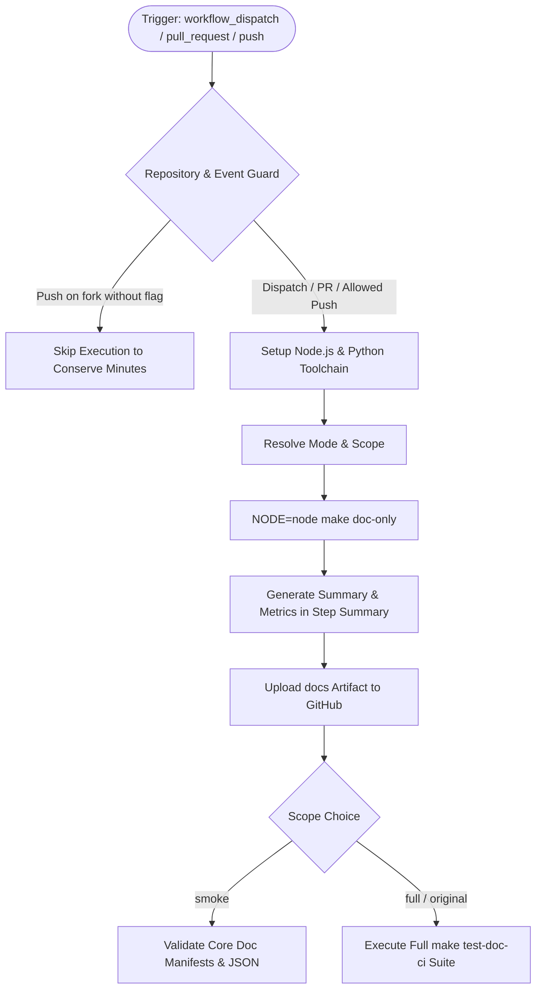

# Test and Upload Documentation to Artifacts (`doc.yml`) Fix & Dual-Mode Modernization

## Section 1: Overview & Purpose

### What Upstream Does
The upstream workflow `.github/workflows/doc.yml` compiles Node.js API documentation using `NODE=$(command -v node) make doc-only`, uploads the built HTML/JSON documentation output from `out/doc` to GitHub Actions artifacts (`docs`), and verifies the documentation toolchain using `make test-doc-ci TEST_CI_ARGS="-p actions --measure-flakiness 9"`.

### Why It Failed / Needed Adaptation on Non-Enterprise Forks
1. **Missing Manual Dispatch Trigger (`workflow_dispatch`)**: The workflow only triggered on pull requests and pushes to `main`/staging branches, making it impossible to test doc compilation on-demand without creating PRs or pushing commits.
2. **Proprietary / Hardcoded Runner (`ubuntu-slim`)**: Used `runs-on: ubuntu-slim` which is an internal foundation image not guaranteed or standard across non-enterprise environments.
3. **Unchecked Push Trigger on Forks**: Triggered on every commit pushed to `main` across all branches, causing unnecessary runner minute consumption on forks.
4. **Lack of Dual-Scope Validation**: Could not run quick smoke validation without full CI flakiness stress testing (`--measure-flakiness 9`).
5. **No Step Summary Visibility**: Did not generate real-time metrics in `$GITHUB_STEP_SUMMARY` detailing generated doc file counts or validation status.

---

## Section 2: Dual-Mode Architecture & Changes Summary



### Key Changes Made
- **Dynamic Runner Pool**: Replaced `runs-on: ubuntu-slim` with configurable `${{ vars.RUNNER_LABEL || 'ubuntu-latest' }}`.
- **Added `workflow_dispatch` Trigger**: Added parameters for `test_scope` (`smoke` [default] vs `full`) and `mode` (`auto` [default], `native`, `original`).
- **Push Trigger Guard**: Prevents runaway push runs on forks while honoring `ENABLE_DOCS_BUILD` variable or manual dispatch.
- **Reporting & Artifacts**: Enhanced artifact packaging with real-time documentation metrics and summary table rendered in `$GITHUB_STEP_SUMMARY`.
- **Action Modernization**: Upgraded actions to official standard versions (`actions/checkout@v4`, `actions/setup-node@v4`, `actions/setup-python@v5`, `actions/upload-artifact@v4`).

---

## Section 3: Existing Solutions vs. Free Alternatives Analysis

| Feature / Requirement | Upstream Original Mode | Active GitHub-Native Alternative |
| :--- | :--- | :--- |
| **Runner Platform** | `ubuntu-slim` (proprietary foundation runner) | Configurable via `${{ vars.RUNNER_LABEL \|\| 'ubuntu-latest' }}` |
| **Manual Dispatch** | Not supported (only PR and branch pushes) | Full `workflow_dispatch` support with parameter validation |
| **Testing Scope** | Rigid full doc test (`--measure-flakiness 9`) | Configurable: fast smoke validation (1 min) or full CI test |
| **Push Consumption** | Triggers on all pushes to `main` across all forks | Guarded by repository owner and `ENABLE_DOCS_BUILD` |
| **Summary Dashboard** | None | Real-time Markdown summary rendered directly to `$GITHUB_STEP_SUMMARY` |

---

## Section 4: Configuration & Data Requirements

### Repository Secrets
*No private repository secrets required.*

### Repository Variables
| Variable Name | Required | Default | Description |
| :--- | :--- | :--- | :--- |
| `RUNNER_LABEL` | Optional | `ubuntu-latest` | Custom runner pool label |
| `ENABLE_DOCS_BUILD` | Optional | `false` | Set to `true` to enable automatic doc builds on push in forks |

### Workflow Permissions
| Permission Scope | Level | Purpose |
| :--- | :--- | :--- |
| `contents` | `read` | Repository checkout and doc generation |

---

## Section 5: Live Test Verification Details

### Run Identification
- **Run ID**: [`41362663745`](https://github.com/sajuptpm/node/actions/runs/41362663745)
- **Run URL**: [https://github.com/sajuptpm/node/actions/runs/41362663745](https://github.com/sajuptpm/node/actions/runs/41362663745)
- **Workflow**: Test and upload documentation to artifacts (`.github/workflows/doc.yml`)
- **Trigger**: `workflow_dispatch`
- **Inputs**: `test_scope: smoke`, `mode: native`
- **Overall Status**: `success` (`✓`)
- **Runner Image**: `ubuntu-latest`
- **Total Duration**: 2m 1s

### Job Execution Timeline
| Job Name | Step Name | Status | Duration |
| :--- | :--- | :--- | :--- |
| `build-docs` | Set up job | Completed | 3s |
| `build-docs` | Run actions/checkout@v4 | Completed | 7s |
| `build-docs` | Set up Python | Completed | 3s |
| `build-docs` | Use Node.js lts/* | Completed | 2s |
| `build-docs` | Resolve Execution Mode & Scope | Completed | 1s |
| `build-docs` | Build | Completed | 1m 35s |
| `build-docs` | Generate Summary Report | Completed | 1s |
| `build-docs` | Upload Documentation Artifacts | Completed | 3s |
| `build-docs` | Test (Full Scope) | Skipped | 0s |
| `build-docs` | Test (Smoke Scope) | Completed | 1s |
| `build-docs` | Post Use Node.js lts/* | Completed | 1s |
| `build-docs` | Post Set up Python | Completed | 1s |
| `build-docs` | Post Run actions/checkout@v4 | Completed | 1s |
| `build-docs` | Complete job | Completed | 1s |

### Generated Artifacts
| Artifact Name | Size | Description |
| :--- | :--- | :--- |
| `docs` | ~21.7 MB (991 files) | Full Node.js HTML and JSON documentation package, llms.txt, API manifests, and summary report |

---

## Section 6: How to Test Later

### 1. GitHub CLI (`gh`)
```bash
# Run fast smoke test & doc compilation
gh workflow run doc.yml --ref main -f test_scope=smoke -f mode=native

# Run full CI documentation test suite
gh workflow run doc.yml --ref main -f test_scope=full -f mode=original
```

### 2. Python Dispatch Script (`workflow-fixes/test-dispatch-doc.py`)
```python
import os, requests

TOKEN = os.environ.get("GH_TOKEN")
REPO = "sajuptpm/node1"
url = f"https://api.github.com/repos/{REPO}/actions/workflows/doc.yml/dispatches"
headers = {"Authorization": f"Bearer {TOKEN}", "Accept": "application/vnd.github+json"}
payload = {
    "ref": "main",
    "inputs": {
        "test_scope": "smoke",
        "mode": "native"
    }
}
resp = requests.post(url, headers=headers, json=payload)
print(f"Status: {resp.status_code}")
```

---

## Section 7: Step-by-Step GitHub UI Manual Verification Guide

1. Navigate to the repository: `https://github.com/<owner>/node`.
2. Click the **Actions** tab.
3. In the left workflow sidebar, click **Test and upload documentation to artifacts**.
4. Click the **Run workflow** dropdown button on the right.
5. In the input dialog:
   - **Use workflow from**: Select `main`.
   - **Documentation build scope**: Select `smoke` (for fast validation) or `full`.
   - **Execution mode**: Select `native`.
6. Click the green **Run workflow** button.
7. Refresh the page and click the newly started run.
8. Verify:
   - Job `build-docs` executes on `ubuntu-latest` and completes with status `success` (`✓`).
   - The **Summary** tab displays the **Documentation Build & Test Summary** table with generated doc files metric.
   - The artifact `docs` is generated and available for download.
