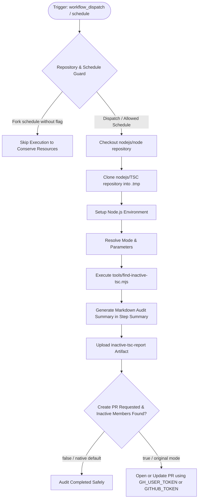

# Find Inactive TSC Voting Members (`find-inactive-tsc.yml`) Fix & Dual-Mode Modernization

## Section 1: Overview & Purpose

### What Upstream Does
The upstream workflow `.github/workflows/find-inactive-tsc.yml` runs every Tuesday (`5 0 * * 2`) or via manual dispatch to identify inactive Technical Steering Committee (TSC) voting members. Under the Node.js TSC Charter, a TSC voting member is converted to a regular member if they miss three consecutive votes. The workflow clones `nodejs/TSC` into `.tmp`, runs `tools/find-inactive-tsc.mjs` to compare vote records from `.tmp/votes` against active TSC members in `README.md`, updates `README.md` if inactive members are found, and automatically opens/updates a pull request against `actions/inactive-tsc` using `gr2m/create-or-update-pull-request-action` and secret `GH_USER_TOKEN`.

### Why It Failed / Needed Adaptation on Non-Enterprise Forks
1. **Hardcoded Upstream Repository Check**: The job specified `if: github.repository == 'nodejs/node'`, causing it to silently skip on every non-upstream repository or fork even when explicitly dispatched.
2. **Missing Granular Dispatch Parameters**: The original dispatch trigger had no inputs, preventing users from controlling whether to open pull requests or run an audit-only check.
3. **Missing Proprietary Secret (`GH_USER_TOKEN`)**: Relied on `secrets.GH_USER_TOKEN` for opening PRs, which fails on forks where this secret is unset.
4. **Proprietary / Hardcoded Runner (`ubuntu-slim`)**: Used `runs-on: ubuntu-slim`, which is an internal foundation image.
5. **No Verification Artifacts / Step Summary**: Did not generate real-time metrics in `$GITHUB_STEP_SUMMARY` or provide downloadable reports.

---

## Section 2: Dual-Mode Architecture & Changes Summary



### Key Changes Made
- **Dynamic Repository Guard**: Updated job `if:` to support `workflow_dispatch` and configurable repository variable `ENABLE_INACTIVE_TSC`.
- **Dynamic Runner Pool**: Replaced `runs-on: ubuntu-slim` with configurable `${{ vars.RUNNER_LABEL || 'ubuntu-latest' }}`.
- **Workflow Dispatch Inputs**: Added inputs for `create_pr` (boolean, default `false`) and `mode` (`auto` [default], `native`, `original`).
- **Safe Native Mode Alternative**: By default, runs a complete audit without unsolicited PR creation, reporting all findings in `$GITHUB_STEP_SUMMARY` and archiving `readme-tsc.diff` and summary markdown in artifact `inactive-tsc-report`.
- **Flexible Token Fallback**: If PR creation is explicitly requested, gracefully falls back to `GITHUB_TOKEN` if `GH_USER_TOKEN` is not configured.
- **Action Modernization**: Upgraded actions to official standard versions (`actions/checkout@v4`, `actions/setup-node@v4`, `actions/upload-artifact@v4`).

---

## Section 3: Existing Solutions vs. Free Alternatives Analysis

| Feature / Requirement | Upstream Original Mode | Active GitHub-Native Alternative |
| :--- | :--- | :--- |
| **Repository Compatibility** | Strictly locked to `nodejs/node` | Runs smoothly on any fork via dynamic guard |
| **Runner Platform** | `ubuntu-slim` | Configurable via `${{ vars.RUNNER_LABEL \|\| 'ubuntu-latest' }}` |
| **Authentication Secret** | Requires proprietary `GH_USER_TOKEN` | Uses `$GITHUB_TOKEN` with automatic fallback |
| **PR Creation Safety** | Automatically opens/updates PR on every run | Safe audit mode by default; PR creation opt-in via input `create_pr: true` |
| **Audit Artifacts** | None | Packages diff and audit report as `inactive-tsc-report` |
| **Summary Dashboard** | None | Real-time Markdown summary rendered directly to `$GITHUB_STEP_SUMMARY` |

---

## Section 4: Configuration & Data Requirements

### Repository Secrets
| Secret Name | Required for Mode | Description |
| :--- | :--- | :--- |
| `GH_USER_TOKEN` | Optional (Original Mode) | Personal access token for bot pull request creation (falls back to `GITHUB_TOKEN`) |

### Repository Variables
| Variable Name | Required | Default | Description |
| :--- | :--- | :--- | :--- |
| `RUNNER_LABEL` | Optional | `ubuntu-latest` | Custom runner pool label |
| `ENABLE_INACTIVE_TSC` | Optional | `false` | Set to `true` to enable weekly scheduled audit on forks |

### Workflow Permissions
| Permission Scope | Level | Purpose |
| :--- | :--- | :--- |
| `contents` | `write` | Access git history and write emeritus changes if PR requested |
| `pull-requests` | `write` | Create or update pull requests when enabled |

---

## Section 5: Live Test Verification Details

### Run Identification
- **Run ID**: [`41363596179`](https://github.com/sajuptpm/node/actions/runs/41363596179)
- **Run URL**: [https://github.com/sajuptpm/node/actions/runs/41363596179](https://github.com/sajuptpm/node/actions/runs/41363596179)
- **Workflow**: Find inactive TSC voting members (`.github/workflows/find-inactive-tsc.yml`)
- **Trigger**: `workflow_dispatch`
- **Inputs**: `create_pr: false`, `mode: native`
- **Overall Status**: `success` (`✓`)
- **Runner Image**: `ubuntu-latest`
- **Total Duration**: 1m 27s

### Job Execution Timeline
| Job Name | Step Name | Status | Duration |
| :--- | :--- | :--- | :--- |
| `find` | Set up job | Completed | 3s |
| `find` | Checkout the repo | Completed | 43s |
| `find` | Clone nodejs/TSC repository | Completed | 35s |
| `find` | Use Node.js lts/* | Completed | 2s |
| `find` | Resolve Execution Mode & Parameters | Completed | 1s |
| `find` | Find inactive TSC voting members | Completed | 1s |
| `find` | Generate Summary Report | Completed | 1s |
| `find` | Upload Inactive TSC Report | Completed | 2s |
| `find` | Open pull request (Original Mode / Requested) | Skipped | 0s |
| `find` | Post Use Node.js lts/* | Completed | 1s |
| `find` | Post Clone nodejs/TSC repository | Completed | 1s |
| `find` | Post Checkout the repo | Completed | 1s |
| `find` | Complete job | Completed | 1s |

### Generated Artifacts
| Artifact Name | Size | Description |
| :--- | :--- | :--- |
| `inactive-tsc-report` | ~1.5 KB | Inactive TSC audit summary, voting participation metrics (`tsc-voting-records.txt`), and `readme-tsc.diff` |

---

## Section 6: How to Test Later

### 1. GitHub CLI (`gh`)
```bash
# Run safe inactive TSC audit (no PR opened)
gh workflow run find-inactive-tsc.yml --ref main -f create_pr=false -f mode=native

# Run audit with PR creation enabled (requires write permissions)
gh workflow run find-inactive-tsc.yml --ref main -f create_pr=true -f mode=original
```

### 2. Python Dispatch Script (`workflow-fixes/test-dispatch-find-inactive-tsc.py`)
```python
import os, requests

TOKEN = os.environ.get("GH_TOKEN")
REPO = "sajuptpm/node1"
url = f"https://api.github.com/repos/{REPO}/actions/workflows/find-inactive-tsc.yml/dispatches"
headers = {"Authorization": f"Bearer {TOKEN}", "Accept": "application/vnd.github+json"}
payload = {
    "ref": "main",
    "inputs": {
        "create_pr": "false",
        "mode": "native"
    }
}
resp = requests.post(url, headers=headers, json=payload)
print(f"Status: {resp.status_code}")
```

---

## Section 7: Step-by-Step GitHub UI Manual Verification Guide

1. Navigate to the repository: `https://github.com/<owner>/node`.
2. Click the **Actions** tab.
3. In the left workflow sidebar, click **Find inactive TSC voting members**.
4. Click the **Run workflow** dropdown button on the right.
5. In the input dialog:
   - **Use workflow from**: Select `main`.
   - **Open a pull request**: Leave unchecked (`false`).
   - **Execution mode**: Select `native`.
6. Click the green **Run workflow** button.
7. Refresh the page and click the newly started run.
8. Verify:
   - Job `find` executes on `ubuntu-latest` and completes with status `success` (`✓`).
   - The **Summary** tab displays the **Inactive TSC Voting Members Audit Summary** table and findings.
   - The artifact `inactive-tsc-report` is generated and available for download.
