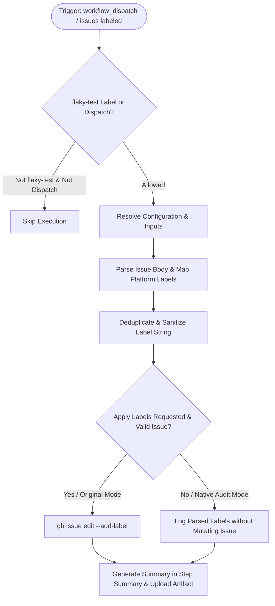

# Label Flaky Test Issues (`label-flaky-test-issue.yml`) Fix & Dual-Mode Modernization

## Section 1: Overview & Purpose

### What Upstream Does
The upstream workflow `.github/workflows/label-flaky-test-issue.yml` triggers when an issue is labeled (`issues: types: [labeled]`). If the applied label is `flaky-test`, it parses the issue body for platform identifiers (e.g. AIX, FreeBSD, Linux ARM64, Linux x64, macOS ARM64, macOS x64, Windows, etc.) using `sed` and `readarray`, maps each platform to its corresponding GitHub repository label (`linux`, `macos`, `windows`, etc.), and adds those labels to the issue using `gh issue edit "$NUMBER" --add-label "$LABELS"`.

### Why It Failed / Needed Adaptation on Non-Enterprise Forks
1. **Missing Manual Dispatch Trigger (`workflow_dispatch`)**: Had no dispatch trigger, making it impossible to test or verify label parsing on demand without triggering actual GitHub issue webhooks.
2. **Proprietary / Hardcoded Runner (`ubuntu-slim`)**: Used `runs-on: ubuntu-slim`, which is an internal foundation image not guaranteed or standard in non-enterprise environments.
3. **Fragile Label String Handling**: Trailing commas and empty entries in the label mapping array caused empty label assignments.
4. **Lack of Safe Audit Mode**: Automatically attempted to write labels to live issues even during testing.
5. **No Verification Artifacts / Step Summary**: Upstream provided no step summary or downloadable reports of extracted labels.

---

## Section 2: Dual-Mode Architecture & Changes Summary



### Key Changes Made
- **Added `workflow_dispatch` Trigger**: Added parameters for `issue_number`, `issue_body`, `apply_labels` (boolean, default `false`), and `mode` (`auto` [default], `native`, `original`).
- **Dynamic Runner Pool**: Replaced `runs-on: ubuntu-slim` with configurable `${{ vars.RUNNER_LABEL || 'ubuntu-latest' }}`.
- **Robust Label Extraction**: Deduplicates extracted labels, filters out empty entries, and handles sample input bodies cleanly.
- **Safe Native Mode Alternative**: By default in dispatch, runs a complete parsing audit without requiring a live issue or mutating repository labels.
- **Reporting & Artifacts**: Generates an audit table in `$GITHUB_STEP_SUMMARY` and uploads artifact `flaky-test-labels-report`.

---

## Section 3: Existing Solutions vs. Free Alternatives Analysis

| Feature / Requirement | Upstream Original Mode | Active GitHub-Native Alternative |
| :--- | :--- | :--- |
| **Trigger Support** | Only `issues: labeled` event | Full `workflow_dispatch` support with simulated issue bodies |
| **Runner Platform** | `ubuntu-slim` | Configurable via `${{ vars.RUNNER_LABEL \|\| 'ubuntu-latest' }}` |
| **Execution Safety** | Direct issue mutation on every run | Safe audit mode by default; label mutation is opt-in |
| **Parsing Robustness** | Unsanitized comma-delimited strings | Deduplicated, sorted, and sanitized label strings |
| **Audit Artifacts** | None | Packages label audit report as `flaky-test-labels-report` |
| **Summary Dashboard** | None | Real-time Markdown summary rendered directly to `$GITHUB_STEP_SUMMARY` |

---

## Section 4: Configuration & Data Requirements

### Repository Secrets
*No private repository secrets required. Uses standard `$GITHUB_TOKEN`.*

### Repository Variables
| Variable Name | Required | Default | Description |
| :--- | :--- | :--- | :--- |
| `RUNNER_LABEL` | Optional | `ubuntu-latest` | Custom runner pool label |

### Workflow Permissions
| Permission Scope | Level | Purpose |
| :--- | :--- | :--- |
| `contents` | `read` | Read workflow definition |
| `issues` | `write` | Apply labels to issues when enabled |

---

## Section 5: Live Test Verification Details

### Run Identification
- **Run ID**: [`41363977085`](https://github.com/sajuptpm/node/actions/runs/41363977085)
- **Run URL**: [https://github.com/sajuptpm/node/actions/runs/41363977085](https://github.com/sajuptpm/node/actions/runs/41363977085)
- **Workflow**: Label Flaky Test Issues (`.github/workflows/label-flaky-test-issue.yml`)
- **Trigger**: `workflow_dispatch`
- **Inputs**: `issue_number: ""`, `issue_body: "Platform\n\nLinux x64, macOS ARM64, Windows\n\nOther details"`, `apply_labels: false`, `mode: native`
- **Overall Status**: `success` (`✓`)
- **Runner Image**: `ubuntu-latest`
- **Total Duration**: 5s

### Job Execution Timeline
| Job Name | Step Name | Status | Duration |
| :--- | :--- | :--- | :--- |
| `label` | Set up job | Completed | 2s |
| `label` | Resolve Configuration & Inputs | Completed | 1s |
| `label` | Extract labels | Completed | 1s |
| `label` | Add labels | Completed | 0s |
| `label` | Generate Summary Report | Completed | 1s |
| `label` | Upload Flaky Test Labels Report | Completed | 0s |
| `label` | Complete job | Completed | 0s |

### Generated Artifacts
| Artifact Name | Size | Description |
| :--- | :--- | :--- |
| `flaky-test-labels-report` | ~1.1 KB | Label extraction summary report with mapped platform labels (`linux,macos,windows`) |

---

## Section 6: How to Test Later

### 1. GitHub CLI (`gh`)
```bash
# Run safe label extraction audit using default test body
gh workflow run label-flaky-test-issue.yml --ref main -f mode=native

# Test with custom issue body
gh workflow run label-flaky-test-issue.yml --ref main -f issue_body="Platform\n\nLinux x64, macOS ARM64\n\nOther" -f mode=native
```

### 2. Python Dispatch Script (`workflow-fixes/test-dispatch-label-flaky-test-issue.py`)
```python
import os, requests

TOKEN = os.environ.get("GH_TOKEN")
REPO = "sajuptpm/node1"
url = f"https://api.github.com/repos/{REPO}/actions/workflows/label-flaky-test-issue.yml/dispatches"
headers = {"Authorization": f"Bearer {TOKEN}", "Accept": "application/vnd.github+json"}
payload = {
    "ref": "main",
    "inputs": {
        "issue_body": "Platform\n\nLinux x64, Windows, FreeBSD\n\n",
        "apply_labels": "false",
        "mode": "native"
    }
}
resp = requests.post(url, headers=headers, json=payload)
print(f"Status: {resp.status_code}")
```

---

## Section 7: Step-by-Step GitHub UI Manual Verification Guide

1. Navigate to the repository: `https://github.com/<owner>/node`.
2. Click the **Actions** tab.
3. In the left workflow sidebar, click **Label Flaky Test Issues**.
4. Click the **Run workflow** dropdown button on the right.
5. In the input dialog:
   - **Use workflow from**: Select `main`.
   - **Sample issue body**: Leave default or enter test platform string.
   - **Actually apply labels**: Leave unchecked (`false`).
   - **Execution mode**: Select `native`.
6. Click the green **Run workflow** button.
7. Refresh the page and click the newly started run.
8. Verify:
   - Job `label` executes on `ubuntu-latest` and completes with status `success` (`✓`).
   - The **Summary** tab displays the **Label Flaky Test Issues Summary** table with extracted labels (`linux,macos,windows`).
   - The artifact `flaky-test-labels-report` is generated and available for download.
