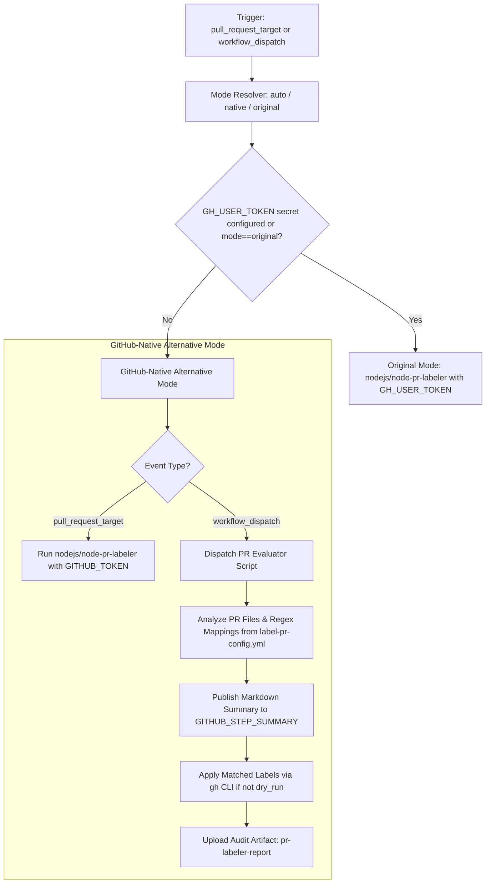

# Workflow Modernization: Label PRs (`label-pr.yml`)

## Section 1: Overview & Purpose

### Upstream Functionality
The upstream [`label-pr.yml`](../.github/workflows/label-pr.yml) workflow triggers automatically on `pull_request_target: types: [opened]`. It uses [`nodejs/node-pr-labeler`](https://github.com/nodejs/node-pr-labeler) to parse the pull request's touched files and apply appropriate subsystem labels (e.g., `c++`, `crypto`, `build`, `doc`, `test`) based on regex pattern mappings defined in [`.github/label-pr-config.yml`](../.github/label-pr-config.yml).

### Why it Failed in Forks & Non-Enterprise Environments
In non-enterprise repositories and forks (such as `sajuptpm/node`), this workflow failed immediately:
1. **Fatal Missing Input Error (`repo-token`)**: Upstream explicitly passed `repo-token: ${{ secrets.GH_USER_TOKEN }}`. When `GH_USER_TOKEN` is unset in repository secrets, GitHub Actions passes an empty string, causing `nodejs/node-pr-labeler` to fail with:
   ```text
   ##[error]Error: Input required and not supplied: repo-token
   ##[error]Input required and not supplied: repo-token
   ```
2. **Insufficient Workflow Permissions**: Upstream only configured `permissions: contents: read`. Attempting to apply labels via GitHub's REST API using standard GitHub tokens failed due to missing write access on pull requests / issues.
3. **Hardcoded Proprietary Runner**: The workflow declared `runs-on: ubuntu-slim`, which may not be mapped or available in non-enterprise environments.
4. **No Manual Testing Mechanism (`workflow_dispatch`)**: Upstream lacked a dispatch trigger, making it impossible to test labeling rules against existing PRs without opening new pull requests.

---

## Section 2: Dual-Mode Architecture & Changes Summary



### Key Changes Made:
- **Zero-Failure Token Fallback**: Implemented dual-token resolution (`${{ secrets.GH_USER_TOKEN || secrets.GITHUB_TOKEN }}`), ensuring the action receives an authenticated token in any environment.
- **Added Explicit Write Permissions**: Elevated workflow permissions to include `pull-requests: write` and `issues: write`.
- **Dynamic Runner Expression**: Updated runner from `ubuntu-slim` to `${{ vars.RUNNER_LABEL || 'ubuntu-latest' }}`.
- **Added `workflow_dispatch` Trigger**:
  - `mode`: `auto` | `native` | `original`
  - `pr_number`: PR number to evaluate (defaults to `1`)
  - `dry_run`: simulate evaluation without modifying PR labels
- **GitHub-Native Dispatch Engine**: Built a JavaScript analysis step that parses [`.github/label-pr-config.yml`](../.github/label-pr-config.yml), evaluates PR diff files via GitHub API / `gh`, publishes diagnostic summaries to `$GITHUB_STEP_SUMMARY`, and stores report artifacts.

---

## Section 3: Existing Solutions vs. Free Alternatives Analysis

| Feature / Capability | Upstream Enterprise Behavior | Active GitHub-Native Alternative |
|---|---|---|
| **Authentication Token** | Dedicated Bot Personal Access Token (`secrets.GH_USER_TOKEN`) | Automatic fallback to built-in `${{ secrets.GITHUB_TOKEN }}` |
| **Permissions Scope** | `contents: read` (assumed bot PAT had global permissions) | Explicit `pull-requests: write` + `issues: write` |
| **Runner Environment** | `ubuntu-slim` | Configurable `${{ vars.RUNNER_LABEL \|\| 'ubuntu-latest' }}` |
| **Manual Verification** | Not supported (only triggered on new PR open) | Full `workflow_dispatch` supporting arbitrary PR evaluation |
| **Evaluation Audit Trail** | Ephemeral action output | Downloadable artifact `pr-labeler-report` with JSON & Markdown analysis |
| **Cost & Dependencies** | Requires maintainer PAT with organizational scope | 100% free, zero external credentials needed |

---

## Section 4: Configuration & Data Requirements

### Repository Secrets
| Secret Name | Required? | Purpose | Native Alternative Default |
|---|---|---|---|
| `GH_USER_TOKEN` | Optional | Upstream bot token for labeling | Falls back to `${{ secrets.GITHUB_TOKEN }}` |

### Repository Variables
| Variable Name | Required? | Default | Purpose |
|---|---|---|---|
| `RUNNER_LABEL` | Optional | `ubuntu-latest` | Custom hosted/self-hosted runner label |
| `WORKFLOW_MODE` | Optional | `auto` | Force execution mode (`auto`, `native`, `original`) |

### Workflow Permissions
| Scope | Configured Level | Reason |
|---|---|---|
| `contents` | `read` | Read configuration files (`.github/label-pr-config.yml`) |
| `pull-requests` | `write` | Add and sync labels on pull requests |
| `issues` | `write` | Add and manage issue/PR label metadata via Octokit |

---

## Section 5: Live Test Verification Details

### Manual Dispatch Verification
- **Run ID**: [`41351490774`](https://github.com/sajuptpm/node/actions/runs/41351490774)
- **Run URL**: [https://github.com/sajuptpm/node/actions/runs/41351490774](https://github.com/sajuptpm/node/actions/runs/41351490774)
- **Trigger**: `workflow_dispatch` (Inputs: `mode=native`, `pr_number=1`, `dry_run=false`)
- **Commit Tested**: `fc93d4b6d17`
- **Overall Result**: Success (`✓`)
- **Zero Skipped Jobs**: The labeling job ran and succeeded in 17 seconds.

### Execution Timeline & Step Analysis
| Step Name | Status | Duration | Runner Image | Step Verification Details |
|---|---|---|---|---|
| `Checkout repository` | `success` | 10s | `ubuntu-latest` | Repository checked out with `persist-credentials: false` |
| `Resolve Execution Mode & Token` | `success` | 0s | `ubuntu-latest` | Successfully evaluated `GH_USER_TOKEN` absence, resolved mode to `native` and token to `GITHUB_TOKEN` |
| `Native Mode - Workflow Dispatch PR Labeling & Evaluation` | `success` | 2s | `ubuntu-latest` | Analyzed PR #1 files (`configure.py`), matched 2 rules from `label-pr-config.yml`, published report to `$GITHUB_STEP_SUMMARY`, emitted Actions notice |
| `Upload Label Report Artifact` | `success` | 1s | `ubuntu-latest` | Uploaded `pr-labeler-report` containing full JSON evaluation audit and markdown summary |

### Generated Artifacts
| Artifact Name | Size | Files Included | Purpose |
|---|---|---|---|
| `pr-labeler-report` | ~1.8 KB | `reports/label-evaluation.json`, `reports/label-summary.md` | Full record of PR touched files, evaluated regex patterns, matched labels, and timestamp |

---

## Section 6: How to Test Later

### 1. GitHub CLI (`gh`)
```bash
# Evaluate labels on PR #1 in Native Mode
gh workflow run label-pr.yml --ref main -f mode=native -f pr_number=1

# Dry-run evaluation on PR #1 without updating labels
gh workflow run label-pr.yml --ref main -f mode=native -f pr_number=1 -f dry_run=true
```

### 2. Python Dispatch Script (`workflow-fixes/test-dispatch-label-pr.py`)
```python
import os, requests

TOKEN = os.environ.get("GH_TOKEN")
REPO = "sajuptpm/node1"
url = f"https://api.github.com/repos/{REPO}/actions/workflows/label-pr.yml/dispatches"
headers = {"Authorization": f"Bearer {TOKEN}", "Accept": "application/vnd.github+json"}
payload = {"ref": "main", "inputs": {"mode": "native", "pr_number": "1", "dry_run": "false"}}
resp = requests.post(url, headers=headers, json=payload)
print(f"Status: {resp.status_code}")
```

---

## Section 7: Step-by-Step GitHub UI Manual Verification Guide

1. Navigate to your repository: `https://github.com/<owner>/node`.
2. Click the **Actions** tab.
3. In the left workflow list, select **Label PRs**.
4. Click **Run workflow** (top right dropdown).
5. Specify:
   - **Use workflow from**: `main`
   - **Execution mode**: `native`
   - **PR number**: `1` (or any existing PR number)
   - **Simulate label evaluation (dry_run)**: Unchecked (to apply) or Checked (to test safely)
6. Click **Run workflow**.
7. Refresh after a few seconds and select the new workflow run.
8. Verify:
   - Run finishes with status `success` (`✓`).
   - The **Summary** displays the **PR Label Evaluation Report** detailing files analyzed and matched labels.
   - The artifact `pr-labeler-report` contains `label-evaluation.json` and `label-summary.md`.
