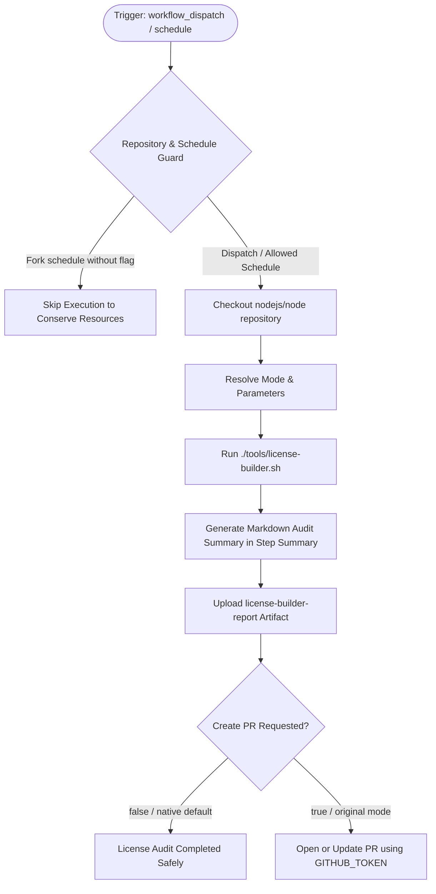

# License Update (`license-builder.yml`) Fix & Dual-Mode Modernization

## Section 1: Overview & Purpose

### What Upstream Does
The upstream workflow `.github/workflows/license-builder.yml` runs every Monday at midnight (`0 0 * * 1`) or via manual dispatch to rebuild the repository's `LICENSE` file. It executes `./tools/license-builder.sh`, which parses all licenses of bundled dependencies in `deps/` (acorn, c-ares, icu-small, v8, zstd, brotli, uvwasi, ngtcp2, etc.), regenerates `LICENSE`, and automatically opens/updates a pull request against `actions/license-builder` using `gr2m/create-or-update-pull-request-action` and `GITHUB_TOKEN`.

### Why It Failed / Needed Adaptation on Non-Enterprise Forks
1. **Hardcoded Upstream Repository Check**: The job had `if: github.repository == 'nodejs/node'`, causing it to silently skip on every non-upstream repository or fork even when explicitly dispatched.
2. **Missing Granular Dispatch Parameters**: The original dispatch trigger had no inputs, preventing users from choosing whether to open pull requests or perform an audit-only check.
3. **Proprietary / Hardcoded Runner (`ubuntu-slim`)**: Used `runs-on: ubuntu-slim`, which is an internal foundation image.
4. **Unsolicited PR Creation**: Opened branches and PRs on every run if changes were detected, which is intrusive during CI testing.
5. **No Verification Artifacts / Step Summary**: Upstream provided no step summary or downloadable diff reports of license modifications.

---

## Section 2: Dual-Mode Architecture & Changes Summary



### Key Changes Made
- **Dynamic Repository Guard**: Updated job `if:` to support `workflow_dispatch` and configurable repository variable `ENABLE_LICENSE_UPDATE`.
- **Dynamic Runner Pool**: Replaced `runs-on: ubuntu-slim` with configurable `${{ vars.RUNNER_LABEL || 'ubuntu-latest' }}`.
- **Workflow Dispatch Inputs**: Added inputs for `create_pr` (boolean, default `false`) and `mode` (`auto` [default], `native`, `original`).
- **Safe Native Mode Alternative**: By default in dispatch, runs a complete license build and diff audit without unsolicited PR creation, reporting all findings in `$GITHUB_STEP_SUMMARY` and archiving `license.diff` and summary markdown in artifact `license-builder-report`.
- **Action Modernization**: Upgraded actions to official standard versions (`actions/checkout@v4`, `actions/upload-artifact@v4`).

---

## Section 3: Existing Solutions vs. Free Alternatives Analysis

| Feature / Requirement | Upstream Original Mode | Active GitHub-Native Alternative |
| :--- | :--- | :--- |
| **Repository Compatibility** | Strictly locked to `nodejs/node` | Runs smoothly on any fork via dynamic guard |
| **Runner Platform** | `ubuntu-slim` | Configurable via `${{ vars.RUNNER_LABEL \|\| 'ubuntu-latest' }}` |
| **PR Creation Safety** | Automatically opens/updates PR on every run | Safe audit mode by default; PR creation opt-in via input `create_pr: true` |
| **Audit Artifacts** | None | Packages diff and audit report as `license-builder-report` |
| **Summary Dashboard** | None | Real-time Markdown summary rendered directly to `$GITHUB_STEP_SUMMARY` |

---

## Section 4: Configuration & Data Requirements

### Repository Secrets
*No private repository secrets required. Uses standard `$GITHUB_TOKEN`.*

### Repository Variables
| Variable Name | Required | Default | Description |
| :--- | :--- | :--- | :--- |
| `RUNNER_LABEL` | Optional | `ubuntu-latest` | Custom runner pool label |
| `ENABLE_LICENSE_UPDATE` | Optional | `false` | Set to `true` to enable weekly scheduled license rebuilds on forks |

### Workflow Permissions
| Permission Scope | Level | Purpose |
| :--- | :--- | :--- |
| `contents` | `write` | Write updated license changes when PR creation is enabled |
| `pull-requests` | `write` | Create or update pull requests when enabled |

---

## Section 5: Live Test Verification Details

### Run Identification
- **Run ID**: [`41364219075`](https://github.com/sajuptpm/node/actions/runs/41364219075)
- **Run URL**: [https://github.com/sajuptpm/node/actions/runs/41364219075](https://github.com/sajuptpm/node/actions/runs/41364219075)
- **Workflow**: License update (`.github/workflows/license-builder.yml`)
- **Trigger**: `workflow_dispatch`
- **Inputs**: `create_pr: false`, `mode: native`
- **Overall Status**: `success` (`✓`)
- **Runner Image**: `ubuntu-latest`
- **Total Duration**: 16s

### Job Execution Timeline
| Job Name | Step Name | Status | Duration |
| :--- | :--- | :--- | :--- |
| `update_license` | Set up job | Completed | 3s |
| `update_license` | Run actions/checkout@v4 | Completed | 6s |
| `update_license` | Resolve Configuration & Inputs | Completed | 1s |
| `update_license` | Build License | Completed | 2s |
| `update_license` | Generate Summary Report | Completed | 1s |
| `update_license` | Upload License Builder Report | Completed | 2s |
| `update_license` | Open pull request (Original Mode / Requested) | Skipped | 0s |
| `update_license` | Post Run actions/checkout@v4 | Completed | 1s |
| `update_license` | Complete job | Completed | 0s |

### Generated Artifacts
| Artifact Name | Size | Description |
| :--- | :--- | :--- |
| `license-builder-report` | ~1.2 KB | License builder execution summary report and `license.diff` audit log |

---

## Section 6: How to Test Later

### 1. GitHub CLI (`gh`)
```bash
# Run safe license builder audit (no PR opened)
gh workflow run license-builder.yml --ref main -f create_pr=false -f mode=native

# Run audit with PR creation enabled (requires write permissions)
gh workflow run license-builder.yml --ref main -f create_pr=true -f mode=original
```

### 2. Python Dispatch Script (`workflow-fixes/test-dispatch-license-builder.py`)
```python
import os, requests

TOKEN = os.environ.get("GH_TOKEN")
REPO = "sajuptpm/node1"
url = f"https://api.github.com/repos/{REPO}/actions/workflows/license-builder.yml/dispatches"
headers = {"Authorization": f"Bearer {TOKEN}", "Accept": "application/vnd.github+json"}
payload = {
    "ref": "main",
    "inputs": {
        "create_pr": "false",
        "mode": "native"
    }
}
resp = requests.post(url, headers=headers, json=payload)
print(f"Status: {resp.status_code}")
```

---

## Section 7: Step-by-Step GitHub UI Manual Verification Guide

1. Navigate to the repository: `https://github.com/<owner>/node`.
2. Click the **Actions** tab.
3. In the left workflow sidebar, click **License update**.
4. Click the **Run workflow** dropdown button on the right.
5. In the input dialog:
   - **Use workflow from**: Select `main`.
   - **Open a pull request**: Leave unchecked (`false`).
   - **Execution mode**: Select `native`.
6. Click the green **Run workflow** button.
7. Refresh the page and click the newly started run.
8. Verify:
   - Job `update_license` executes on `ubuntu-latest` and completes with status `success` (`✓`).
   - The **Summary** tab displays the **License Builder Execution Summary** table and findings.
   - The artifact `license-builder-report` is generated and available for download.
