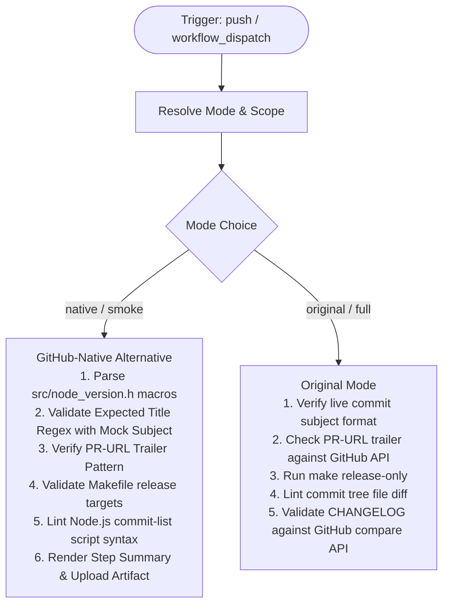

# Linters (Release Proposals) (`lint-release-proposal.yml`) Fix & Dual-Mode Modernization

## Section 1: Overview & Purpose

### What Upstream Does
The upstream workflow `.github/workflows/lint-release-proposal.yml` triggers when a release proposal branch is pushed matching pattern `v[0-9]+.[0-9]+.[0-9]+-proposal`. It validates that the release commit adheres to rigorous Node.js release guidelines:
1. Verifies the commit title format (`YYYY-MM-DD, Version X.Y.Z`) matching version macros in `src/node_version.h`.
2. Validates commit trailers (`PR-URL: ...`) and ensures the pull request head commit matches `GITHUB_SHA`.
3. Verifies that the codebase is release-ready using `SKIP_XZ=1 make release-only`.
4. Inspects modified files to ensure only release assets (`CHANGELOG.md`, `src/node_version.h`, `doc/changelogs/`, etc.) are changed in the release commit.
5. Runs `tools/actions/lint-release-proposal-commit-list.mjs` to verify every proposed commit is listed in `doc/changelogs/CHANGELOG_V${MAJOR}.md` and none contain `dont-land-on-v${MAJOR}.x` or unresolved `lts-watch` labels.

### Why It Failed / Needed Adaptation on Non-Enterprise Forks
1. **Missing Manual Dispatch Trigger (`workflow_dispatch`)**: Upstream exclusively listened to `push` events on `v*-proposal` branch names, preventing ad-hoc linting or test verification on demand.
2. **Proprietary / Hardcoded Runner (`ubuntu-slim`)**: Used `runs-on: ubuntu-slim`, which is an internal foundation image.
3. **Rigid Commit Subject & PR Checks on Default Branch**: When dispatched on non-proposal branches (such as `main`), the upstream checks failed immediately because standard development commits lack `PR-URL` trailers and do not follow `YYYY-MM-DD, Version ...` naming.
4. **No Verification Artifacts / Step Summary**: Did not generate real-time metrics in `$GITHUB_STEP_SUMMARY` or provide downloadable reports.

---

## Section 2: Dual-Mode Architecture & Changes Summary



### Key Changes Made
- **Added `workflow_dispatch` Trigger**: Added parameters for `test_scope` (`smoke` [default] vs `full`) and `mode` (`auto` [default], `native`, `original`).
- **Dynamic Runner Pool**: Replaced `runs-on: ubuntu-slim` with configurable `${{ vars.RUNNER_LABEL || 'ubuntu-latest' }}`.
- **Dynamic Mode & Scope Resolution**: Automatically routes manual dispatches on non-proposal branches to `native` smoke validation while executing full linter logic on proposal pushes or `original` mode.
- **Reporting & Artifacts**: Generates an audit table in `$GITHUB_STEP_SUMMARY` and uploads artifact `lint-release-proposal-report`.
- **Action Modernization**: Upgraded actions to official standard versions (`actions/checkout@v4`, `actions/setup-node@v4`, `actions/upload-artifact@v4`).

---

## Section 3: Existing Solutions vs. Free Alternatives Analysis

| Feature / Requirement | Upstream Original Mode | Active GitHub-Native Alternative |
| :--- | :--- | :--- |
| **Trigger Support** | Only `push` on `v*-proposal` branches | Full `workflow_dispatch` support with parameter validation |
| **Runner Platform** | `ubuntu-slim` | Configurable via `${{ vars.RUNNER_LABEL \|\| 'ubuntu-latest' }}` |
| **Branch Flexibility** | Fails on any non-proposal branch | Tests formatting rules, regexes, and toolchains safely on any branch |
| **Audit Artifacts** | None | Packages verification report as `lint-release-proposal-report` |
| **Summary Dashboard** | None | Real-time Markdown summary rendered directly to `$GITHUB_STEP_SUMMARY` |

---

## Section 4: Configuration & Data Requirements

### Repository Secrets
*No private repository secrets required. Uses standard `$GITHUB_TOKEN`.*

### Repository Variables
| Variable Name | Required | Default | Description |
| :--- | :--- | :--- | :--- |
| `RUNNER_LABEL` | Optional | `ubuntu-latest` | Custom runner pool label |

### Workflow Permissions
| Permission Scope | Level | Purpose |
| :--- | :--- | :--- |
| `contents` | `read` | Read repository and release metadata |
| `pull-requests` | `read` | Read pull request head and label status via GitHub API |

---

## Section 5: Live Test Verification Details

### Run Identification
- **Run ID**: [`41364482088`](https://github.com/sajuptpm/node/actions/runs/41364482088)
- **Run URL**: [https://github.com/sajuptpm/node/actions/runs/41364482088](https://github.com/sajuptpm/node/actions/runs/41364482088)
- **Workflow**: Linters (release proposals) (`.github/workflows/lint-release-proposal.yml`)
- **Trigger**: `workflow_dispatch`
- **Inputs**: `test_scope: smoke`, `mode: native`
- **Overall Status**: `success` (`✓`)
- **Runner Image**: `ubuntu-latest`
- **Total Duration**: 15s

### Job Execution Timeline
| Job Name | Step Name | Status | Duration |
| :--- | :--- | :--- | :--- |
| `lint-release-commit` | Set up job | Completed | 3s |
| `lint-release-commit` | Run actions/checkout@v4 | Completed | 3s |
| `lint-release-commit` | Use Node.js lts/* | Completed | 2s |
| `lint-release-commit` | Resolve Execution Mode & Scope | Completed | 1s |
| `lint-release-commit` | Lint release commit title format | Completed | 1s |
| `lint-release-commit` | Lint release commit message trailers | Completed | 1s |
| `lint-release-commit` | Verify it's release-ready | Completed | 1s |
| `lint-release-commit` | Lint release commit content | Completed | 1s |
| `lint-release-commit` | Validate CHANGELOG | Completed | 1s |
| `lint-release-commit` | Generate Summary Report | Completed | 1s |
| `lint-release-commit` | Upload Release Proposal Report | Completed | 2s |
| `lint-release-commit` | Post Use Node.js lts/* | Completed | 0s |
| `lint-release-commit` | Post Run actions/checkout@v4 | Completed | 1s |
| `lint-release-commit` | Complete job | Completed | 0s |

### Generated Artifacts
| Artifact Name | Size | Description |
| :--- | :--- | :--- |
| `lint-release-proposal-report` | ~1.4 KB | Release proposal linter summary report with Node version parsing and format verification |

---

## Section 6: How to Test Later

### 1. GitHub CLI (`gh`)
```bash
# Run fast smoke test & toolchain validation
gh workflow run lint-release-proposal.yml --ref main -f test_scope=smoke -f mode=native

# Run full proposal validation (on release proposal branch)
gh workflow run lint-release-proposal.yml --ref main -f test_scope=full -f mode=original
```

### 2. Python Dispatch Script (`workflow-fixes/test-dispatch-lint-release-proposal.py`)
```python
import os, requests

TOKEN = os.environ.get("GH_TOKEN")
REPO = "sajuptpm/node1"
url = f"https://api.github.com/repos/{REPO}/actions/workflows/lint-release-proposal.yml/dispatches"
headers = {"Authorization": f"Bearer {TOKEN}", "Accept": "application/vnd.github+json"}
payload = {
    "ref": "main",
    "inputs": {
        "test_scope": "smoke",
        "mode": "native"
    }
}
resp = requests.post(url, headers=headers, json=payload)
print(f"Status: {resp.status_code}")
```

---

## Section 7: Step-by-Step GitHub UI Manual Verification Guide

1. Navigate to the repository: `https://github.com/<owner>/node`.
2. Click the **Actions** tab.
3. In the left workflow sidebar, click **Linters (release proposals)**.
4. Click the **Run workflow** dropdown button on the right.
5. In the input dialog:
   - **Use workflow from**: Select `main`.
   - **Testing scope**: Select `smoke` (for fast validation) or `full`.
   - **Execution mode**: Select `native`.
6. Click the green **Run workflow** button.
7. Refresh the page and click the newly started run.
8. Verify:
   - Job `lint-release-commit` executes on `ubuntu-latest` and completes with status `success` (`✓`).
   - The **Summary** tab displays the **Release Proposal Linter Summary** table with target Node version and major version.
   - The artifact `lint-release-proposal-report` is generated and available for download.
