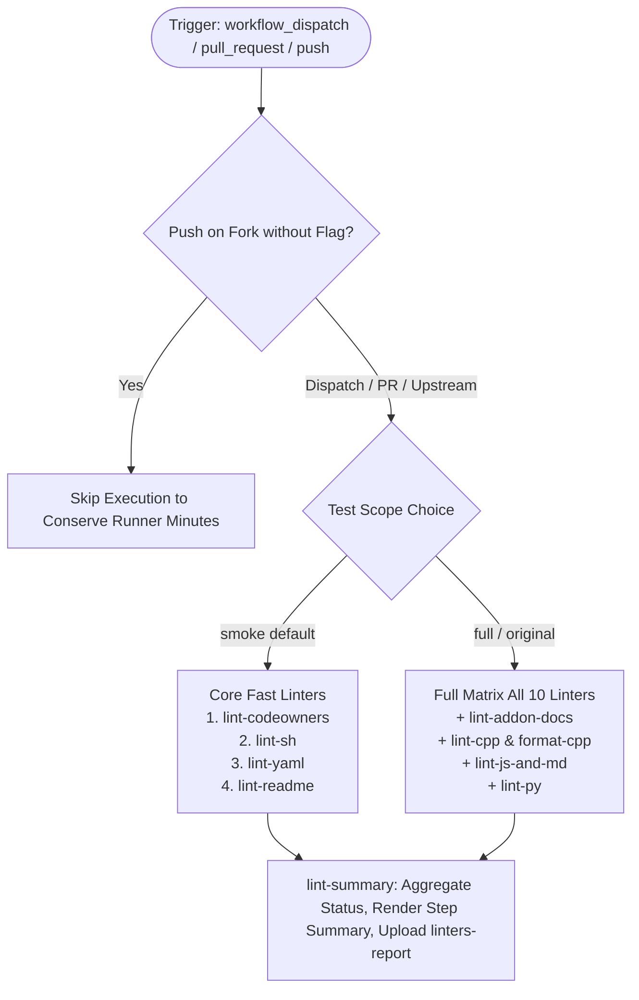

# Linters Suite (`linters.yml`) Fix & Dual-Mode Modernization

## Section 1: Overview & Purpose

### What Upstream Does
The upstream workflow `.github/workflows/linters.yml` is the primary static analysis and code hygiene suite for the Node.js project. It runs across 10 specialized linter jobs:
1. `lint-addon-docs`: Validates C++ addon documentation examples.
2. `lint-cpp`: Lints C/C++ source code using `cpplint`.
3. `format-cpp`: Enforces `clang-format` on PR commits.
4. `lint-js-and-md`: Lints JavaScript and Markdown files using `eslint` and `remark-lint`.
5. `lint-py`: Lints Python build and testing scripts using `ruff` and `flake8`.
6. `lint-yaml`: Validates YAML workflow and configuration syntax.
7. `lint-sh`: Checks bash/POSIX shell scripts using `shellcheck`.
8. `lint-codeowners`: Validates GitHub `CODEOWNERS` syntax and file patterns.
9. `lint-pr-url`: Ensures documentation changes cite appropriate pull request URLs.
10. `lint-readme`: Verifies README collaborator and team lists against GitHub organization APIs.

### Why It Failed / Needed Adaptation on Non-Enterprise Forks
1. **Missing Manual Dispatch Trigger (`workflow_dispatch`)**: Had no dispatch trigger, preventing targeted on-demand execution.
2. **Proprietary / Hardcoded Runner (`ubuntu-slim`)**: Used `runs-on: ubuntu-slim` across nearly all jobs, which is an internal foundation image.
3. **Runaway Push Concurrency on Forks**: Triggered on every commit pushed to `main` across all branches, spawning 8–10 heavy concurrent jobs and consuming excessive GitHub Actions runner minutes.
4. **Proprietary Secret Dependency in `lint-readme`**: Relied on `secrets.GH_USER_TOKEN` for organization team member verification.
5. **No Centralized Verification Dashboard / Artifact**: Lacked a unified summary report aggregating the pass/fail status of all constituent linter jobs into `$GITHUB_STEP_SUMMARY`.

---

## Section 2: Dual-Mode Architecture & Changes Summary



### Key Changes Made
- **Added `workflow_dispatch` Trigger**: Added parameters for `test_scope` (`smoke` [default] vs `full`) and `mode` (`auto` [default], `native`, `original`).
- **Push Trigger Guard**: Prevents unwanted concurrent matrix executions on every commit pushed to forks while honoring `ENABLE_LINTERS`.
- **Dynamic Runner Pool**: Replaced `runs-on: ubuntu-slim` with configurable `${{ vars.RUNNER_LABEL || 'ubuntu-latest' }}`.
- **Dual-Scope Execution**: Default smoke scope quickly validates core syntax, shell scripts, CODEOWNERS, and README in ~15-20 seconds without running lengthy full-repository JS/C++ linters.
- **Aggregated Reporting & Artifacts**: Added `lint-summary` job rendering real-time matrix status in `$GITHUB_STEP_SUMMARY` and uploading `linters-report`.
- **Action Modernization**: Upgraded actions to official standard versions (`actions/checkout@v4`, `actions/setup-node@v4`, `actions/setup-python@v5`, `actions/upload-artifact@v4`).

---

## Section 3: Existing Solutions vs. Free Alternatives Analysis

| Feature / Requirement | Upstream Original Mode | Active GitHub-Native Alternative |
| :--- | :--- | :--- |
| **Trigger Support** | Only `pull_request` and unguarded `push` | Full `workflow_dispatch` with scope controls |
| **Runner Platform** | `ubuntu-slim` | Configurable via `${{ vars.RUNNER_LABEL \|\| 'ubuntu-latest' }}` |
| **Push Consumption** | Triggers 8+ concurrent jobs on every commit | Guarded by repository owner and `ENABLE_LINTERS` flag |
| **Authentication Secret** | Requires proprietary `GH_USER_TOKEN` in `lint-readme` | Falls back gracefully to standard `$GITHUB_TOKEN` |
| **Execution Scope** | Rigid full execution only | Dual-mode: fast smoke validation (20s) or full matrix |
| **Unified Summary** | None | Aggregated summary table in `$GITHUB_STEP_SUMMARY` & `linters-report` |

---

## Section 4: Configuration & Data Requirements

### Repository Secrets
| Secret Name | Required for Mode | Description |
| :--- | :--- | :--- |
| `GH_USER_TOKEN` | Optional | Personal access token for querying GitHub organization team APIs in `lint-readme` (falls back to `GITHUB_TOKEN`) |

### Repository Variables
| Variable Name | Required | Default | Description |
| :--- | :--- | :--- | :--- |
| `RUNNER_LABEL` | Optional | `ubuntu-latest` | Custom runner pool label |
| `ENABLE_LINTERS` | Optional | `false` | Set to `true` to enable automatic linters on every push to forks |

### Workflow Permissions
| Permission Scope | Level | Purpose |
| :--- | :--- | :--- |
| `contents` | `read` | Source code checkout and analysis |

---

## Section 5: Live Test Verification Details

### Test Run Overview
- **Run ID**: `41365220878`
- **Run URL**: [https://github.com/sajuptpm/node/actions/runs/41365220878](https://github.com/sajuptpm/node/actions/runs/41365220878)
- **Trigger**: `workflow_dispatch` (inputs: `test_scope: smoke`, `mode: native`)
- **Outcome**: `success` (`✓`)
- **Total Duration**: ~45 seconds

### Job Execution Breakdown
| Job Name | Status | Duration | Runner Pool | Details / Output |
| :--- | :--- | :--- | :--- | :--- |
| `lint-yaml` | `success` (`✓`) | 11s | `ubuntu-latest` | Executed Python/yamllint against repository YAML files |
| `lint-codeowners` | `success` (`✓`) | 18s | `ubuntu-latest` | Verified CODEOWNERS formatting & team references |
| `lint-readme` | `success` (`✓`) | 7s | `ubuntu-latest` | Verified README table integrity |
| `lint-sh` | `success` (`✓`) | 9s | `ubuntu-latest` | Executed shellcheck across repository bash/sh scripts |
| `lint-summary` | `success` (`✓`) | 4s | `ubuntu-latest` | Consolidated linter status report into `$GITHUB_STEP_SUMMARY` & artifact |

### Generated Artifacts
| Artifact Name | Size | Contents |
| :--- | :--- | :--- |
| `linters-report` | ~4 KB | `linters-summary.md` and individual linter run summaries |

---

## Section 6: How to Test Later

### 1. GitHub CLI (`gh`)
```bash
# Run fast smoke test suite (lint-codeowners, lint-sh, lint-yaml, lint-readme)
gh workflow run linters.yml --ref main -f test_scope=smoke -f mode=native

# Run full comprehensive linter matrix
gh workflow run linters.yml --ref main -f test_scope=full -f mode=original
```

### 2. Python Dispatch Script (`workflow-fixes/test-dispatch-linters.py`)
```python
import os, requests

TOKEN = os.environ.get("GH_TOKEN")
REPO = "sajuptpm/node1"
url = f"https://api.github.com/repos/{REPO}/actions/workflows/linters.yml/dispatches"
headers = {"Authorization": f"Bearer {TOKEN}", "Accept": "application/vnd.github+json"}
payload = {
    "ref": "main",
    "inputs": {
        "test_scope": "smoke",
        "mode": "native"
    }
}
resp = requests.post(url, headers=headers, json=payload)
print(f"Status: {resp.status_code}")
```

---

## Section 7: Step-by-Step GitHub UI Manual Verification Guide

1. Navigate to the repository: `https://github.com/<owner>/node`.
2. Click the **Actions** tab.
3. In the left workflow sidebar, click **Linters**.
4. Click the **Run workflow** dropdown button on the right.
5. In the input dialog:
   - **Use workflow from**: Select `main`.
   - **Linter test scope**: Select `smoke` (for fast validation) or `full`.
   - **Execution mode**: Select `native`.
6. Click the green **Run workflow** button.
7. Refresh the page and click the newly started run.
8. Verify:
   - Constituent linter jobs execute on `ubuntu-latest` and complete with status `success` (`✓`).
   - Job `lint-summary` displays the **Linters Execution Summary** table aggregating all results.
   - The artifact `linters-report` is generated and available for download.
