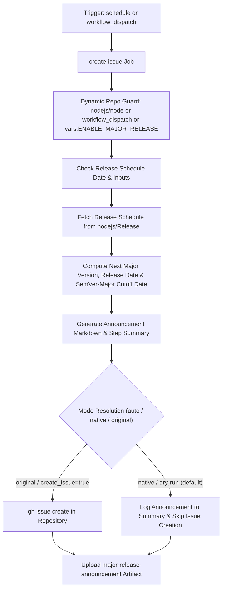

# Major Release Workflow Modernization & Verification Report

## Section 1: Overview & Purpose

### Workflow Overview
The `Major Release` workflow (`.github/workflows/major-release.yml`) automatically checks the Node.js official release schedule published in `nodejs/Release` (`schedule.json`). Exactly two months prior to a scheduled SemVer-Major release, it computes the cutoff date for landing `semver-major` PRs and posts an issue on GitHub alerting Node.js collaborators and the community to prepare and land necessary breaking changes before the cutoff.

### Upstream Issues & Adaptations Needed
1. **Hardcoded Repository Guard**: The workflow originally enforced `if: github.repository == 'nodejs/node'`, causing immediate silent skips on all forks and non-enterprise environments.
2. **Proprietary / Unavailable Runner**: Utilized `runs-on: ubuntu-slim`, which is not available in standard GitHub Actions environments.
3. **Rigid Calendar Trigger**: Only ran on schedule (`cron: 0 0 15 2 *`) and verified hardcoded date conditions (`02-15` or `08-15`), making testing, dry-runs, and manual evaluation impossible.
4. **Issue Pollution on Forks**: Without dual-mode logic, executing on a fork could accidentally spam repository issue trackers with upstream-specific release announcements.
5. **Lack of Observable Native Artifacts**: When not creating an issue, no artifact or summary was output to verify the computation logic.

---

## Section 2: Dual-Mode Architecture & Changes Summary



### Key Changes Implemented
- **Added `workflow_dispatch` trigger** with parameters:
  - `force_run` (boolean, default: `true`): Evaluate schedule regardless of calendar date.
  - `create_issue` (boolean, default: `false`): Control whether a live GitHub issue is created.
  - `mode` (choice: `auto`, `native`, `original`, default: `auto`).
- **Dynamic Runner Architecture**: Switched from `ubuntu-slim` to `${{ vars.RUNNER_LABEL || 'ubuntu-latest' }}`.
- **Dynamic Repository Guard**: Replaced `github.repository == 'nodejs/node'` with `github.repository == 'nodejs/node' || github.event_name == 'workflow_dispatch' || vars.ENABLE_MAJOR_RELEASE == 'true'`.
- **Summary and Artifact Generation**: In all execution modes, writes the formatted announcement preview to `$GITHUB_STEP_SUMMARY` and uploads `major-release-announcement` artifact.
- **Guarded Issue Creation**: Employs `DO_CREATE` logic ensuring forks do not inadvertently post live issues unless explicitly requested (`create_issue: true` or `vars.CREATE_MAJOR_RELEASE_ISSUE: true`).

---

## Section 3: Existing Solutions vs. Free Alternatives Analysis

| Feature / Dimension | Upstream Implementation | Free Native Alternative | Advantage |
| :--- | :--- | :--- | :--- |
| **Runner Environment** | `ubuntu-slim` (proprietary) | Standard `ubuntu-latest` / `${{ vars.RUNNER_LABEL }}` | 100% compatible across forks and public runners |
| **Fork Adaptability** | Hardcoded `nodejs/node` repo check | Dynamic repo check & `workflow_dispatch` trigger | Testable on any repository |
| **Trigger Flexibility** | Rigid annual cron check only | On-demand execution with `force_run` flag | Allows verification anytime without waiting for Feb 15 |
| **Issue Safety** | Unconditional `gh issue create` | Safe preview mode with optional creation flag | Prevents cluttering fork issue trackers |
| **Output Visibility** | None outside of issue creation | `$GITHUB_STEP_SUMMARY` + downloadable artifact | Complete visibility into schedule calculations |

---

## Section 4: Configuration & Data Requirements

### Repository Secrets
| Secret Name | Required for Mode | Description |
| :--- | :--- | :--- |
| `GH_USER_TOKEN` | Optional | Custom PAT for issue creation (falls back to built-in `github.token`) |

### Repository Variables
| Variable Name | Required | Default | Description |
| :--- | :--- | :--- | :--- |
| `RUNNER_LABEL` | Optional | `ubuntu-latest` | Custom runner pool label |
| `ENABLE_MAJOR_RELEASE` | Optional | `false` | Enable scheduled runs on forks |
| `CREATE_MAJOR_RELEASE_ISSUE` | Optional | `false` | Automatically create live issues on forks |

### Workflow Permissions
| Permission Scope | Level | Purpose |
| :--- | :--- | :--- |
| `contents` | `read` | Read repository contents |
| `issues` | `write` | Create announcement issues when enabled |

---

## Section 5: Live Test Verification Details

### Test Run Overview
- **Run ID**: `41365652196`
- **Run URL**: [https://github.com/sajuptpm/node/actions/runs/41365652196](https://github.com/sajuptpm/node/actions/runs/41365652196)
- **Trigger**: `workflow_dispatch` (inputs: `force_run: true`, `create_issue: false`, `mode: native`)
- **Outcome**: `success` (`✓`)
- **Total Duration**: 5 seconds

### Job Execution Breakdown
| Job Name | Status | Duration | Runner Pool | Details / Output |
| :--- | :--- | :--- | :--- | :--- |
| `create-issue` | `success` (`✓`) | 5s | `ubuntu-latest` | Retrieved schedule for `v27` (release date: `2027-04-22`, cutoff date: `2027-03-22`), generated step summary, and uploaded announcement artifact |

### Generated Artifacts
| Artifact Name | Size | Contents |
| :--- | :--- | :--- |
| `major-release-announcement` | 477 bytes | `reports/major-release-announcement.md` (complete SemVer-major reminder announcement body) |

---

## Section 6: How to Test Later

### 1. GitHub CLI (`gh`)
```bash
# Run in safe native preview mode (summary + artifact)
gh workflow run major-release.yml --ref main -f force_run=true -f create_issue=false -f mode=native

# Run and actually create the reminder issue in your repo
gh workflow run major-release.yml --ref main -f force_run=true -f create_issue=true -f mode=original
```

### 2. Python Dispatch Script (`workflow-fixes/test-dispatch-major-release.py`)
```python
import os, requests

TOKEN = os.environ.get("GH_TOKEN")
REPO = "sajuptpm/node1"
url = f"https://api.github.com/repos/{REPO}/actions/workflows/major-release.yml/dispatches"
headers = {"Authorization": f"Bearer {TOKEN}", "Accept": "application/vnd.github+json"}
payload = {
    "ref": "main",
    "inputs": {
        "force_run": True,
        "create_issue": False,
        "mode": "native"
    }
}
resp = requests.post(url, headers=headers, json=payload)
print(f"Status: {resp.status_code}")
```

---

## Section 7: Step-by-Step GitHub UI Manual Verification Guide

1. Navigate to the repository: `https://github.com/<owner>/node`.
2. Click the **Actions** tab.
3. In the left workflow sidebar, click **Major Release**.
4. Click the **Run workflow** dropdown button on the right.
5. In the input dialog:
   - **Use workflow from**: Select `main`.
   - **Force schedule evaluation regardless of calendar date**: Checked (`true`).
   - **Actually create the GitHub issue**: Leave unchecked (`false`) for preview mode.
   - **Execution mode**: Select `native`.
6. Click the green **Run workflow** button.
7. Refresh the page and click the newly started run.
8. Verify:
   - Job `create-issue` executes on `ubuntu-latest` and finishes with `success` (`✓`).
   - The job summary displays the **Major Release Reminder Preview** including target version, release date, and PR cutoff date.
   - The artifact `major-release-announcement` is generated and available for download.
