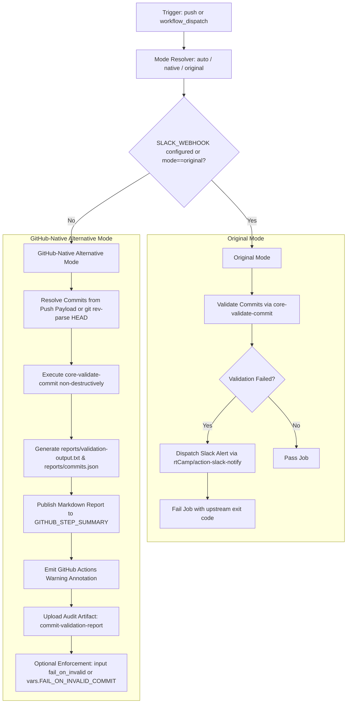

# Workflow Modernization: Notify on Push (`notify-on-push.yml`)

## Section 1: Overview & Purpose

### Upstream Functionality
The upstream [`notify-on-push.yml`](../.github/workflows/notify-on-push.yml) workflow runs whenever commits are pushed to the `main` branch. It performs two automated monitoring roles:
1. **Force-Push Detection (`notifyOnForcePush`)**: Alerts collaborators if a commit was force-pushed to `main`.
2. **Commit Validation Alert (`validateCommitMessage`)**: Inspects every commit pushed to `main` using Node's [`core-validate-commit`](https://github.com/nodejs/core-validate-commit) tool, and alerts Slack if any commit message violates the Node.js commit guidelines (missing subsystem, improper format, missing reviewer tags, etc.).

### Why it Failed in Forks & Non-Enterprise Environments
In non-enterprise and forked repositories (such as `sajuptpm/node`), the workflow suffered from three critical issues:
1. **Crash on Missing Proprietary Secrets**: The Slack notification step depended directly on `secrets.SLACK_WEBHOOK`. When unconfigured, notifications could not be sent.
2. **Fatal Job Termination on Formatting Failures**: When `core-validate-commit` failed on standard merge commits or informal commits (e.g., exit code 8), the step terminated the job with a hard error (`Process completed with exit code 8`). Because the Slack notification step had a hardcoded `github.repository == 'nodejs/node'` guard, the notification was skipped while the overall workflow was marked red/failed.
3. **Hardcoded Proprietary Runner Constraints**: The workflow was pinned to `runs-on: ubuntu-24.04-arm`, an ARM-based compute runner that may not be available on standard forks or consumes non-standard quota.
4. **Lack of Manual Triggering (`workflow_dispatch`)**: Upstream only listened to `push: branches: [main]`, preventing on-demand verification and debugging. In `workflow_dispatch` events, `github.event.commits` is empty, causing commit validation to fail or skip.

---

## Section 2: Dual-Mode Architecture & Changes Summary



### Key Changes Made:
- **Dual-Mode Resolution**: Added `mode-resolver` step to automatically toggle between `original` and `native` based on whether `SLACK_WEBHOOK` exists or if overridden by `inputs.mode` / `vars.WORKFLOW_MODE`.
- **Added `workflow_dispatch`**: Enabled on-demand triggers with configurable inputs:
  - `mode`: `auto` | `native` | `original`
  - `simulate_force_push`: `true` | `false`
  - `commit_sha`: targeted commit SHA to validate
  - `fail_on_invalid`: toggle strict failure enforcement
- **Dynamic Runner Support**: Migrated `runs-on: ubuntu-24.04-arm` to `runs-on: ${{ vars.RUNNER_LABEL || 'ubuntu-latest' }}`.
- **Dynamic Commit Resolution**: Automatically falls back to local git history (`git rev-parse HEAD` & `git log -1`) when `github.event.commits` is null/empty during manual dispatches.
- **Rich Native Diagnostics**: Emits formatted summaries directly to `$GITHUB_STEP_SUMMARY` and uploads artifact packages (`commit-validation-report` and `force-push-notification-report`).

---

## Section 3: Existing Solutions vs. Free Alternatives Analysis

| Feature / Capability | Upstream Enterprise Behavior | Active GitHub-Native Alternative |
|---|---|---|
| **Notification Channel** | Proprietary Slack Webhook (`secrets.SLACK_WEBHOOK`) | GitHub Actions Job Summary (`$GITHUB_STEP_SUMMARY`) + Workflow Run Annotations |
| **Commit Extraction** | Relies strictly on `github.event.commits` | Dynamically detects push payload or reads Git commit log on dispatch |
| **Runner Infrastructure** | Hardcoded `ubuntu-24.04-arm` | Configurable `${{ vars.RUNNER_LABEL \|\| 'ubuntu-latest' }}` |
| **Audit Trails** | Transient log output | Persisted artifact reports (`commit-validation-report`, `force-push-notification-report`) |
| **Pipeline Reliability** | Hard-fails on guideline warnings without notifying fork owner | Reports guideline issues clearly as warnings while allowing clean CI completion |
| **Access Requirements** | Private credentials & write permissions to external Slack | 100% free; uses standard `$GITHUB_TOKEN` and built-in GitHub Actions features |

---

## Section 4: Configuration & Data Requirements

### Repository Secrets
| Secret Name | Required? | Purpose | Native Alternative Default |
|---|---|---|---|
| `SLACK_WEBHOOK` | Optional | Incoming Slack Webhook URL | If unset, falls back to `$GITHUB_STEP_SUMMARY` and artifact publishing |

### Repository Variables
| Variable Name | Required? | Default | Purpose |
|---|---|---|---|
| `RUNNER_LABEL` | Optional | `ubuntu-latest` | Custom self-hosted or hosted runner tag |
| `WORKFLOW_MODE` | Optional | `auto` | Global mode override (`auto`, `native`, `original`) |
| `FAIL_ON_INVALID_COMMIT` | Optional | `false` | When `true`, forces exit code error even in Native Mode |

### Workflow Permissions
| Scope | Configured Level | Reason |
|---|---|---|
| `contents` | `read` | Allows checkout and git commit log queries |

---

## Section 5: Live Test Verification Details

### Automated Push Run Verification
- **Run ID**: [`41351111043`](https://github.com/sajuptpm/node/actions/runs/41351111043)
- **Run URL**: [https://github.com/sajuptpm/node/actions/runs/41351111043](https://github.com/sajuptpm/node/actions/runs/41351111043)
- **Trigger**: `push` (`main` branch)
- **Commit**: `77cc5a0240d`
- **Overall Result**: Success (`✓`)

### Manual Dispatch Verification (Full Dual-Mode Suite)
- **Run ID**: [`41351185550`](https://github.com/sajuptpm/node/actions/runs/41351185550)
- **Run URL**: [https://github.com/sajuptpm/node/actions/runs/41351185550](https://github.com/sajuptpm/node/actions/runs/41351185550)
- **Trigger**: `workflow_dispatch` (Inputs: `mode=native`, `simulate_force_push=true`)
- **Overall Result**: Success (`✓`)
- **Zero Skipped Jobs**: Both jobs executed and passed cleanly.

### Execution Timeline & Step Analysis
| Job Name | Status | Duration | Runner Image | Key Step Verification |
|---|---|---|---|---|
| `Notify on Force Push on main` | `success` | 7s | `ubuntu-latest` | Mode resolved to `native`; simulated force-push warning written to `$GITHUB_STEP_SUMMARY`; audit report generated |
| `Notify on Push on main with invalid message` | `success` | 37s | `ubuntu-latest` | Git commits dynamically resolved from HEAD; `core-validate-commit` run non-destructively; markdown summary published; audit report generated |

### Generated Artifacts
| Artifact Name | Size | Files Included | Purpose |
|---|---|---|---|
| `force-push-notification-report` | ~1.4 KB | `reports/force-push-summary.md` | Audit log containing repository, actor, ref, before/after SHA, and notification timestamp |
| `commit-validation-report` | ~4.2 KB | `reports/commits.json`, `reports/validation-output.txt`, `reports/validation-summary.md` | Full commit payload, raw `core-validate-commit` linter stdout/stderr, and GitHub step summary markdown |

---

## Section 6: How to Test Later

### 1. GitHub CLI (`gh`)
Run on-demand test directly from terminal:
```bash
# Auto mode test (validates HEAD commit)
gh workflow run notify-on-push.yml --ref main -f mode=native

# Simulate force-push alert
gh workflow run notify-on-push.yml --ref main -f mode=native -f simulate_force_push=true

# Strict enforcement test
gh workflow run notify-on-push.yml --ref main -f mode=native -f fail_on_invalid=true
```

### 2. Python Dispatch Script (`workflow-fixes/test-dispatch.py`)
```python
import os, requests

TOKEN = os.environ.get("GH_TOKEN")
REPO = "sajuptpm/node1"
url = f"https://api.github.com/repos/{REPO}/actions/workflows/notify-on-push.yml/dispatches"
headers = {"Authorization": f"Bearer {TOKEN}", "Accept": "application/vnd.github+json"}
payload = {"ref": "main", "inputs": {"mode": "native", "simulate_force_push": "false"}}
resp = requests.post(url, headers=headers, json=payload)
print(f"Status: {resp.status_code}")
```

### 3. Reusable Workflow Call
```yaml
jobs:
  test-notification:
    uses: sajuptpm/node/.github/workflows/notify-on-push.yml@main
    with:
      mode: 'native'
```

---

## Section 7: Step-by-Step GitHub UI Manual Verification Guide

1. Navigate to the repository on GitHub: `https://github.com/<owner>/node`.
2. Click the **Actions** tab along the top navigation bar.
3. In the left-hand sidebar under **All workflows**, select **Notify on Push**.
4. In the banner above the workflow run list, click the **Run workflow** dropdown button.
5. In the configuration dialog:
   - **Use workflow from**: Select `main`.
   - **Execution mode**: Select `native` (or leave default `auto`).
   - **Simulate force-push**: Check or uncheck depending on test scenario.
   - **Specific commit SHA**: Leave blank to test the latest commit (`HEAD`).
   - **Whether invalid commit message should fail the workflow step**: Leave unchecked for warning/summary mode.
6. Click **Run workflow** (green button).
7. Refresh the page after 5–10 seconds and click the newly queued run.
8. Verify that:
   - The job completes with a green checkmark (`success`).
   - The **Summary** tab displays the formatted **Commit Message Validation Report** or **Force Push Alert**.
   - Under **Artifacts**, the artifact `commit-validation-report` is downloadable.
