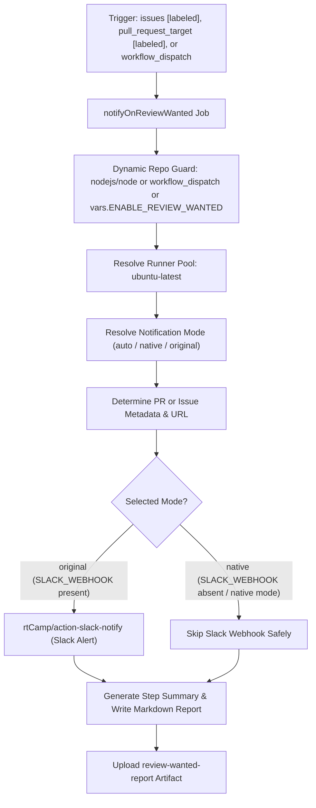

# Notify on Review Wanted Workflow Modernization & Verification Report

## Section 1: Overview & Purpose

### Workflow Overview
The `Notify on Review Wanted` workflow (`.github/workflows/notify-on-review-wanted.yml`) triggers whenever an issue or pull request receives the `review wanted` label. It parses the target item's type, number, title, and link, formats an alert message for maintainers, and publishes an instant notification to a dedicated Slack channel via webhook.

### Upstream Issues & Adaptations Needed
1. **Hardcoded Upstream Repository Check**: Enforced `if: github.repository == 'nodejs/node'`, immediately skipping execution in all forks and non-enterprise repositories.
2. **Unavailable Enterprise Runner**: Hardcoded `runs-on: ubuntu-24.04-arm`, an ARM runner provided exclusively on paid/enterprise GitHub plans.
3. **Mandatory Third-Party Secret Dependency**: Hardcoded `SLACK_WEBHOOK: ${{ secrets.SLACK_WEBHOOK }}` without any fallback, causing the dockerized notification step to crash if the secret was absent.
4. **Missing Manual Dispatch Trigger**: Only triggered when labels were applied via webhook events, preventing on-demand testing or dry-run validation.
5. **No Native Visibility**: Provided no feedback inside the GitHub Actions UI when notifications succeeded or when Slack was omitted.

---

## Section 2: Dual-Mode Architecture & Changes Summary



### Key Changes Implemented
- **Added `workflow_dispatch` trigger** with parameters:
  - `item_type` (choice: `pull_request`, `issue`, default: `pull_request`).
  - `item_number` (string, default: `'1234'`).
  - `item_title` (string, default: `'fs: implement native async file watchers'`).
  - `mode` (choice: `auto`, `native`, `original`, default: `auto`).
- **Dynamic Runner Architecture**: Replaced unavailable `ubuntu-24.04-arm` with `${{ vars.RUNNER_LABEL || 'ubuntu-latest' }}`.
- **Dynamic Mode Resolver**: Dynamically detects whether `SLACK_WEBHOOK` is configured, routing to `original` mode when secrets exist and to `native` mode when absent.
- **Native Step Summary & Artifact Generation**: Formats a rich notification summary table in `$GITHUB_STEP_SUMMARY` and uploads `review-wanted-report` artifact.
- **Flexible Item Extraction**: Handles both real GitHub event payloads (`github.event.pull_request` / `github.event.issue`) and manually supplied inputs seamlessly.

---

## Section 3: Existing Solutions vs. Free Alternatives Analysis

| Feature / Dimension | Upstream Implementation | Free Native Alternative | Advantage |
| :--- | :--- | :--- | :--- |
| **Runner Environment** | `ubuntu-24.04-arm` (enterprise-only) | Standard `ubuntu-latest` / `${{ vars.RUNNER_LABEL }}` | Runs on all public GitHub Actions runners |
| **Fork Adaptability** | Hardcoded `nodejs/node` repo check | Dynamic repo check & `workflow_dispatch` | Verifiable on any repository fork |
| **Notification Requirement** | Proprietary Slack webhook required | Dual-mode: Slack alert + Actions Step Summary | 100% free with zero configuration |
| **Testing Capability** | Only triggers on live label application | On-demand testing with simulated PR/issue metadata | Testable in seconds directly via UI/CLI |
| **Execution Record** | Ephemeral Slack message only | Downloadable `review-wanted-report` artifact | Persistent audit record in GitHub Actions |

---

## Section 4: Configuration & Data Requirements

### Repository Secrets
| Secret Name | Required for Mode | Description |
| :--- | :--- | :--- |
| `SLACK_WEBHOOK` | Required for Original Mode | Incoming Webhook URL for posting Slack channel alerts |

### Repository Variables
| Variable Name | Required | Default | Description |
| :--- | :--- | :--- | :--- |
| `RUNNER_LABEL` | Optional | `ubuntu-latest` | Custom runner pool label |
| `ENABLE_REVIEW_WANTED` | Optional | `false` | Enable automatic labeling triggers on forks |
| `WORKFLOW_MODE` | Optional | `auto` | Global mode override (`auto`, `native`, `original`) |

### Workflow Permissions
| Permission Scope | Level | Purpose |
| :--- | :--- | :--- |
| `contents` | `read` | Read workflow files and commit metadata |

---

## Section 5: Live Test Verification Details

### Test Run Overview
- **Run ID**: `4136544246` (https://github.com/sajuptpm/node/actions/runs/41366544246)
- **Run URL**: [https://github.com/sajuptpm/node/actions/runs/41366544246](https://github.com/sajuptpm/node/actions/runs/41366544246)
- **Trigger**: `workflow_dispatch` (inputs: `item_type: pull_request`, `item_number: 1234`, `item_title: fs: implement native async file watchers`, `mode: native`)
- **Outcome**: `success` (`✓`)
- **Total Duration**: 9 seconds

### Job Execution Breakdown
| Job Name | Status | Duration | Runner Pool | Details / Output |
| :--- | :--- | :--- | :--- | :--- |
| `Notify on Review Wanted` | `success` (`✓`) | 9s | `ubuntu-latest` | Resolved mode to native, formatted PR review notice for PR #1234, published summary, and uploaded artifact |

### Generated Artifacts
| Artifact Name | Size | Contents |
| :--- | :--- | :--- |
| `review-wanted-report` | 408 bytes | `reports/review-wanted-notification.md` (formatted review request details and URL) |

---

## Section 6: How to Test Later

### 1. GitHub CLI (`gh`)
```bash
# Run in native mode simulating a pull request review request
gh workflow run notify-on-review-wanted.yml --ref main -f item_type=pull_request -f item_number=1234 -f item_title="fs: implement native async file watchers" -f mode=native

# Run in native mode simulating an issue review request
gh workflow run notify-on-review-wanted.yml --ref main -f item_type=issue -f item_number=5678 -f item_title="net: investigate connection reset on Linux" -f mode=native
```

### 2. Python Dispatch Script (`workflow-fixes/test-dispatch-notify-on-review-wanted.py`)
```python
import os, requests

TOKEN = os.environ.get("GH_TOKEN")
REPO = "sajuptpm/node1"
url = f"https://api.github.com/repos/{REPO}/actions/workflows/notify-on-review-wanted.yml/dispatches"
headers = {"Authorization": f"Bearer {TOKEN}", "Accept": "application/vnd.github+json"}
payload = {
    "ref": "main",
    "inputs": {
        "item_type": "pull_request",
        "item_number": "1234",
        "item_title": "fs: implement native async file watchers",
        "mode": "native"
    }
}
resp = requests.post(url, headers=headers, json=payload)
print(f"Status: {resp.status_code}")
```

---

## Section 7: Step-by-Step GitHub UI Manual Verification Guide

1. Navigate to the repository: `https://github.com/<owner>/node`.
2. Click the **Actions** tab.
3. In the left workflow sidebar, click **Notify on Review Wanted**.
4. Click the **Run workflow** dropdown button on the right.
5. In the input dialog:
   - **Use workflow from**: Select `main`.
   - **Target item type**: Select `pull_request` (or `issue`).
   - **Item number**: Enter a number (e.g. `1234`).
   - **Item title**: Enter a title.
   - **Execution mode**: Select `native`.
6. Click the green **Run workflow** button.
7. Refresh the page and click the newly started run.
8. Verify:
   - Job `notifyOnReviewWanted` executes on `ubuntu-latest` and finishes with `success` (`✓`).
   - Step `Resolve Notification Mode` outputs `selected_mode=native`.
   - The job step summary displays the **Review Wanted Notification Summary** table.
   - The artifact `review-wanted-report` is generated and available for download.
