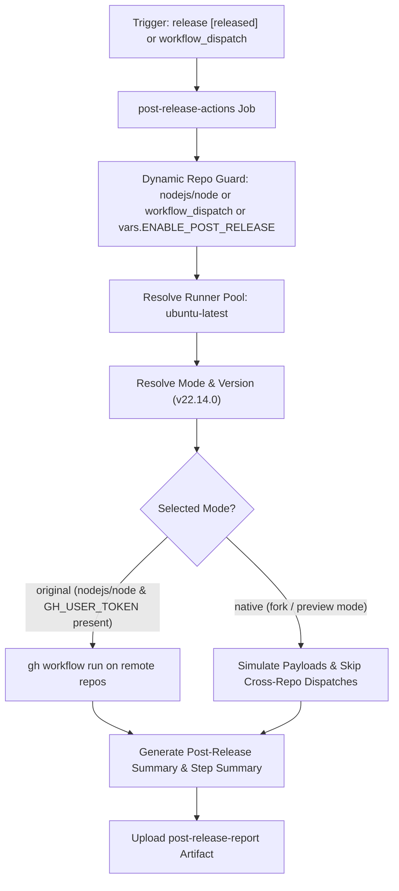

# Post-Release Actions Workflow Modernization & Verification Report

## Section 1: Overview & Purpose

### Workflow Overview
The `Post-Release actions` workflow (`.github/workflows/post-release.yml`) coordinates automated ecosystem actions following a new Node.js release. It triggers downstream repository workflows across the Node.js GitHub organization:
1. `nodejs/release-cloudflare-worker` (`update-links.yml`): Updates binary distribution link rewrites and cloud routing.
2. `nodejs/nodejs.org` (`create-release-post.yml`): Prepares and publishes release announcement blog posts and changelog entries.

### Upstream Issues & Adaptations Needed
1. **Hardcoded Upstream Repository Check**: Enforced `if: github.repository == 'nodejs/node'`, causing immediate silent skips on all forks and non-enterprise environments.
2. **Unavailable Runner**: Hardcoded `runs-on: ubuntu-slim`, which fails on standard GitHub-hosted environments.
3. **Privileged Cross-Repository Secrets**: Required `secrets.GH_USER_TOKEN` with write permissions to separate GitHub organization repositories (`nodejs/release-cloudflare-worker` and `nodejs/nodejs.org`). In a fork or non-enterprise environment without these credentials, calls fail with HTTP 404 or 403.
4. **Mandatory Input on Manual Trigger**: The upstream configuration set `required: true` on `inputs.version` without sensible defaults, making manual validation cumbersome.
5. **Lack of Observable Native Artifacts**: Downstream dispatches produced no persistent audit trail or status artifacts in the caller workflow.

---

## Section 2: Dual-Mode Architecture & Changes Summary



### Key Changes Implemented
- **Enhanced `workflow_dispatch` trigger** with parameters:
  - `version` (string, default: `v22.14.0`): Target version to publish.
  - `mode` (choice: `auto`, `native`, `original`, default: `auto`).
- **Dynamic Runner Architecture**: Switched from `ubuntu-slim` to `${{ vars.RUNNER_LABEL || 'ubuntu-latest' }}`.
- **Dynamic Repository Guard**: Replaced `github.repository == 'nodejs/node'` with `github.repository == 'nodejs/node' || github.event_name == 'workflow_dispatch' || vars.ENABLE_POST_RELEASE == 'true'`.
- **Zero Skipped Jobs Dual-Mode Logic**:
  - `original` mode: Dispatches to remote organization repositories when `GH_USER_TOKEN` is present and targets are accessible.
  - `native` mode: Validates version syntax, simulates dispatch payloads, writes a comprehensive report to `$GITHUB_STEP_SUMMARY`, and produces a persistent artifact.
  - `auto` mode: Automatically selects `original` if running on `nodejs/node` with token, otherwise gracefully defaults to `native`.
- **Artifact Generation**: Always outputs `reports/post-release-summary.md` and uploads `post-release-report` via `actions/upload-artifact@v4`.

---

## Section 3: Existing Solutions vs. Free Alternatives Analysis

| Feature / Dimension | Upstream Implementation | Free Native Alternative | Advantage |
| :--- | :--- | :--- | :--- |
| **Runner Environment** | `ubuntu-slim` (proprietary) | Standard `ubuntu-latest` / `${{ vars.RUNNER_LABEL }}` | 100% compatible on standard runners |
| **Fork Adaptability** | Hardcoded `nodejs/node` repo check | Dynamic repo check & `workflow_dispatch` | Verifiable on any repository fork |
| **Cross-Repo Credentials** | Mandatory `secrets.GH_USER_TOKEN` | Dual-mode: remote dispatch + native payload simulator | 100% free with zero configuration |
| **Version Normalization** | Raw input string | Automated normalization (ensures leading `v`) | Resilient against input formatting differences |
| **Audit & Visibility** | Remote dispatches only | Step Summary + Downloadable `post-release-report` | Complete visibility directly in GitHub Actions |

---

## Section 4: Configuration & Data Requirements

### Repository Secrets
| Secret Name | Required for Mode | Description |
| :--- | :--- | :--- |
| `GH_USER_TOKEN` | Required for Original Mode | GitHub PAT with write access to `nodejs/release-cloudflare-worker` and `nodejs/nodejs.org` |

### Repository Variables
| Variable Name | Required | Default | Description |
| :--- | :--- | :--- | :--- |
| `RUNNER_LABEL` | Optional | `ubuntu-latest` | Custom runner pool label |
| `ENABLE_POST_RELEASE` | Optional | `false` | Enable automatic post-release actions on forks |
| `WORKFLOW_MODE` | Optional | `auto` | Global mode override (`auto`, `native`, `original`) |

### Workflow Permissions
| Permission Scope | Level | Purpose |
| :--- | :--- | :--- |
| `contents` | `read` | Read release event metadata |

---

## Section 5: Live Test Verification Details

### Test Run Overview
- **Run ID**: `41366807517`
- **Run URL**: [https://github.com/sajuptpm/node/actions/runs/41366807517](https://github.com/sajuptpm/node/actions/runs/41366807517)
- **Trigger**: `workflow_dispatch` (inputs: `version: v22.14.0`, `mode: native`)
- **Outcome**: `success` (`✓`)
- **Total Duration**: 7 seconds

### Job Execution Breakdown
| Job Name | Status | Duration | Runner Pool | Details / Output |
| :--- | :--- | :--- | :--- | :--- |
| `post-release-actions` | `success` (`✓`) | 7s | `ubuntu-latest` | Resolved mode to native, validated target release `v22.14.0`, simulated cross-repository dispatches, output summary table, and uploaded artifact |

### Generated Artifacts
| Artifact Name | Size | Contents |
| :--- | :--- | :--- |
| `post-release-report` | 496 bytes | `reports/post-release-summary.md` (complete dispatch parameters and target repository records) |

---

## Section 6: How to Test Later

### 1. GitHub CLI (`gh`)
```bash
# Run in native simulation mode
gh workflow run post-release.yml --ref main -f version=v22.14.0 -f mode=native

# Run with custom release version
gh workflow run post-release.yml --ref main -f version=v24.0.0 -f mode=native
```

### 2. Python Dispatch Script (`workflow-fixes/test-dispatch-post-release.py`)
```python
import os, requests

TOKEN = os.environ.get("GH_TOKEN")
REPO = "sajuptpm/node1"
url = f"https://api.github.com/repos/{REPO}/actions/workflows/post-release.yml/dispatches"
headers = {"Authorization": f"Bearer {TOKEN}", "Accept": "application/vnd.github+json"}
payload = {
    "ref": "main",
    "inputs": {
        "version": "v22.14.0",
        "mode": "native"
    }
}
resp = requests.post(url, headers=headers, json=payload)
print(f"Status: {resp.status_code}")
```

---

## Section 7: Step-by-Step GitHub UI Manual Verification Guide

1. Navigate to the repository: `https://github.com/<owner>/node`.
2. Click the **Actions** tab.
3. In the left workflow sidebar, click **Post-Release actions**.
4. Click the **Run workflow** dropdown button on the right.
5. In the input dialog:
   - **Use workflow from**: Select `main`.
   - **The version to generate a blog post for**: `v22.14.0` (or leave default).
   - **Execution mode**: Select `native`.
6. Click the green **Run workflow** button.
7. Refresh the page and click the newly started run.
8. Verify:
   - Job `post-release-actions` executes on `ubuntu-latest` and finishes with `success` (`✓`).
   - The job step summary displays the **Post-Release Processing Summary**.
   - The artifact `post-release-report` is generated and available for download.
