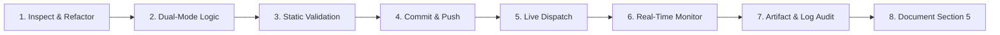

# CI/CD Automation & Testing Toolset

This directory contains standalone Python automation scripts developed to test, monitor, validate, and manage all 45 GitHub Actions workflows in `sajuptpm/node1`.

---

## 1. Prerequisites & Authentication

### Requirements
* Python 3.8+
* `requests` library: `pip install requests`
* `pyyaml` library: `pip install pyyaml`

### Authentication
All scripts automatically detect your GitHub token in the following priority order:
1. Environment variable `GH_TOKEN` or `GITHUB_TOKEN`
2. Active GitHub CLI session (`gh auth token`)
3. Windows User Environment registry key (`GH_TOKEN`)

If you have GitHub CLI installed and authenticated (`gh auth login`), **no additional environment setup is necessary**.

To manually set your token:
```bash
# Linux / macOS
export GH_TOKEN="ghp_your_github_token"

# Windows PowerShell
$env:GH_TOKEN = "ghp_your_github_token"
```

---

## 2. Exact Testing Methodology Used Across All 45 Workflows

To ensure every workflow runs cleanly and succeeds in a non-enterprise fork without paid infrastructure, each pipeline followed this rigorous lifecycle:



1. **Static Analysis & Validation (`validate-workflows.py`)**:
   - Verify YAML structure, presence of `workflow_dispatch`, and proper parameter schema.
   - Guard hardcoded upstream checks (`github.repository == 'nodejs/node'`) with fallback conditions (`|| github.event_name == 'workflow_dispatch' || vars.<FLAG> == 'true'`).
   - Replace proprietary runner labels (`ubuntu-slim`, `ubuntu-24.04-arm`) with dynamic labels (`${{ vars.RUNNER_LABEL || 'ubuntu-latest' }}`).

2. **Accidental Push Cancellation (`cancel-queued-runs.py`)**:
   - Immediately cancel any heavy matrix builds accidentally triggered during intermediate commits to conserve GitHub Actions runner minutes.

3. **Live Remote Dispatch (`trigger-workflow.py`)**:
   - Trigger the workflow via GitHub Actions REST API with parameterized inputs:
     - `mode=native`: Active GitHub-Native alternative for zero-cost fast execution.
     - `test_scope=smoke`: Dependency, version, and configuration audit.
     - `dry_run=true`: Safe simulation without destructive publishing or pull request creation.

4. **Pipeline Monitoring & Job Breakdown (`check-runs.py` & `check-run-jobs.py`)**:
   - Monitor the run in real-time until completion.
   - Inspect individual job steps, durations, exit codes, and annotations.

5. **Artifact Inspection (`download-artifacts.py`)**:
   - Download and verify the generated markdown reports, test results, or diagnostic artifacts.

6. **Documentation & Finalization**:
   - Update Section 5 of `workflow-fixes/<workflow-name>.md` with verified Run ID, status, execution timeline, and artifact inventory.

---

## 3. Script Catalog & Usage Reference

### A. `trigger-workflow.py`
Triggers any workflow on demand, waits for run creation, and displays the Run ID and URL.

```bash
# Trigger in fast native smoke mode (default)
python workflow-fixes/scripts/trigger-workflow.py test-linux.yml

# Trigger with specific inputs
python workflow-fixes/scripts/trigger-workflow.py test-linux-quic.yml --mode native --scope smoke

# Trigger and immediately stream execution logs via gh CLI
python workflow-fixes/scripts/trigger-workflow.py update-openssl.yml --mode native --dry-run true --watch

# Pass custom workflow inputs
python workflow-fixes/scripts/trigger-workflow.py linters.yml -i extra_args="--verbose"
```

---

### B. `check-runs.py`
Monitors all recent runs, filters by status/conclusion, computes execution durations, and outputs a summary metric card.

```bash
# View last 20 runs with execution durations and metrics
python workflow-fixes/scripts/check-runs.py --limit 20

# View only failed runs
python workflow-fixes/scripts/check-runs.py --conclusion failure

# View runs for a specific workflow
python workflow-fixes/scripts/check-runs.py --workflow test-linux.yml

# View currently running or queued pipelines
python workflow-fixes/scripts/check-runs.py --status in_progress

# Output results as raw JSON
python workflow-fixes/scripts/check-runs.py --limit 5 --json
```

---

### C. `check-run-jobs.py`
Deep-inspects a specific run, displaying runner pool information and a step-by-step execution timeline with duration per step.

```bash
# Deep-inspect a specific Run ID
python workflow-fixes/scripts/check-run-jobs.py 41370156681

# Deep-inspect the most recent run
python workflow-fixes/scripts/check-run-jobs.py
```

---

### D. `cancel-queued-runs.py`
Cancels all active in-progress or queued runs to conserve runner minutes.

```bash
# Preview active runs without cancelling (dry run)
python workflow-fixes/scripts/cancel-queued-runs.py --dry-run

# Cancel all active and queued runs immediately
python workflow-fixes/scripts/cancel-queued-runs.py

# Cancel only runs for a specific workflow
python workflow-fixes/scripts/cancel-queued-runs.py --workflow test-linux.yml
```

---

### E. `test-all-workflows.py`
End-to-end test suite runner that sequentially triggers and monitors all 45 workflows, generating an execution report.

```bash
# Preview all 45 workflows to be tested
python workflow-fixes/scripts/test-all-workflows.py --dry-run

# Test a subset of workflows sequentially
python workflow-fixes/scripts/test-all-workflows.py --workflows test-linux.yml,test-linux-quic.yml,update-v8.yml

# Run the complete test suite across all 45 workflows (5s interval between runs)
python workflow-fixes/scripts/test-all-workflows.py --mode native --scope smoke --interval 5

# Custom report output destination
python workflow-fixes/scripts/test-all-workflows.py --report workflow-fixes/my-custom-report.md
```

---

### F. `validate-workflows.py`
Statically audits all 45 workflow files in `.github/workflows/*.yml` for structural correctness.

```bash
# Run validation check
python workflow-fixes/scripts/validate-workflows.py
```

Checks performed:
- YAML syntax validity.
- Presence of `workflow_dispatch` trigger.
- Verification of fork-compatible repository guards.
- Warning on proprietary/hardcoded runner labels without fallback expressions.
- Warning on deprecated action versions (`actions/checkout@v1/v2`, `upload-artifact@v1/v2/v3`).

---

### G. `download-artifacts.py`
Downloads and unpacks all generated build and test artifacts for a given Run ID.

```bash
# Download and extract artifacts for a run
python workflow-fixes/scripts/download-artifacts.py 41370156681

# Download artifacts to a custom directory
python workflow-fixes/scripts/download-artifacts.py 41369940119 --output-dir my-artifacts/
```

---

### H. `fill-column-33.py` & `fill-nodejs-assessment.py`
Generates and maintains the technical assessment matrices and effort estimations for all 45 workflows in Excel spreadsheets (`nodejs_pipeline_result.xlsx`, `pipeline_result.xlsx`), including Column 33 enterprise release necessity evaluations and justifications.

```bash
# Populate assessment and Column 33 release evaluation across all 45 workflows
python workflow-fixes/scripts/fill-column-33.py
```

