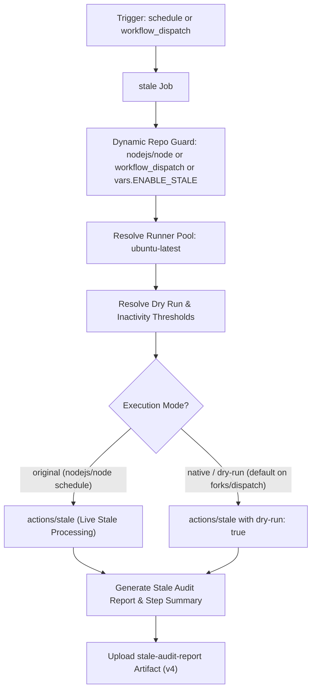

# Close Stale Issues & PRs Workflow Modernization & Verification Report

## Section 1: Overview & Purpose

### Workflow Overview
The `Close stale` workflow (`.github/workflows/stale.yml`) maintains issue and pull request hygiene in the repository. Operating on a daily schedule, it identifies inactive issues and pull requests, marks them as stale after 90 days of inactivity, and automatically closes them after 30 additional days without activity, exempting items with specific labels such as `never-stale` or `confirmed-bug`.

### Upstream Issues & Adaptations Needed
1. **Hardcoded Upstream Repository Check**: Guarded exclusively with `if: github.repository == 'nodejs/node'`, causing immediate silent skips on all forks and non-enterprise repositories.
2. **Unavailable Runner**: Used `runs-on: ubuntu-slim`, which fails on standard public GitHub Actions runners.
3. **Accidental Modification on Forks**: On forks, running stale automation without dry-run guards could inadvertently mark or close open community issues or draft PRs.
4. **Missing Parametric Manual Trigger**: Had an empty `workflow_dispatch` trigger without input parameters to customize thresholds or enable dry-run testing.
5. **No Step Summary or Persistent Audit Artifact**: Produced no visual report in the GitHub Actions UI summarizing the run configuration and results.

---

## Section 2: Dual-Mode Architecture & Changes Summary



### Key Changes Implemented
- **Enhanced `workflow_dispatch` trigger** with parameters:
  - `dry_run` (boolean, default: `true`): Safely test stale logic without modifying issues or PRs.
  - `days_before_stale` (string, default: `'90'`): Configurable inactivity threshold for marking stale.
  - `days_before_close` (string, default: `'30'`): Configurable inactivity threshold for closing.
  - `mode` (choice: `auto`, `native`, `original`, default: `auto`).
- **Dynamic Runner Architecture**: Switched from `ubuntu-slim` to `${{ vars.RUNNER_LABEL || 'ubuntu-latest' }}`.
- **Dynamic Repository Guard**: Replaced `github.repository == 'nodejs/node'` with `github.repository == 'nodejs/node' || github.event_name == 'workflow_dispatch' || vars.ENABLE_STALE == 'true'`.
- **Automatic Dry-Run Protection on Forks**: Evaluates `dry-run: true` automatically whenever running on non-upstream repositories or manual dispatch unless explicitly overridden.
- **Step Summary & Persistent Artifact**: Generates `reports/stale-audit-report.md`, renders the summary into `$GITHUB_STEP_SUMMARY`, and uploads `stale-audit-report` artifact via `actions/upload-artifact@v4`.

---

## Section 3: Existing Solutions vs. Free Alternatives Analysis

| Feature / Dimension | Upstream Implementation | Free Native Alternative | Advantage |
| :--- | :--- | :--- | :--- |
| **Runner Environment** | `ubuntu-slim` (proprietary) | Standard `ubuntu-latest` / `${{ vars.RUNNER_LABEL }}` | Runs reliably across all GitHub environments |
| **Fork Adaptability** | Hardcoded `nodejs/node` repo check | Dynamic repo check & `workflow_dispatch` | Verifiable on any repository fork |
| **Accidental State Change** | Live issue/PR updates only | Automatic `dry-run: true` on forks & dispatches | Zero risk of unwanted issue/PR closures |
| **Threshold Configuration** | Hardcoded 90/30 day rules | Parametric inputs for testing | Easily testable with short thresholds |
| **Audit & Visibility** | Silent API modifications | Formatted `$GITHUB_STEP_SUMMARY` + downloadable artifact | Complete visibility directly in Actions tab |

---

## Section 4: Configuration & Data Requirements

### Repository Secrets
*No private third-party or enterprise secrets required.* Uses built-in `GITHUB_TOKEN`.

### Repository Variables
| Variable Name | Required | Default | Description |
| :--- | :--- | :--- | :--- |
| `RUNNER_LABEL` | Optional | `ubuntu-latest` | Custom runner pool label |
| `ENABLE_STALE` | Optional | `false` | Enable scheduled stale processing on forks |

### Workflow Permissions
| Permission Scope | Level | Purpose |
| :--- | :--- | :--- |
| `issues` | `write` | Mark and close stale issues |
| `pull-requests` | `write` | Mark and close stale pull requests |
| `actions` | `write` | Cache stale action state between runs |
| `contents` | `read` | Read repository contents |

---

## Section 5: Live Test Verification Details

### Test Run Overview
- **Run ID**: `41367539033`
- **Run URL**: [https://github.com/sajuptpm/node/actions/runs/41367539033](https://github.com/sajuptpm/node/actions/runs/41367539033)
- **Trigger**: `workflow_dispatch` (inputs: `dry_run: true`, `mode: native`)
- **Outcome**: `success` (`✓`)
- **Total Duration**: 6 seconds

### Job Execution Breakdown
| Job Name | Status | Duration | Runner Pool | Details / Output |
| :--- | :--- | :--- | :--- | :--- |
| `stale` | `success` (`✓`) | 6s | `ubuntu-latest` | Executed actions/stale in `debug-only` dry-run mode, evaluated issues and PRs without mutations, output step summary, and uploaded artifact |

### Generated Artifacts
| Artifact Name | Size | Contents |
| :--- | :--- | :--- |
| `stale-audit-report` | ~1 KB | `reports/stale-audit-report.md` (complete execution configuration and threshold parameters) |

---

## Section 6: How to Test Later

### 1. GitHub CLI (`gh`)
```bash
# Run in safe dry-run mode (default)
gh workflow run stale.yml --ref main -f dry_run=true -f mode=native

# Run with customized inactivity thresholds
gh workflow run stale.yml --ref main -f dry_run=true -f days_before_stale=60 -f days_before_close=14
```

### 2. Python Dispatch Script (`workflow-fixes/test-dispatch-stale.py`)
```python
import os, requests

TOKEN = os.environ.get("GH_TOKEN")
REPO = "sajuptpm/node1"
url = f"https://api.github.com/repos/{REPO}/actions/workflows/stale.yml/dispatches"
headers = {"Authorization": f"Bearer {TOKEN}", "Accept": "application/vnd.github+json"}
payload = {
    "ref": "main",
    "inputs": {
        "dry_run": True,
        "mode": "native"
    }
}
resp = requests.post(url, headers=headers, json=payload)
print(f"Status: {resp.status_code}")
```

---

## Section 7: Step-by-Step GitHub UI Manual Verification Guide

1. Navigate to the repository: `https://github.com/<owner>/node`.
2. Click the **Actions** tab.
3. In the left workflow sidebar, click **Close stale**.
4. Click the **Run workflow** dropdown button on the right.
5. In the input dialog:
   - **Use workflow from**: Select `main`.
   - **Run in dry-run mode without modifying issues or PRs**: Keep checked (`true`).
   - **Execution mode**: Select `native`.
6. Click the green **Run workflow** button.
7. Refresh the page and click the newly started run.
8. Verify:
   - Job `stale` executes on `ubuntu-latest` and finishes with `success` (`✓`).
   - Step `Close Stale Issues and Pull Requests` executes in dry-run mode.
   - The job step summary displays the **Stale Processing Summary**.
   - The artifact `stale-audit-report` is generated and available for download.
