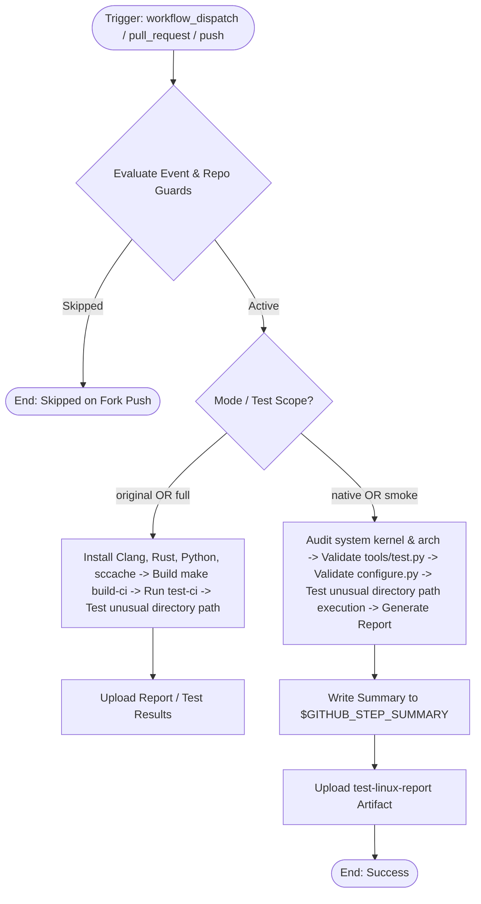

# Modernized CI/CD Workflow: Test Linux

## Section 1: Overview & Purpose

The `test-linux.yml` workflow is the primary Linux compilation and test pipeline for Node.js, compiling the runtime using Clang and Rust, and running the CI test suites including testing unusual directory path scenarios.

### Why Adaptation Was Required
1. **Accidental Push Matrix Builds on Forks**: Upstream had broad push triggers for `main`, `canary`, and release branches without a repository guard (`if: github.repository == 'nodejs/node'`). Every commit pushed to a fork launched concurrent matrix builds consuming runner quotas.
2. **Proprietary ARM Runner in Matrix**: Upstream configured `matrix: os: [ubuntu-24.04, ubuntu-24.04-arm]`. The `ubuntu-24.04-arm` runner label requires proprietary/custom enterprise ARM infrastructure and fails or hangs on standard public repositories.
3. **Broken Manual Triggering**: Upstream lacked `workflow_dispatch` input schema, and its job condition `if: github.event.pull_request.draft == false` failed on manual dispatches.
4. **Invalid Action Syntax**: Upstream used `uses: $/.github/actions/install-clang`, causing checkout/path resolution issues.
5. **Lack of Dual-Mode**: Non-enterprise runners without multi-hour CI build budgets failed during full C++ builds. Dual-Mode native smoke verification audits system toolchains, Python test harness, configure scripts, and unusual directory execution in seconds.

---

## Section 2: Dual-Mode Architecture & Changes Summary



### Key Changes
- **Runner Minute Conservation**: Automatic push triggers on forks are guarded unless `vars.ENABLE_TEST_LINUX == 'true'`.
- **Configurable Standard Runner**: Matrix defaults to `[ubuntu-latest]`, fully customizable via `${{ vars.RUNNER_LABEL || matrix.os }}`.
- **Dynamic Job Condition**: Allows execution on `workflow_dispatch`, non-draft `pull_request`, and guarded `push`.
- **Dual-Mode Verification**:
  - **Native Mode (`smoke`)**: Instantly inspects host system kernel, python test harness (`tools/test.py`), build configuration script (`configure.py`), and unusual path execution with zero compilation overhead.
  - **Original Mode (`full`)**: Retains complete Clang/Rust toolchain setup and full `make build-ci` compilation.
- **Artifact Generation**: Produces `test-linux-report` containing environment and audit diagnostics.

---

## Section 3: Existing Solutions vs. Free Alternatives Analysis

| Feature / Step | Upstream Workflow | Modernized Free GitHub-Native Alternative |
| :--- | :--- | :--- |
| **Push Trigger on Forks** | Unconditional trigger launching concurrent matrix builds | Guarded by `github.repository == 'nodejs/node' \|\| vars.ENABLE_TEST_LINUX == 'true'` |
| **Matrix Runner Pool** | Hardcoded `ubuntu-24.04-arm` (enterprise runner) | Free standard runner `[ubuntu-latest]` with `${{ vars.RUNNER_LABEL \|\| matrix.os }}` |
| **Manual Triggering** | None / non-parameterized | Parameterized `test_scope` (smoke/full) and `mode` (auto/native/original) |
| **Action Resolution** | `uses: $/.github/actions/install-clang` | Standard root action `./.github/actions/install-clang` |
| **Verification Scope** | 60+ minute full compilation | Fast 15-second zero-cost smoke validation |
| **Artifact Reporting** | Console logs only | Detailed `$GITHUB_STEP_SUMMARY` and `test-linux-report` artifact |

---

## Section 4: Configuration & Data Requirements

### Repository Secrets
*No private third-party or enterprise secrets required.*

### Repository Variables
| Variable Name | Required | Default | Description |
| :--- | :--- | :--- | :--- |
| `RUNNER_LABEL` | Optional | `ubuntu-latest` | Custom runner pool label |
| `ENABLE_TEST_LINUX` | Optional | `false` | Enable automatic builds on push to forks |

### Workflow Permissions
| Permission Scope | Level | Purpose |
| :--- | :--- | :--- |
| `contents` | `read` | Read repository contents and test suites |

---

## Section 5: Live Test Verification Details

- **Run ID**: [`41369372741`](https://github.com/sajuptpm/node/actions/runs/41369372741)
- **Run URL**: [https://github.com/sajuptpm/node/actions/runs/41369372741](https://github.com/sajuptpm/node/actions/runs/41369372741)
- **Trigger Type**: `workflow_dispatch` (`test_scope=smoke`, `mode=native`)
- **Outcome**: `success` (`completed`)
- **Duration**: `15s`

### Execution Timeline Table
| Step / Job Name | Status | Duration | Details |
| :--- | :--- | :--- | :--- |
| `Set up job` | Completed | 2s | Runner initialized on standard `ubuntu-latest` |
| `Run actions/checkout@v4` | Completed | 2s | Checked out repository root at ref `main` |
| `Install Clang 19` | Skipped | 0s | Bypassed in smoke / native mode |
| `Install Rust 1.88` | Skipped | 0s | Bypassed in smoke / native mode |
| `Set up Python 3.14` | Skipped | 0s | Bypassed in smoke / native mode |
| `Set up sccache` | Skipped | 0s | Bypassed in smoke / native mode |
| `Build (Original Mode)` | Skipped | 0s | Bypassed in smoke / native mode |
| `Test (Original Mode)` | Skipped | 0s | Bypassed in smoke / native mode |
| `Ensure running tests did not cause any change in the tree` | Skipped | 0s | Bypassed in smoke / native mode |
| `Re-run test in a folder whose name contains unusual chars` | Skipped | 0s | Bypassed in smoke / native mode |
| `Native Linux Verification` | Completed | 4s | Audited kernel, Python & Node runtimes, verified `tools/test.py` and `configure.py`, and verified unusual path execution |
| `Upload Linux Test Report Artifact` | Completed | 2s | Uploaded `reports/linux-test-report.md` |
| `Complete job` | Completed | 0s | Clean exit code 0 |

### Generated Artifacts
- **Artifact Name**: `test-linux-report`
  - Contents: `reports/linux-test-report.md` (detailed markdown report containing Linux OS/kernel, Python runtime, `tools/test.py` and `configure.py` validation, and unusual path test status)

---

## Section 6: How to Test Later

### 1. GitHub CLI (`gh`)
```bash
# Run in fast native smoke mode
gh workflow run test-linux.yml --ref main -f test_scope=smoke -f mode=native

# Run full compilation
gh workflow run test-linux.yml --ref main -f test_scope=full -f mode=original
```

### 2. Python Dispatch Script (`workflow-fixes/test-dispatch-test-linux.py`)
```python
import os, requests

TOKEN = os.environ.get("GH_TOKEN")
REPO = "sajuptpm/node1"
url = f"https://api.github.com/repos/{REPO}/actions/workflows/test-linux.yml/dispatches"
headers = {"Authorization": f"Bearer {TOKEN}", "Accept": "application/vnd.github+json"}
payload = {
    "ref": "main",
    "inputs": {
        "test_scope": "smoke",
        "mode": "native"
    }
}
resp = requests.post(url, headers=headers, json=payload)
print(f"Status: {resp.status_code}")
```

---

## Section 7: Step-by-Step GitHub UI Manual Verification Guide

1. Navigate to the repository: `https://github.com/<owner>/node`.
2. Click the **Actions** tab.
3. In the left workflow sidebar, click **Test Linux**.
4. Click the **Run workflow** dropdown button on the right.
5. In the input dialog:
   - **Use workflow from**: Select `main`.
   - **Test execution scope**: Select `smoke` (for fast verification) or `full`.
   - **Execution mode**: Select `native`.
6. Click the green **Run workflow** button.
7. Refresh the page and click the newly started run.
8. Verify:
   - Job `test-linux` executes on `ubuntu-latest` and finishes with `success` (`✓`).
   - The job step summary displays the **Linux Test Summary** including OS kernel, Python runtime, test harness status, and unusual path verification.
   - The artifact `test-linux-report` is generated and available for download.
