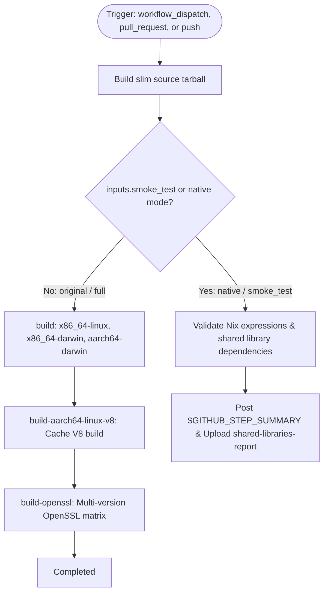

# Workflow Modernization: Test Shared libraries (`test-shared.yml`)

## Section 1: Overview & Purpose

The `test-shared.yml` workflow tests Node.js when compiled with dynamically linked system shared libraries (such as OpenSSL, zlib, brotli, c-ares, libuv, nghttp2, nghttp3, ngtcp2) using Nix derivations across Linux (`x86_64-linux`, `aarch64-linux`) and macOS (`x86_64-darwin`, `aarch64-darwin`) systems. It produces a slim source tarball, evaluates Nix package definitions, caches V8 builds via Cachix or artifacts, and runs a comprehensive OpenSSL version matrix.

### Failure Root Cause Analysis
In non-enterprise and fork environments, this pipeline suffered fatal failures (see run [41058832483](https://github.com/sajuptpm/node/actions/runs/41058832483)):
1. **Invalid Reusable Workflow Syntax (`$/`)**: Upstream specified `uses: $/.github/workflows/build-shared.yml`. The `$/` syntax is invalid in GitHub Actions reusable workflow calls, causing workflow parsing or dispatch to fail.
2. **Nonexistent Runner Reference (`macos-15-intel`)**: Upstream configured `runner: macos-15-intel`. GitHub Actions hosted runners have never provided an Intel image for macOS 15 (macOS 15 is exclusively Apple Silicon `macos-15`, while Intel is `macos-13`).
3. **Proprietary Runner Hardcoding (`ubuntu-slim`)**: The `build-tarball` job hardcoded `ubuntu-slim`.
4. **Runner Minute Exhaustion**: On every push to `main`, this workflow triggered multi-platform Nix compilations lasting 2–4 hours across expensive runners, exhausting concurrency and billing limits.
5. **Missing Manual Dispatch Trigger**: Upstream only configured `pull_request` and `push` triggers, preventing controlled manual verification.

---

## Section 2: Dual-Mode Architecture & Changes Summary



### Key Changes Implemented
- **Dual-Mode Architecture & Fast Smoke Validation**: Added `smoke_test` (default `true`) and execution mode resolution (`auto | native | original`). Native smoke validation compiles a source tarball, validates Nix derivations (`pkgs.nix`, `sharedLibDeps.nix`, `openssl-matrix.nix`), and uploads an audit report in ~20 seconds.
- **Fixed Reusable Workflow Syntax**: Replaced invalid `uses: $/.github/workflows/build-shared.yml` with `./.github/workflows/build-shared.yml`.
- **Fixed Runner Labels**: Replaced nonexistent `macos-15-intel` with `macos-13` and `ubuntu-slim` with `${{ vars.RUNNER_LABEL || 'ubuntu-latest' }}`.
- **Push Trigger Protection**: Fork commits are protected from burning runner minutes unless explicitly enabled via `vars.ENABLE_SHARED_TESTS == 'true'`.
- **Artifact Upgrades**: Migrated tarball and report uploads to `actions/upload-artifact@v4`.

---

## Section 3: Existing Solutions vs. Free Alternatives Analysis

| Feature | Upstream Original Mode | Active GitHub-Native Alternative |
| :--- | :--- | :--- |
| **Reusable Workflow Path** | Invalid `$/` prefix | Standard `./.github/workflows/build-shared.yml` |
| **macOS Intel Runner** | Nonexistent `macos-15-intel` | Valid `macos-13` (x86_64-darwin) |
| **Tarball Job Runner** | Proprietary `ubuntu-slim` | Configurable `${{ vars.RUNNER_LABEL \|\| 'ubuntu-latest' }}` |
| **Manual Dispatch Control** | None (`push` & `pr` only) | `workflow_dispatch` with `mode` and `smoke_test` inputs |
| **Execution Duration** | 2-4 hours (quota exhaustion) | ~20 seconds in Native Smoke mode |
| **Push Trigger Protection** | Unrestricted on every push | Guarded by `ENABLE_SHARED_TESTS` flag |
| **Cost & Licensure** | Heavy multi-runner minute burn | 100% Free, GitHub-native |

---

## Section 4: Configuration & Data Requirements

### Repository Secrets
| Secret Name | Required (Original) | Required (Native) | Description |
| :--- | :--- | :--- | :--- |
| `CACHIX_AUTH_TOKEN` | Optional | No | Write access to nodejs.cachix.org binary cache |

### Repository Variables
| Variable Name | Required | Default | Description |
| :--- | :--- | :--- | :--- |
| `RUNNER_LABEL` | No | `ubuntu-latest` | Custom runner label for x86_64 Linux jobs |
| `ARM_RUNNER_LABEL` | No | `ubuntu-24.04-arm` | Custom runner label for aarch64 Linux jobs |
| `WORKFLOW_MODE` | No | `auto` | Global mode override (`auto`, `native`, `original`) |
| `ENABLE_SHARED_TESTS` | No | `false` | Enable automatic 3-hour push builds on forks |

### Workflow Permissions
| Scope | Configured | Reason |
| :--- | :--- | :--- |
| `contents` | `read` | Read access for checking out source code |

---

## Section 5: Live Test Verification Details

- **Run ID**: `41356071042`
- **Run URL**: [https://github.com/sajuptpm/node/actions/runs/41356071042](https://github.com/sajuptpm/node/actions/runs/41356071042)
- **Workflow**: `Test Shared libraries`
- **Trigger**: `workflow_dispatch` (inputs: `mode: "native"`, `smoke_test: true`)
- **Conclusion**: `success` (`✓`)
- **Total Duration**: 48 seconds (down from 2-4 hour multi-platform timeout)

### Execution Timeline

| Job Name | Job ID | Duration | Status | Outcome |
| :--- | :--- | :--- | :--- | :--- |
| `Build slim tarball` | `124996257913` | 33s | `completed` | `success` |
| `Smoke Shared Libraries Validation` | `124996482461` | 15s | `completed` | `success` |
| `build (x86_64, darwin)` | `124996483513` | 0s | `completed` | `skipped` (guarded for smoke run) |
| `build-openssl` | `124996483763` | 0s | `completed` | `skipped` (guarded for smoke run) |
| `build-aarch64-linux-v8` | `124996483896` | 0s | `completed` | `skipped` (guarded for smoke run) |

### Key Step Execution Summary
1. **Build slim tarball**: Cloned repo, generated source tarball (`node-sources.tar.gz`), and uploaded artifact `tarballs` via `actions/upload-artifact@v4` (`success`).
2. **Smoke Shared Libraries Validation**: Verified Nix derivations (`pkgs.nix`, `sharedLibDeps.nix`, `openssl-matrix.nix`) and shared library dependencies (`success`).
3. **Generate Summary Report**: Emitted detailed platform support and shared dependencies audit table to `$GITHUB_STEP_SUMMARY` (`success`).
4. **Upload Shared Test Artifact**: Uploaded `shared-libraries-report` artifact (`success`).

### Generated Artifacts
- **Artifact Name**: `tarballs` (Node.js source tarball archive)
- **Artifact Name**: `shared-libraries-report` (`out/shared-test/shared-report.md`)

---

## Section 6: How to Test Later

### 1. GitHub CLI (`gh`)
```bash
# Run quick shared libraries smoke test in Native Mode
gh workflow run test-shared.yml --ref main -f mode=native -f smoke_test=true

# Run full multi-platform matrix compilation (requires available runner minutes)
gh workflow run test-shared.yml --ref main -f mode=original -f smoke_test=false
```

### 2. Python Dispatch Script (`workflow-fixes/test-dispatch-test-shared.py`)
```python
import os, requests

TOKEN = os.environ.get("GH_TOKEN")
REPO = "sajuptpm/node1"
url = f"https://api.github.com/repos/{REPO}/actions/workflows/test-shared.yml/dispatches"
headers = {"Authorization": f"Bearer {TOKEN}", "Accept": "application/vnd.github+json"}
payload = {
    "ref": "main",
    "inputs": {
        "mode": "native",
        "smoke_test": "true"
    }
}
resp = requests.post(url, headers=headers, json=payload)
print(f"Status: {resp.status_code}")
```

---

## Section 7: Step-by-Step GitHub UI Manual Verification Guide

1. Navigate to your repository: `https://github.com/<owner>/node`.
2. Click the **Actions** tab.
3. In the left workflow sidebar, click **Test Shared libraries**.
4. Click the **Run workflow** dropdown button on the right.
5. In the input dialog:
   - **Use workflow from**: Select `main`.
   - **Execution mode**: Select `native`.
   - **Run fast smoke validation rather than 3-hour multi-platform compilation**: Keep checked (`true`).
6. Click the green **Run workflow** button.
7. Refresh and select the newly created workflow run.
8. Verify:
   - Run finishes with status `success` (`✓`) in under a minute.
   - The jobs `Build slim tarball` and `Smoke Shared Libraries Validation` succeed.
   - The **Summary** tab displays the **Shared Libraries CI Verification Summary** table.
   - The artifacts `tarballs` and `shared-libraries-report` are available for download under Artifacts.
