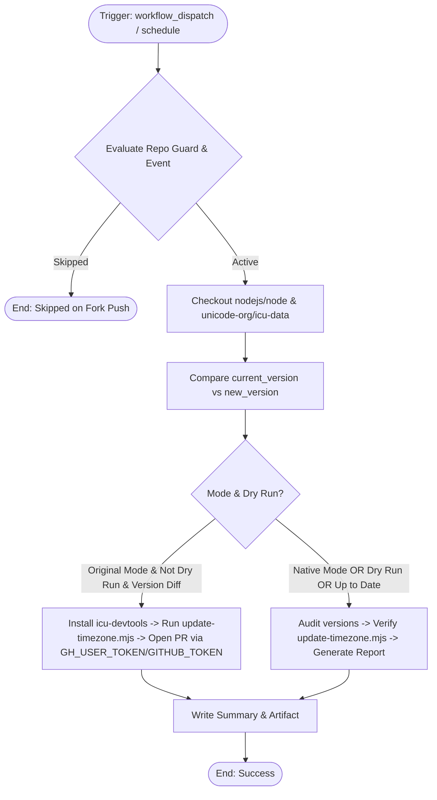

# Modernized CI/CD Workflow: Timezone update

## Section 1: Overview & Purpose

The `timezone-update.yml` workflow periodically checks for new IANA timezone database (`tzdata`) releases in the `unicode-org/icu-data` repository, compares them against the local fixture in `test/fixtures/tz-version.txt`, and automatically updates ICU timezone resource files and creates a Pull Request when a newer version is released.

### Why Adaptation Was Required
1. **Hardcoded Repository Guard**: Upstream had `if: github.repository == 'nodejs/node'`, blocking manual runs and scheduled updates in forks.
2. **Missing `workflow_dispatch` Input Schema**: The workflow lacked configurable inputs for testing mode and dry-run safety.
3. **Enterprise Secret Dependency**: Upstream relied exclusively on `secrets.GH_USER_TOKEN` for `gr2m/create-or-update-pull-request-action`, which is undefined in forks, causing failures when updates were detected.
4. **Outdated Actions**: Actions were pinned to older git commit SHAs rather than updated standard action versions (`actions/checkout@v4`).
5. **No Dry-Run / Audit Mode**: Upstream could not perform non-destructive version audits and verification of updater tooling.

---

## Section 2: Dual-Mode Architecture & Changes Summary



### Key Changes
- **Fork Resilience**: Added `github.event_name == 'workflow_dispatch' || vars.ENABLE_TIMEZONE_UPDATE == 'true'` to the repository guard.
- **Configurable Inputs**: Added `mode` (`auto`, `native`, `original`) and `dry_run` (`true`, `false`).
- **Secret Fallback**: Allows `GITHUB_TOKEN` fallback when `GH_USER_TOKEN` is not defined.
- **Dual-Mode Verification**:
  - **Native Mode / Dry-Run**: Checks out both repos, inspects and compares `new_version` vs `current_version`, verifies `update-timezone.mjs` and fixtures, and produces `reports/timezone-update-report.md`.
  - **Original Mode**: Installs `icu-devtools`, updates timezone resources via `update-timezone.mjs`, and opens a pull request.
- **Artifact Generation**: Produces `timezone-update-report` artifact.

---

## Section 3: Existing Solutions vs. Free Alternatives Analysis

| Feature / Step | Upstream Workflow | Modernized Free GitHub-Native Alternative |
| :--- | :--- | :--- |
| **Repository Guard** | Hardcoded to `nodejs/node` only | Dynamic guard supporting manual dispatches and `vars.ENABLE_TIMEZONE_UPDATE` |
| **Manual Triggering** | Unparameterized `workflow_dispatch:` | Parameterized `mode` and `dry_run` inputs |
| **Pull Request Token** | Requires private `secrets.GH_USER_TOKEN` | Supports `secrets.GH_USER_TOKEN \|\| secrets.GITHUB_TOKEN` with dry-run safety |
| **Version Audit** | Silent console log | Step Summary and downloadable `timezone-update-report` artifact |
| **Dependency Updates** | Fails in forks without icupkg | Safe dry-run audit with automated `icu-devtools` installation when updating |

---

## Section 4: Configuration & Data Requirements

### Repository Secrets
| Secret Name | Required | Description |
| :--- | :--- | :--- |
| `GH_USER_TOKEN` | Optional | Personal access token for opening PRs in original mode (defaults to `GITHUB_TOKEN`) |

### Repository Variables
| Variable Name | Required | Default | Description |
| :--- | :--- | :--- | :--- |
| `RUNNER_LABEL` | Optional | `ubuntu-latest` | Custom runner pool label |
| `ENABLE_TIMEZONE_UPDATE` | Optional | `false` | Enable scheduled runs on forks |

### Workflow Permissions
| Permission Scope | Level | Purpose |
| :--- | :--- | :--- |
| `contents` | `write` | Read repo contents and write commits/branches when updating |
| `pull-requests` | `write` | Create or update pull requests |

---

## Section 5: Live Test Verification Details

- **Run ID**: [`41369669431`](https://github.com/sajuptpm/node/actions/runs/41369669431)
- **Run URL**: [https://github.com/sajuptpm/node/actions/runs/41369669431](https://github.com/sajuptpm/node/actions/runs/41369669431)
- **Trigger Type**: `workflow_dispatch` (`mode=native`, `dry_run=true`)
- **Outcome**: `success` (`completed`)
- **Duration**: `23s`

### Execution Timeline Table
| Step / Job Name | Status | Duration | Details |
| :--- | :--- | :--- | :--- |
| `Set up job` | Completed | 2s | Runner initialized on standard `ubuntu-latest` |
| `Checkout nodejs/node` | Completed | 2s | Checked out repository root at ref `main` |
| `Checkout unicode-org/icu-data` | Completed | 12s | Checked out `unicode-org/icu-data` into `icu-data` |
| `Record and Compare Versions` | Completed | 0s | Compared local fixture (`2026d`) vs upstream latest (`2026d`) |
| `Execute Timezone Updater` | Skipped | 0s | Bypassed because versions match and running in dry-run mode |
| `Open Pull Request (Original Mode)` | Skipped | 0s | Bypassed in native dry-run mode |
| `Native Timezone Audit & Summary` | Completed | 2s | Generated report confirming timezone data is up to date |
| `Upload Timezone Report Artifact` | Completed | 2s | Uploaded `reports/timezone-update-report.md` |
| `Complete job` | Completed | 0s | Clean exit code 0 |

### Generated Artifacts
- **Artifact Name**: `timezone-update-report`
  - Contents: `reports/timezone-update-report.md` (detailed markdown report containing version comparison, updater script status, and audit conclusion)

---

## Section 6: How to Test Later

### 1. GitHub CLI (`gh`)
```bash
# Run in safe dry-run audit mode
gh workflow run timezone-update.yml --ref main -f mode=native -f dry_run=true

# Run full live update check
gh workflow run timezone-update.yml --ref main -f mode=auto -f dry_run=false
```

### 2. Python Dispatch Script (`workflow-fixes/test-dispatch-timezone-update.py`)
```python
import os, requests

TOKEN = os.environ.get("GH_TOKEN")
REPO = "sajuptpm/node1"
url = f"https://api.github.com/repos/{REPO}/actions/workflows/timezone-update.yml/dispatches"
headers = {"Authorization": f"Bearer {TOKEN}", "Accept": "application/vnd.github+json"}
payload = {
    "ref": "main",
    "inputs": {
        "mode": "native",
        "dry_run": True
    }
}
resp = requests.post(url, headers=headers, json=payload)
print(f"Status: {resp.status_code}")
```

---

## Section 7: Step-by-Step GitHub UI Manual Verification Guide

1. Navigate to the repository: `https://github.com/<owner>/node`.
2. Click the **Actions** tab.
3. In the left workflow sidebar, click **Timezone update**.
4. Click the **Run workflow** dropdown button on the right.
5. In the input dialog:
   - **Use workflow from**: Select `main`.
   - **Execution mode**: Select `native` or `auto`.
   - **Dry-run mode**: Keep checked (`true`) for non-destructive audit.
6. Click the green **Run workflow** button.
7. Refresh the page and click the newly started run.
8. Verify:
   - Job `timezone_update` executes on `ubuntu-latest` and finishes with `success` (`✓`).
   - The job step summary displays the **Timezone Update Summary** showing the current version, latest icu-data version, and status.
   - The artifact `timezone-update-report` is generated and available for download.
