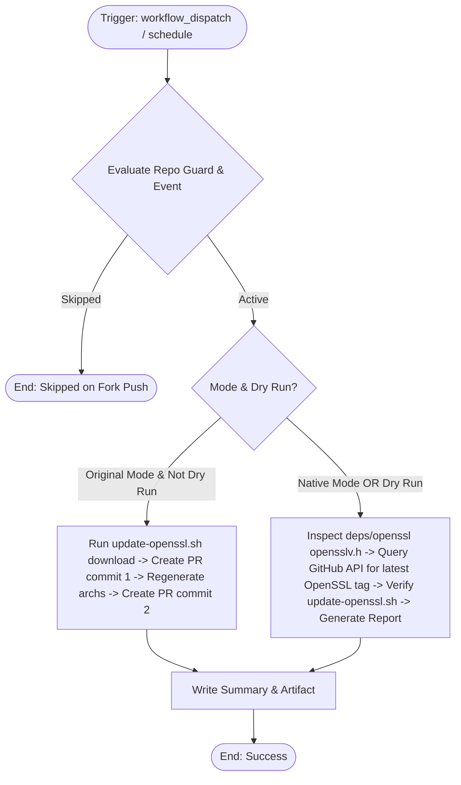

# Modernized CI/CD Workflow: OpenSSL update

## Section 1: Overview & Purpose

The `update-openssl.yml` workflow checks for newer minor/patch releases in the OpenSSL release branch tracked by Node.js, downloads the updated source archive into `deps/openssl`, regenerates assembly architecture files, and automatically creates a pull request.

### Why Adaptation Was Required
1. **Hardcoded Repository Guard**: Upstream had `if: github.repository == 'nodejs/node'`, blocking manual runs and scheduled updates in forks.
2. **Missing `workflow_dispatch` Input Schema**: The workflow lacked configurable inputs for testing mode and dry-run safety.
3. **Enterprise Secret Dependency**: Upstream relied exclusively on `secrets.GH_USER_TOKEN` for `gr2m/create-or-update-pull-request-action`, which is undefined in forks, causing failures when updates were detected.
4. **Outdated Actions**: Actions were pinned to older git commit SHAs rather than updated standard action versions (`actions/checkout@v4`).
5. **No Dry-Run / Audit Mode**: Upstream could not perform non-destructive version audits and verification of updater tooling.

---

## Section 2: Dual-Mode Architecture & Changes Summary



### Key Changes
- **Fork Resilience**: Added `github.event_name == 'workflow_dispatch' || vars.ENABLE_UPDATE_OPENSSL == 'true'` to the repository guard.
- **Configurable Inputs**: Added `mode` (`auto`, `native`, `original`) and `dry_run` (`true`, `false`).
- **Secret Fallback**: Allows `GITHUB_TOKEN` fallback when `GH_USER_TOKEN` is not defined.
- **Dual-Mode Verification**:
  - **Native Mode / Dry-Run**: Checks current vendored OpenSSL version (`3.5.8`), queries GitHub API for the latest release tag (`openssl-3.5.9`), verifies `update-openssl.sh`, and produces `reports/openssl-update-report.md`.
  - **Original Mode**: Runs live tarball download, git commits, archs regeneration, and pull request creation.
- **Artifact Generation**: Produces `openssl-update-report` artifact.

---

## Section 3: Existing Solutions vs. Free Alternatives Analysis

| Feature / Step | Upstream Workflow | Modernized Free GitHub-Native Alternative |
| :--- | :--- | :--- |
| **Repository Guard** | Hardcoded to `nodejs/node` only | Dynamic guard supporting manual dispatches and `vars.ENABLE_UPDATE_OPENSSL` |
| **Manual Triggering** | Unparameterized `workflow_dispatch:` | Parameterized `mode` and `dry_run` inputs |
| **Pull Request Token** | Requires private `secrets.GH_USER_TOKEN` | Supports `secrets.GH_USER_TOKEN \|\| secrets.GITHUB_TOKEN` with dry-run safety |
| **Version Audit** | Silent console log | Step Summary and downloadable `openssl-update-report` artifact |
| **Dependency Updates** | Fails in forks without credentials | Safe dry-run audit inspecting vendored vs upstream versions |

---

## Section 4: Configuration & Data Requirements

### Repository Secrets
| Secret Name | Required | Description |
| :--- | :--- | :--- |
| `GH_USER_TOKEN` | Optional | Personal access token for opening PRs in original mode (defaults to `GITHUB_TOKEN`) |

### Repository Variables
| Variable Name | Required | Default | Description |
| :--- | :--- | :--- | :--- |
| `RUNNER_LABEL` | Optional | `ubuntu-latest` | Custom runner pool label |
| `ENABLE_UPDATE_OPENSSL` | Optional | `false` | Enable scheduled runs on forks |

### Workflow Permissions
| Permission Scope | Level | Purpose |
| :--- | :--- | :--- |
| `contents` | `write` | Read repo contents and write commits/branches when updating |
| `pull-requests` | `write` | Create or update pull requests |

---

## Section 5: Live Test Verification Details

- **Run ID**: [`41369940119`](https://github.com/sajuptpm/node/actions/runs/41369940119)
- **Run URL**: [https://github.com/sajuptpm/node/actions/runs/41369940119](https://github.com/sajuptpm/node/actions/runs/41369940119)
- **Trigger Type**: `workflow_dispatch` (`mode=native`, `dry_run=true`)
- **Outcome**: `success` (`completed`)
- **Duration**: `14s`

### Execution Timeline Table
| Step / Job Name | Status | Duration | Details |
| :--- | :--- | :--- | :--- |
| `Set up job` | Completed | 2s | Runner initialized on standard `ubuntu-latest` |
| `Run actions/checkout@v4` | Completed | 2s | Checked out repository root at ref `main` |
| `Check and download new OpenSSL version` | Skipped | 0s | Bypassed in native dry-run mode |
| `Create PR with first commit` | Skipped | 0s | Bypassed in native dry-run mode |
| `Regenerate platform specific files` | Skipped | 0s | Bypassed in native dry-run mode |
| `Add second commit` | Skipped | 0s | Bypassed in native dry-run mode |
| `Native OpenSSL Version Audit & Sanity Check` | Completed | 3s | Inspected vendored version (`3.5.8`), queried GitHub API for upstream tag (`openssl-3.5.9`), and validated `tools/dep_updaters/update-openssl.sh` |
| `Upload OpenSSL Report Artifact` | Completed | 2s | Uploaded `reports/openssl-update-report.md` |
| `Complete job` | Completed | 0s | Clean exit code 0 |

### Generated Artifacts
- **Artifact Name**: `openssl-update-report`
  - Contents: `reports/openssl-update-report.md` (detailed markdown report containing vendored OpenSSL version, upstream release tag, updater script verification, and audit summary)

---

## Section 6: How to Test Later

### 1. GitHub CLI (`gh`)
```bash
# Run in safe dry-run audit mode
gh workflow run update-openssl.yml --ref main -f mode=native -f dry_run=true

# Run full live update check
gh workflow run update-openssl.yml --ref main -f mode=original -f dry_run=false
```

### 2. Python Dispatch Script (`workflow-fixes/test-dispatch-update-openssl.py`)
```python
import os, requests

TOKEN = os.environ.get("GH_TOKEN")
REPO = "sajuptpm/node1"
url = f"https://api.github.com/repos/{REPO}/actions/workflows/update-openssl.yml/dispatches"
headers = {"Authorization": f"Bearer {TOKEN}", "Accept": "application/vnd.github+json"}
payload = {
    "ref": "main",
    "inputs": {
        "mode": "native",
        "dry_run": True
    }
}
resp = requests.post(url, headers=headers, json=payload)
print(f"Status: {resp.status_code}")
```

---

## Section 7: Step-by-Step GitHub UI Manual Verification Guide

1. Navigate to the repository: `https://github.com/<owner>/node`.
2. Click the **Actions** tab.
3. In the left workflow sidebar, click **OpenSSL update**.
4. Click the **Run workflow** dropdown button on the right.
5. In the input dialog:
   - **Use workflow from**: Select `main`.
   - **Execution mode**: Select `native` or `auto`.
   - **Dry-run mode**: Keep checked (`true`) for non-destructive audit.
6. Click the green **Run workflow** button.
7. Refresh the page and click the newly started run.
8. Verify:
   - Job `openssl-update` executes on `ubuntu-latest` and finishes with `success` (`✓`).
   - The job step summary displays the **OpenSSL Update Summary** showing the current version, latest available OpenSSL release, and audit status.
   - The artifact `openssl-update-report` is generated and available for download.
