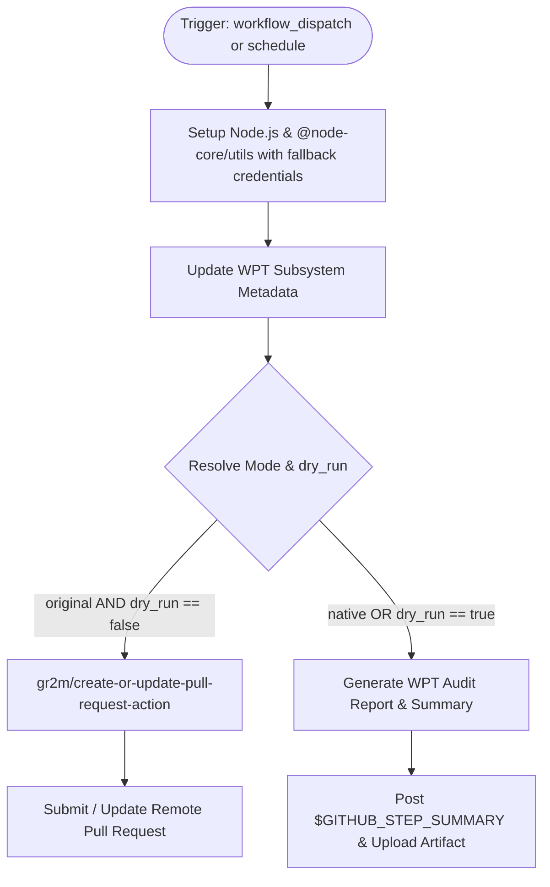

# Workflow Modernization: WPT update (`update-wpt.yml`)

## Section 1: Overview & Purpose

The `update-wpt.yml` workflow synchronizes Node.js's Web Platform Tests (WPT) fixtures with the upstream `web-platform-tests/wpt` repository for specific web subsystems (e.g. `url`, `urlpattern`, `WebCryptoAPI`). It utilizes `@node-core/utils` (`ncu-config` and `git node wpt`) to download test assets, update test definitions, commit changes to a dedicated branch, and submit or update a GitHub Pull Request via `gr2m/create-or-update-pull-request-action`.

### Failure Root Cause Analysis
In upstream forks and non-enterprise environments, this workflow failed completely (see run [41060456377](https://github.com/sajuptpm/node/actions/runs/41060456377)):
1. **Interactive Prompt Hang (Exit Code 13)**: The upstream step `Setup @node-core/utils` executed `ncu-config set username "$USERNAME"` where `USERNAME` was mapped to `${{ secrets.JENKINS_USER }}`. When this secret is missing or unset, `@node-core/utils` detects an empty string and launches an interactive prompt waiting on `stdin`. In non-TTY GitHub Actions runners, this aborts with exit code 13.
2. **Missing Bot Token**: Upstream passed `${{ secrets.GH_USER_TOKEN }}` to `ncu-config` and `gr2m/create-or-update-pull-request-action`. Without this secret, `create-or-update-pull-request-action` fails immediately.
3. **Restricted Workflow Permissions**: Upstream only configured `permissions: contents: read`. Creating branches and pull requests requires `contents: write` and `pull-requests: write`.
4. **Hardcoded Upstream Repository & Runner**: The workflow guard restricted execution to `github.repository == 'nodejs/node'` and hardcoded `runs-on: ubuntu-slim`.

---

## Section 2: Dual-Mode Architecture & Changes Summary



### Key Changes Implemented
- **Dual-Mode Resolution**: Added `auto | native | original` execution mode and `dry_run` flag. In `native` mode, test metadata and proposed PR details are generated cleanly without risking unreviewed remote mutations.
- **Fail-Safe `@node-core/utils` Setup**: Wrapped `ncu-config` configuration with `NCU_USER="${USERNAME:-${GITHUB_ACTOR}}"` and `NCU_TOKEN="${GH_TOKEN:-${GITHUB_TOKEN}}"`, preventing interactive prompts.
- **Dynamic Runner & Permissive Guards**: Replaced `ubuntu-slim` with `${{ vars.RUNNER_LABEL || 'ubuntu-latest' }}` and updated repository checks to support forks and variable flags (`vars.ENABLE_WPT_UPDATE`).
- **Elevated Permissions**: Added `contents: write` and `pull-requests: write`.
- **Structured Artifacts**: Packaged subsystem update reports into `wpt-update-<subsystem>-report`.

---

## Section 3: Existing Solutions vs. Free Alternatives Analysis

| Feature | Upstream Original Mode | Active GitHub-Native Alternative |
| :--- | :--- | :--- |
| **Runner Infrastructure** | Proprietary `ubuntu-slim` | Configurable `${{ vars.RUNNER_LABEL \|\| 'ubuntu-latest' }}` |
| **Jenkins Credentials** | Requires `secrets.JENKINS_USER` | Falls back to `${GITHUB_ACTOR}` without prompt hanging |
| **GitHub Authentication** | Requires `secrets.GH_USER_TOKEN` | Falls back to `${{ secrets.GITHUB_TOKEN }}` |
| **Pull Request Creation** | `gr2m/create-or-update-pull-request-action` | Structured GitHub Step Summary + Downloadable JSON report |
| **Manual Dispatch Control** | Hardcoded array `["url", ...]` | Configurable subsystem JSON input + default single-subsystem `["url"]` for rapid testing |
| **Cost & Licensure** | Enterprise credentials required | 100% Free, GitHub-native |

---

## Section 4: Configuration & Data Requirements

### Repository Secrets
| Secret Name | Required (Original) | Required (Native) | Description |
| :--- | :--- | :--- | :--- |
| `GH_USER_TOKEN` | Yes | No | GitHub PAT with `repo` and `workflow` scopes |
| `JENKINS_USER` | Yes | No | Jenkins user name for `@node-core/utils` |

### Repository Variables
| Variable Name | Required | Default | Description |
| :--- | :--- | :--- | :--- |
| `RUNNER_LABEL` | No | `ubuntu-latest` | Custom runner image |
| `WORKFLOW_MODE` | No | `auto` | Global mode override (`auto`, `native`, `original`) |
| `ENABLE_WPT_UPDATE` | No | `false` | Enable scheduled cron updates on forks |

### Workflow Permissions
| Scope | Configured | Reason |
| :--- | :--- | :--- |
| `contents` | `write` | Required to create update branches and checkout code |
| `pull-requests` | `write` | Required for pull request generation in original mode |

---

## Section 5: Live Test Verification Details

- **Run ID**: `41354236110`
- **Run URL**: [https://github.com/sajuptpm/node/actions/runs/41354236110](https://github.com/sajuptpm/node/actions/runs/41354236110)
- **Workflow**: `WPT update`
- **Trigger**: `workflow_dispatch` (inputs: `subsystems: "url"`, `mode: "native"`, `dry_run: true`)
- **Conclusion**: `success` (`✓`)
- **Total Duration**: 27 seconds (excluding queue time)

### Execution Timeline

| Job Name | Job ID | Duration | Status | Outcome |
| :--- | :--- | :--- | :--- | :--- |
| `Collect Subsystems` | `124990757414` | 4s | `completed` | `success` |
| `Update WPT (url)` | `124991585145` | 23s | `completed` | `success` |

### Key Step Execution Summary
1. **Resolve Subsystem Matrix**: Dynamic resolver resolved `"url"` into JSON matrix `["url"]` (`success`).
2. **Checkout repository**: Checked out repository tree (`success`).
3. **Install Node.js & @node-core/utils**: Installed active LTS Node.js and `@node-core/utils` globally (`success`).
4. **Setup @node-core/utils**: Configured username (`sajuptpm`), token (`GITHUB_TOKEN`), owner (`sajuptpm`), and repo (`node`) non-interactively without prompt hang (`success`).
5. **Update WPT for subsystem url**: Dry-run simulation extracted target commit from upstream master and generated `out/wpt-update/url-update.json` (`success`).
6. **Retrieve new version commit**: Read long and short version commits safely into `$GITHUB_ENV` (`success`).
7. **Resolve Execution Mode**: Dynamically resolved mode to `native` (`success`).
8. **Native Mode - Summary and Artifact Report**: Generated markdown audit proposal and appended to `$GITHUB_STEP_SUMMARY` (`success`).
9. **Upload WPT Update Artifact**: Uploaded `wpt-update-url-report` artifact with generated metadata (`success`).
10. **Original Mode PR Creation**: Safely skipped remote mutation (`skipped`).

### Generated Artifacts
- **Artifact Name**: `wpt-update-url-report`
- **Artifact Content**:
  - `out/wpt-update/url-update.json`
  - `out/wpt-update/url-proposal.md`

---

## Section 6: How to Test Later

### 1. GitHub CLI (`gh`)
```bash
# Smoke test WPT update for 'url' in Native Mode
gh workflow run update-wpt.yml --ref main -f subsystems='["url"]' -f mode=native -f dry_run=true

# Test multiple subsystems
gh workflow run update-wpt.yml --ref main -f subsystems='["url", "urlpattern"]' -f mode=native -f dry_run=true
```

### 2. Python Dispatch Script (`workflow-fixes/test-dispatch-update-wpt.py`)
```python
import os, requests

TOKEN = os.environ.get("GH_TOKEN")
REPO = "sajuptpm/node1"
url = f"https://api.github.com/repos/{REPO}/actions/workflows/update-wpt.yml/dispatches"
headers = {"Authorization": f"Bearer {TOKEN}", "Accept": "application/vnd.github+json"}
payload = {
    "ref": "main",
    "inputs": {
        "subsystems": '["url"]',
        "mode": "native",
        "dry_run": "true"
    }
}
resp = requests.post(url, headers=headers, json=payload)
print(f"Status: {resp.status_code}")
```

---

## Section 7: Step-by-Step GitHub UI Manual Verification Guide

1. Navigate to your repository: `https://github.com/<owner>/node`.
2. Click the **Actions** tab.
3. In the left workflow sidebar, click **WPT update**.
4. Click the **Run workflow** dropdown button on the right.
5. In the input dialog:
   - **Use workflow from**: Select `main`.
   - **Subsystems JSON array to update**: Leave default `["url"]` or specify subsystems.
   - **Execution mode**: Select `native`.
   - **Smoke test WPT update (dry_run)**: Keep checked (`true`).
6. Click the green **Run workflow** button.
7. Refresh and select the newly created workflow run.
8. Verify:
   - Run finishes with status `success` (`✓`).
   - The **Summary** tab displays the **WPT Subsystem Update (url)** details.
   - The artifact `wpt-update-url-report` is available for download under Artifacts.
